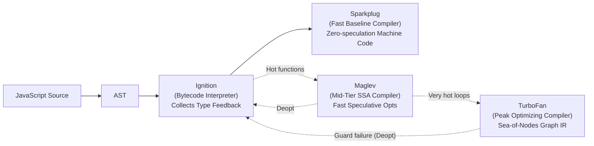
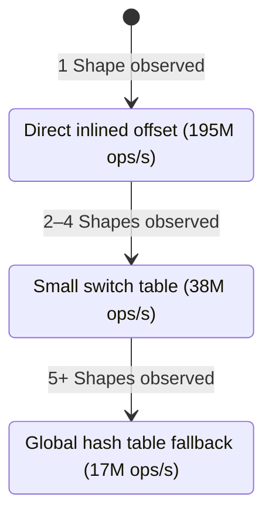

Scan JS/TS for performance anti-patterns. Focus on hot paths — loops, frequent callbacks, per-frame code. Ignore one-shot init code unless allocation is massive.

## Priority Tiers

### 🔴 CRITICAL (10x–50x slowdown, fix immediately)

| Pattern                                           | Detection                                                                                                                                           | Fix                                                                                                                                                                                                                                         |
| ------------------------------------------------- | --------------------------------------------------------------------------------------------------------------------------------------------------- | ------------------------------------------------------------------------------------------------------------------------------------------------------------------------------------------------------------------------------------------- |
| `[...typedArray]` spread on TypedArray            | `[...someFloat32]` or `[...someUint8]`                                                                                                              | `dst.set(src)` or manual `for` copy                                                                                                                                                                                                         |
| `.forEach()` in hot loop                          | `.forEach(` on arrays > 1000 items                                                                                                                  | `for (let i=0; i<N; i++)`                                                                                                                                                                                                                   |
| `for...of` on TypedArray                          | `for (const v of typedArr)`                                                                                                                         | `for (let i=0; i<N; i++)` — iterator protocol overhead is 16-48x                                                                                                                                                                            |
| `.map().filter().reduce()` chain                  | Chained array methods on >10K items                                                                                                                 | Single `for` loop doing all ops in one pass                                                                                                                                                                                                 |
| `Array.reduce` on large arrays                    | `.reduce(` especially with object accumulator                                                                                                       | Classic `for` loop — reduce is 10x slower on V8                                                                                                                                                                                             |
| Layout thrashing (browser)                        | Interleaved read (`offsetHeight`, `getBoundingClientRect`) and write (`style.*`, `className`) in a loop                                             | Batch all reads first, then all writes. Use `requestAnimationFrame` for write batching                                                                                                                                                      |
| Object spread `{...obj}` in hot loop              | `{...obj, key: val}` inside `for` / `.map()` / `.reduce()` body                                                                                     | Mutate in place: `obj.key = val`. For immutability, use `Object.assign` on preallocated target                                                                                                                                              |
| Destructuring `{a,b}` in hot loop                 | `for (const {x,y} of arr)` or `arr.map(({x,y}) => ...)`                                                                                             | 🟡 Minor: direct `.x`/`.y` is ~same speed on modern engines. Not worth rewriting unless profiling shows otherwise                                                                                                                           |
| Sequential `await` in loop for independent work   | `for (const u of urls) { await fetch(u) }`                                                                                                          | `await Promise.all(urls.map(fetch))` — N× latency vs 1× latency                                                                                                                                                                             |
| Missing debounce/throttle on frequent events      | Handler on `scroll`, `resize`, `input`, `mousemove` with no rate limit                                                                              | `debounce(fn, 150)` for search/input; `throttle(fn, 16)` for scroll/resize                                                                                                                                                                  |
| Closure/arrow created per iteration               | `arr.map(x => { const cb = (y) => ...; return cb(x) })` — new function object each iteration                                                        | Hoist the closure outside the loop. Each allocation adds GC pressure in hot paths                                                                                                                                                           |
| Shared closure context memory leak (Meteor Bug)   | Large buffer/array in same lexical scope as a long-lived callback/event handler/timer                                                                | V8 allocates **one shared `Context`** for all closures in a scope. Long-lived closure pins the large buffer in Old Space! Isolate scopes via block `{ ... }` or set `largeBuffer = null`                                                   |
| `SlicedString` parent string memory retention     | Taking small `.substring()` or `.slice()` from a multi-megabyte string (e.g. 10MB HTTP response)                                                      | V8 `SlicedString` stores a pointer to the entire parent string. Retains 10MB in RAM! Detach: `(" " + sub).slice(1)` or `structuredClone(sub)`                                                                                                |
| `typedArray.slice()` instead of `.subarray()`     | Calling `.slice()` in data processing loops or WebGL buffer updates                                                                                 | `.slice()` allocates a new `ArrayBuffer` and deep copies memory. `.subarray()` is $O(1)$ zero-copy view over existing buffer. Use `ArrayBuffer.transfer()` to resize                                                                      |
| Array of Structures (AoS) cache-line thrashing    | Iterating large arrays of objects `[{x,y,z,vx,vy,vz,...}]` (>10k items) in hot update loops                                                          | Converts to **Struct of Arrays (SoA)**: `posX = new Float32Array(N)`, `posY = ...`. Sequential 64-byte L1 cache-line prefetching is **5x–10x faster** and unlocks SIMD                                                                   |
| Detached DOM Subtree Memory Leak                  | Retaining a reference to a removed DOM element in a JS array, cache, or closure                                                                      | Detached element retains its **entire subtree** (all child nodes, styles, listeners) in RAM. Clear references on unmount; verify `el.isConnected === true` before caching                                                                  |
| Microtask Queue Flooding (Starvation)             | Chained resolved promises or recursive `queueMicrotask()` in hot async loops                                                                          | Microtask queue starves macrotask queue, rendering pipeline (rAF), and user input events, completely freezing the browser tab while appearing non-blocking! Break loop with `await scheduler.yield()` or `setTimeout(0)`                  |
| Massive `JSON.parse` on Main Thread (>10MB)       | Calling synchronous `JSON.parse` on large payloads                                                                                                    | Blocks event loop for 50–200ms and inflates memory by 4x–8x. Offload to Web Worker, stream via `JSONStream`, or migrate to zero-copy binary formats (FlatBuffers)                                                                         |
| V8 External Memory Blind Spot (WASM/WebGL OOM)    | Allocating massive WebAssembly linear memory, WebGL textures, or Canvas contexts without notifying V8                                                | V8 is blind to external memory; its GC won't trigger because JS heap is small (~5MB), while external memory consumes 2GB, causing browser OOM crash. Purge buffers explicitly or trigger GC                                                  |
| `new Proxy()` wrapping hot object                 | `new Proxy(` whose result is read in loop/render/handler — V8: get ~13x, set ~27x, ownKeys ~89x slower; real-world interop cases hit 60x per access | Don't wrap modules/stores in Proxy on hot path. Share one handler, cache `.bind()` results, copy properties once instead of Proxy (ESM/CJS interop)                                                                                         |
| `new Intl.*` / `.toLocaleString()` in render/loop | `new Intl.NumberFormat                                                                                                                              | DateTimeFormat                                                                                                                                                                                                                              | Collator | RelativeTimeFormat | ListFormat` inside component/`map`row;`.toLocale(String | DateString)(`in`map` | Constructor does locale negotiation + CLDR lookup (28x-700x penalty), `.format()` is cheap. One instance per locale+options at module scope / `useMemo` / small LRU |
| `new URL()` / `new URLSearchParams()` in hot path | `new URL(` in path resolver, router, loader, fetch wrapper                                                                                          | WHATWG parse is strict and expensive; with base string — worse. Cache parsed result. For internal paths: manual `split()`/`lastIndexOf` (Vite: −150ms startup after removing one `new URL`)                                                 |
| `postMessage(data)` without transfer list         | `postMessage(bigBuffer)` / `postMessage(float32Array)` with no second argument                                                                      | Structured clone = sync serialize on sender + deserialize on receiver: 3-8ms/MB, janky frames past ~100KB-1MB. `postMessage(buf, [buf])` = <0.1ms any size, break-even ~200KB. Shared state → SharedArrayBuffer + Atomics (needs COOP/COEP) |
| `await` in loop used as "yield" on CPU batch      | `for (...) { work(); await Promise.resolve() }` over 10K+ items, no real I/O                                                                        | `await Promise.resolve()` is a microtask — browser never gets to paint, INP fails. Batch work + `await scheduler.yield()` every ~16-50ms (fallback `setTimeout(0)`). For 100K+: chunked `Promise.all` with concurrency limit                |
| `FinalizationRegistry` for native resource cleanup | Using `FinalizationRegistry` to release GPU textures, sockets, or file handles                                                                      | V8 GC is non-deterministic: callback may run minutes later or never. Always use explicit `.dispose()` / `.release()`. Use `FinalizationRegistry` solely as an emergency leak-warning logger |
| Inline `<script>` bundles bypassing V8 Code Cache  | Inlining multi-megabyte JS application bundles directly inside HTML `<script>` tags                                                                 | Chromium disk code cache (`.v8_code_cache`) skips inline scripts. Move to external immutable `.js` files (`app.[hash].js`) to cut warm-load parse/compile time by 70%–90%                                  |
| Brittle JS math loops vs WASM SIMD (128-bit)      | Math-heavy loops (>100K floats) relying on JIT auto-vectorization failing due to aliasing/branches                                                   | WebAssembly SIMD (`v128`) maps guaranteed 4x `f32` / 16x `i8` CPU vector instructions (AVX/NEON) with 0-copy via `wasmInstance.exports.memory.buffer`                                                  |

### 🟡 SIGNIFICANT (1.5x–4x slowdown, fix in hot paths)

| Pattern                                                  | Detection                                                                                                                                                   | Fix                                                                                                                                                                                                                                                                             |
| -------------------------------------------------------- | ----------------------------------------------------------------------------------------------------------------------------------------------------------- | ------------------------------------------------------------------------------------------------------------------------------------------------------------------------------------------------------------------------------------------------------------------------------- |
| `arr.push()` in loop without prealloc                    | `push(` inside `for` body, no `new Array(N)` before                                                                                                         | `const out = new Array(N); out[i] = val`                                                                                                                                                                                                                                        |
| `Math.floor(x)` in tight loop                            | `Math.floor(` inside loop body                                                                                                                              | `x \| 0` (unsigned) or `~~x` (signed) — 1.4-1.8x faster                                                                                                                                                                                                                         |
| `let sum = 0; for(...) sum += ...`                       | Single accumulator in sum loop                                                                                                                              | Unroll x4 with 4 accumulators for ILP: `s0+=a[i]; s1+=a[i+1]; s2+=a[i+2]; s3+=a[i+3]`                                                                                                                                                                                           |
| Reading `.length` each iteration                         | `i < arr.length` in loop condition                                                                                                                          | Cache: `for (let i=0, len=arr.length; i<len; i++)` — matters for plain Array, not TypedArray                                                                                                                                                                                    |
| `...spread` to copy arrays                               | `[...arr]` for arrays >1000 items                                                                                                                           | 🟡 Minor: `[...arr]` is equal or faster than `slice()` in modern engines (Bun: 3x faster spread, Node: ~equal). Only micro-optimize if profiling shows it matters                                                                                                               |
| String `+=` in loop (big strings)                        | Accumulating string with `+=` in loop                                                                                                                       | Array `.push()` + `.join('')` for >100 concats                                                                                                                                                                                                                                  |
| `innerHTML` in loop (browser)                            | `el.innerHTML += html` or setting `innerHTML` repeatedly in loop                                                                                            | `el.textContent = str` for text; `el.insertAdjacentHTML('beforeend', html)` for HTML; `DocumentFragment` for batch DOM                                                                                                                                                          |
| DOM insert in loop without fragment (browser)            | `parent.appendChild(child)` inside loop                                                                                                                     | Build in `DocumentFragment`, then single `appendChild(fragment)` — 1 reflow vs N reflows                                                                                                                                                                                        |
| Event listener per element (browser)                     | `nodes.forEach(n => n.addEventListener(...))` for >100 elements                                                                                             | Event delegation: single listener on parent, check `e.target.closest(selector)` in handler                                                                                                                                                                                      |
| `IntersectionObserver` not used (browser)                | `scroll` event + `getBoundingClientRect` polling for lazy-load / in-view detection                                                                          | `new IntersectionObserver(cb).observe(el)` — fires only on visibility change, no polling                                                                                                                                                                                        |
| `ResizeObserver` not used (browser)                      | `window.addEventListener('resize', ...)` for per-element size tracking                                                                                      | `new ResizeObserver(cb).observe(el)` — fires only when target element resizes                                                                                                                                                                                                   |
| Virtual scrolling missing (browser)                      | Rendering 10,000+ DOM nodes for a scrollable list                                                                                                           | Windowing: render only visible ±1 viewport. Use `content-visibility: auto` CSS for simpler cases                                                                                                                                                                                |
| `requestAnimationFrame` not used for animation (browser) | `setTimeout(fn, 16)` or `setInterval` for visual updates                                                                                                    | `requestAnimationFrame(fn)` — synced to vsync, no jank, pauses when tab hidden                                                                                                                                                                                                  |
| Missing `AbortController` for fetch                      | `fetch(url)` with no cancellation — response may arrive after component unmount                                                                             | `const ctrl = new AbortController(); fetch(url, {signal: ctrl.signal}); ctrl.abort()` on cleanup                                                                                                                                                                                |
| Deep clone via JSON round-trip                           | `JSON.parse(JSON.stringify(obj))` for large/deep objects                                                                                                    | `structuredClone(obj)` — ~2-3x faster, handles cycles, Dates, Maps, ArrayBuffers                                                                                                                                                                                                |
| `regex.test()` for substring existence check             | `re.test(str)` when `str.includes(sub)` would work                                                                                                          | `str.includes(sub)` — 4x-13x faster. Regex compile + match overhead vs direct string scan. Use regex only when you need pattern matching, not literal substrings                                                                                                                |
| Optional chaining `?.` in tight loop                     | `obj?.prop?.nested` inside loop body                                                                                                                        | 🔵 V8-only (5x penalty). Bun: no penalty. Hoist null check for V8: `const v = obj?.prop; if (!v) return; for (...) v.nested`                                                                                                                                                    |
| Default parameters in hot function                       | `function hot(x = expensiveDefault())` — `expensiveDefault` runs every call                                                                                 | Hoist default: `const DEF = expensiveDefault(); function hot(x = DEF)`. V8 also generates extra branching for `undefined` check                                                                                                                                                 |
| `setTimeout(fn, 0)` for slicing long tasks (browser)     | Chunking via `setTimeout` — end of task queue + 4ms clamp after 5 nested levels                                                                             | `await scheduler.yield()` (Chrome 129+, FF 142+; Safari needs fallback) — front of priority queue. `MessageChannel` has no clamp (~50-200µs) — that's what React scheduler uses. Diagnose INP via LoAF API, not deprecated Long Tasks; `isInputPending()` no longer recommended |
| `localStorage` access in hot path (browser)              | `localStorage.getItem                                                                                                                                       | setItem` in render/scroll/startup — sync main-thread block + JSON serialize per touch; unavailable in workers                                                                                                                                                                   | OK for <100KB (theme, flags). Larger → IndexedDB (async) or OPFS in worker. Caveat: IndexedDB also serializes on main thread — hundreds of requests cause long tasks, persist incrementally |
| Heavy cookies on every request (browser)                 | Multi-KB tokens in cookies, resent with every request/subresource — network tax invisible in local benchmarks                                               | Small session ID in `HttpOnly; Secure; SameSite` cookie. Bulk data → IndexedDB/OPFS                                                                                                                                                                                             |
| Animating non-compositor properties (browser)            | `transition: all`, animating `width/height/top/left`, `backdrop-filter: blur()` on large area, huge `box-shadow`/`border-radius`, `:has()` high in DOM tree | Animate only `transform`/`opacity`/`filter` (GPU, no layout/paint). Pair `content-visibility: auto` with `contain: strict` for widgets                                                                                                                                          |
| Canvas misuse (browser)                                  | `getImageData(` in loop, `getContext()` without `{alpha: false, desynchronized: true}`, wasted `save/restore`, heavy canvas on main thread                  | Cache text measurements, batch draw calls, move heavy canvas to `OffscreenCanvas` in worker. ``                                                                                                                                       |
| `new Error()` in hot path                                | `throw` / `new Error` as control flow in loop — stack trace captured at creation                                                                            | Errors only on exceptional path. Sentinel returns / result objects for expected failures                                                                                                                                                                                        |
| `.bind()` per call                                       | `fn.bind(x)` inside loop/render/handler — allocates a new function each time                                                                                | Bind once at init, store the bound ref. Class-field arrow also binds once                                                                                                                                                                                                       |
| Getters in hot loop                                      | `Object.defineProperty` / `get x()` read per iteration — 2-4x vs plain field, megamorphic getter worse                                                      | Read the getter once outside the loop into a local, or use plain fields                                                                                                                                                                                                         |
| `BigInt` in hot math                                     | `BigInt(` / `123n` where values fit in double range                                                                                                         | `Number` — BigInt is ~10x slower. BigInt only for >2^53 precision requirements                                                                                                                                                                                                  |
| `crypto.getRandomValues` per item                        | Called inside loop — syscall each time                                                                                                                      | Batch: request one large buffer, slice as needed                                                                                                                                                                                                                                |
| `new TextEncoder()` per call                             | Instantiated per serialize call                                                                                                                             | Module-scope singleton: `const enc = new TextEncoder()`                                                                                                                                                                                                                         |
| `.localeCompare` in sort comparator                      | `arr.sort((a,b) => a.name.localeCompare(b.name))`                                                                                                           | One `Intl.Collator` instance (see Intl row): `collator.compare` is far faster                                                                                                                                                                                                   |
| `Atomics.wait()` on main thread                          | Calling `Atomics.wait(int32Array, idx, val)` on window agent                                                                                                  | Throws a `TypeError` in browser window agents (blocking UI thread is forbidden). Use `Atomics.waitAsync()` or move blocking wait to a Web Worker                                                                                                |
| Synchronous N-API / FFI crossing in loop                 | Calling native C++/Rust functions in tight loop via standard N-API or FFI                                                                                    | Standard FFI crossing incurs 15–30ns per call. Use V8 Fast API calls (`v8::CFunction`) or batch multiple inputs into a single TypedArray buffer                                                                                               |
| String splitting/slicing in network parsers              | Using `str.split()`, `str.slice()`, or Regex in high-frequency packet/log parsers                                                                             | Creates millions of short-lived `SeqString` objects and thrashes the Young Generation GC. Scan bytes directly via `Uint8Array` + `charCodeAt(i)` (8x–15x faster)                                                                               |
| Full object serialization instead of FlatBuffers         | Serializing high-frequency telemetry, game state, or sensor packets via generic JSON/Protobuf                                                                | JSON forces string serialization; Protobuf requires decoding objects into RAM. Use FlatBuffers for zero-copy reading directly from memory offsets in `ArrayBuffer` without unpacking                                                              |
| `JSON.stringify(obj, null, 2)` / replacer in hot path    | Pretty-print or replacer fn in per-frame/per-request code                                                                                                   | Bare `JSON.stringify(obj)` — pretty-print and replacer are multiple times slower. Reserve for cold path. Cache `Date.now()` once per batch in tight loops (`performance.now()` in browser)                                                                                      |
| `.toSorted/.toReversed/.with/.toSpliced` in hot path     | New immutable array methods in loop — full copy on every call, less obvious than spread                                                                     | In-place `sort`/`reverse` on preallocated array, or manual `for`                                                                                                                                                                                                                |

### 🔵 V8 DEOPT TRIGGERS & JIT BAILOUTS (hard to measure, systemic slowdown)

| Pattern | Why it kills perf | Benchmark Proof & V8 Mechanism | Fix |
| :--- | :--- | :--- | :--- |
| **Megamorphic Function Call Site** | Calling >4 different function targets at the same call site (`fn(x)`) | **110x slower** (894k vs 98M ops/s). TurboFan fails speculative inlining and falls back to generic C++ runtime dispatch | Separate call sites for distinct functions, or use a static dispatch table / enum switch |
| **Megamorphic IC Property Access** | Accessing `.prop` on >4 distinct object shapes at the same read site | **11.2x slower** (17.3M vs 195M ops/s). Inline Cache (IC) transitions `MONO -> POLY -> MEGAMORPHIC`, falling back to global hash table lookup | Use consistent `class` or factory constructors. Initialize objects with identical field order |
| **Holey Array (`HOLEY_ELEMENTS`)** | Array with uninitialized holes: `new Array(N)` without fill, `arr[100]=1`, or `delete arr[i]` | **7.6x slower** iteration (722 vs 5,481 ops/s for 100k items). Every read checks the prototype chain; disables TurboFan vectorization & bounds check elimination | Use `new Array(N).fill(0)` or TypedArrays. Never leave holes or `delete` array elements |
| **`arguments` Object Leaking / Indexing** | Using `arguments[i]` or passing `arguments` to other functions | **12.8x slower** (3M vs 38.6M ops/s). Forces heap allocation of the arguments frame; defeats escape analysis | Use rest parameters: `(...args) => args[0] + args[1]` |
| **`delete obj.prop` (Dictionary Mode)** | Deleting a property from an object destroys its Hidden Class | `%HasFastProperties` becomes `false`. Object drops to slow hash table dictionary mode with **35%–50% read penalty** | Set property to `undefined` or `null`: `obj.prop = undefined` |
| **Inconsistent Property Insertion Order** | Initializing `{ a: 1, b: 2 }` in one place and `{ b: 2, a: 1 }` in another | `%HaveSameMap` returns `false`. Creates 2 distinct Hidden Classes, splitting the transition tree and causing polymorphic ICs | Always assign properties in the exact same order. Use TypeScript interfaces and `class` |
| **Conditional Property Addition** | `if (cond) obj.extra = 123;` creating branching object shapes | Splits shape into multiple transition paths. Downstream functions receive polymorphic shapes | Declare all properties up front in constructor: `this.extra = null;` |
| **Smi Overflow / Float Contamination** | Storing float (`1.5`) or large integer ($>2^{31}-1$) into an array/variable specialized for Smis | Triggers **eager deoptimization** (`[bailout (kind: deopt-eager, reason: not a Smi)]`). Single deopt bailout costs **~2.16 ms** of CPU stall! | Keep integer math within 31-bit signed range (`x \| 0`). Use `Float64Array` / `Float32Array` for floating-point math |
| **Prototype Mutation (Mass Lazy Deopt)** | Mutating `Array.prototype` or `Object.prototype` at runtime (`Array.prototype.foo = ...`) | Invalidates global prototype validity cells. Triggers **mass lazy deoptimizations** across every optimized function in the entire V8 isolate | Never mutate native prototypes during runtime. Use standalone utility functions |
| **`try/catch` Inside Hot Loops** | Wrapping loop body in `try/catch` prevents TurboFan from applying aggressive loop optimizations | Historically 6.7x penalty on V8; blocks loop peeling, vectorization, and hoisting | Move `try/catch` outside the loop. Catch errors in bulk or validate inputs before loop |
| **`eval()` or `new Function()` Anywhere in Scope** | Completely disables lexical scope optimizations and forces runtime deopt | TurboFan refuses to optimize enclosing function scopes | Banned in hot paths. Isolate dynamic code in dedicated worker or cold startup module |
| **`for...in` on Arrays or Objects with Prototypes** | Enumerates entire prototype chain and triggers type feedback churn | V8 cannot optimize property keys; orders of magnitude slower than indexed loops | Use `for (let i=0; i<len; i++)` for arrays, and `Object.keys()` / `Object.entries()` for plain objects |
| **In-Object Property Overflow** | Adding more than 4–10 properties dynamically to `{}` | Exceeds in-object property storage slots; allocates an out-of-object backing store array, adding pointer indirection | Use `class` with declared fields (V8 pre-allocates exact in-object slack tracking) |
| **Deopt Loop (Optimization Disabled)** | Function deoptimizes repeatedly (>10–20 times) on the same failed assumption | V8 permanently marks function as `kOptimizationDisabled`, abandoning TurboFan/Maglev and running forever in Ignition/Sparkplug | Profile bailouts via `node --trace-deopt-verbose` and enforce monomorphic inputs |

### 🟢 CODE QUALITY (perf-neutral but bug-prone)

| Pattern                                     | Issue                                                                        | Fix                                                                                                                                    |
| ------------------------------------------- | ---------------------------------------------------------------------------- | -------------------------------------------------------------------------------------------------------------------------------------- |
| `x == null` or `x != null`                  | Catches `undefined` too — often unintended                                   | Use `x === null` or `x === undefined` explicitly                                                                                       |
| `parseInt(x)` without radix                 | `parseInt("010")` → 8 in old engines                                         | Always `parseInt(x, 10)` or `Number(x)`                                                                                                |
| `typeof x === 'null'`                       | `typeof null === 'object'` — always wrong                                    | `x === null`                                                                                                                           |
| `NaN === NaN`                               | Always `false`                                                               | `Number.isNaN(x)`                                                                                                                      |
| `x === x` to check NaN                      | Works but cryptic                                                            | `Number.isNaN(x)`                                                                                                                      |
| Floating-point equality                     | `0.1 + 0.2 === 0.3` → false                                                  | Use epsilon: `Math.abs(a-b) < 1e-10`                                                                                                   |
| `sort()` without compare fn                 | Lexicographic sort: `[1,2,10].sort()` → `[1,10,2]`                           | `arr.sort((a,b) => a-b)` for numbers                                                                                                   |
| `!!x` for boolean coercion                  | `!!x` vs `Boolean(x)` — style choice                                         | Pick one, be consistent                                                                                                                |
| Promise in loop without await               | Forgetting `await` on async result                                           | `await Promise.all(arr.map(fn))` or use `for` + `await` if sequential                                                                  |
| RegExp re-created in loop                   | `for(...) { new RegExp(pat) }` or inline literal with dynamic flags          | Cache outside loop: `const re = /pattern/;`. Inline literals `/pat/` are cached by V8 once per script, but explicit caching is clearer |
| Catastrophic backtracking regex             | Nested quantifiers: `/(a+)+b/`, `/(.*a){n}/`, alternation with heavy overlap | Rewrite to linear non-backtracking pattern. Test with `re2` library or ReDoS scanner                                                   |
| `.test()` vs `.match()` for existence check | `str.match(/pattern/)` when you only need yes/no                             | `re.test(str)` — 1.5-2x faster, no array allocation. Use `match` only when you need captured groups                                    |

### 🕐 REGEXP

| Pattern                                        | Detection                                                                          | Fix                                                                                                                                                             |
| ---------------------------------------------- | ---------------------------------------------------------------------------------- | --------------------------------------------------------------------------------------------------------------------------------------------------------------- |
| Catastrophic backtracking                      | Nested quantifiers `/(a+)+b/`, `/(.*a){n}/`, alternation with overlapping branches | Rewrite to linear pattern. Use atomic groups `(?>...)` where supported. Test with ReDoS scanner (`re2`, `rxx`)                                                  |
| RegExp re-created per invocation               | `new RegExp(pat)` or `/pat/` with dynamic flags inside loop                        | Cache once: `const re = /pattern/;`. V8 caches inline literals per script, but explicit is safer                                                                |
| Global `/g` regex without `lastIndex` reset    | Using `/g` regex in loop without resetting `lastIndex` between calls               | Set `re.lastIndex = 0` before reuse, or use non-global regex. Prefer `String.matchAll()` for safe iteration                                                     |
| Sticky `/y` vs global `/g` for step parsing    | Using `/g` for token-by-token parsing where match position is known                | `/y` starts match exactly at `lastIndex` — faster, no scan over preceding characters                                                                            |
| `.exec()` vs `.match()` vs `.test()` confusion | Using `.match()` for boolean check or `.exec()` for all matches                    | `.test()` → boolean (fastest). `.exec()` → first match + groups. `.match()` with `/g` → all matches (allocates array). `matchAll()` → iterator over all matches |

## Data Structure Guidance

| Context                              | Use                                                        | Avoid                                                                                                                                                                                       |
| ------------------------------------ | ---------------------------------------------------------- | ------------------------------------------------------------------------------------------------------------------------------------------------------------------------------------------- |
| Math/numeric arrays                  | `Float32Array` / `Float64Array`                            | `number[]` — 2x slower, GC pressure                                                                                                                                                         |
| Vector math (vec3, etc.)             | Flat `Float32Array` + stride access                        | Object `{x,y,z}` per element                                                                                                                                                                |
| Small key-value (frequent read)      | `Object` (with fixed shape)                                | `Map` — in V8, Map.get is ~35x slower than Object.key access. Bun: Map and Object are equal. If target is V8/Node and keys are known strings, use Object                                    |
| Fixed-size queue                     | Ring buffer over preallocated TypedArray                   | `array.push()` / `array.shift()`                                                                                                                                                            |
| Lookup by ID                         | `Map<number, T>` or `Object` with numeric keys             | `array.find()` — O(n) vs O(1). For V8, `Object[id]` is faster than `Map.get(id)` for integer keys. For Bun, both equal. `Set.has(id)` is also O(1) — ~300x faster than `Array.includes(id)` |
| Immutable updates in hot path        | Mutate in place, or prealloc + copy                        | Spread `{...obj, key: val}` in loop                                                                                                                                                         |
| Set operations (union, intersection) | `Set` with `for...of`                                      | `Array.filter`/`includes` — O(n²) vs O(n)                                                                                                                                                   |
| LRU / fixed-size cache               | `Map` with manual eviction (Map preserves insertion order) | Object with `delete` + manual size tracking                                                                                                                                                 |
| String building (many fragments)     | `arr.push(str)`, then `arr.join('')`                       | `+=` in loop — allocates new string each iteration                                                                                                                                          |

---

## 🔥 V8 JIT & Deoptimization Deep Dive (Ignition, Sparkplug, Maglev, TurboFan)

V8 executes JavaScript through a 4-tier execution pipeline designed to balance startup latency with peak throughput:



### 1. Deoptimization Types & The Bailout Penalty
When TurboFan or Maglev compiles machine code, it makes speculative assumptions based on type feedback gathered in Ignition (e.g. "parameter `x` is always a 31-bit integer", "object `o` always has Map #42"). When that assumption is violated:

1. **Eager Deopt (`deopt-eager`)**: Triggered directly by an inline guard instruction failing (e.g., `CheckMaps`, `CheckSmi`, bounds check fail, integer overflow).
   - *Cost*: A single eager bailout takes **~2.16 ms** of main-thread execution time as V8 deconstructs the physical machine registers, reconstructs the unoptimized Ignition stack frame, and switches execution back to bytecode!
2. **Lazy Deopt (`deopt-lazy`)**: Triggered when a global dependency is invalidated by another piece of code (e.g., mutating `Array.prototype` or an object's prototype). All optimized functions relying on that prototype's stability are marked invalid and deoptimize upon return.
3. **Soft Deopt (`deopt-soft`)**: Code reaches a branch that was never executed during profiling. TurboFan bails out to re-profile.
4. **The Deopt Loop Trap (`kOptimizationDisabled`)**:
   If a function deoptimizes repeatedly (typically >10–20 times) for the same bailout reason, V8 permanently disables TurboFan optimization for that function. It will run forever in the interpreter or baseline compiler, permanently losing 10x–50x performance!

---

### 2. Inline Caches (IC) & Hidden Classes (Shapes)
Every object in V8 has an internal hidden class called a **Map** (or **Shape**). V8 uses Maps to compute constant memory offsets for properties instead of performing dynamic dictionary lookups.

#### The Three IC States:


- **Monomorphic (1 Shape)**: TurboFan emits a single type check and inlines direct memory access (`[rax + 16]`). **Fastest: ~195M ops/s**.
- **Polymorphic (2–4 Shapes)**: TurboFan emits a small conditional ladder. **5x slower: ~38M ops/s**.
- **Megamorphic (5+ Shapes)**: TurboFan gives up inlining. Every property read traverses the global stub cache. **11.2x slower: ~17.3M ops/s**.

#### Shape Transition Traps:
```typescript
// ❌ TRAP 1: Property initialization order splits hidden classes!
const objA = { a: 1, b: 2 };
const objB = { b: 2, a: 1 };
// %HaveSameMap(objA, objB) === false! Passing both to fn(o) makes the call polymorphic.

// ❌ TRAP 2: Conditional property assignment
const user = { id: 1 };
if (hasRole) user.role = "admin"; // Creates 2 separate transition trees!

// ✅ FIX: Uniform class constructor with explicit null initialization
class User {
  id: number;
  role: string | null;
  constructor(id: number, role: string | null = null) {
    this.id = id;
    this.role = role; // All instances share the exact same Hidden Class!
  }
}
```

---

### 3. V8 Elements Kinds Lattice (The 1-Way Array Degradation Trap)
V8 internally specializes JavaScript arrays into **Elements Kinds**. Arrays transition down a strictly one-way lattice:

```
PACKED_SMI_ELEMENTS (Dense 31-bit integers: FASTEST)
        │
        ▼ (store float or >2^31)
PACKED_DOUBLE_ELEMENTS (Unboxed IEEE-754 floats)
        │
        ▼ (store string or object)
PACKED_ELEMENTS (Generic JS objects / pointers)
        │
        ▼ (create hole: new Array(N), delete, out-of-bounds index)
HOLEY_ELEMENTS (Sparse elements: SLOWEST)
```

> [!CAUTION]
> **Arrays NEVER transition back up!**
> Once an array becomes `HOLEY` or `PACKED_DOUBLE`, inserting integers will NEVER restore it to `PACKED_SMI`.

#### The Holey Array Disaster:
- Iterating a 100k array of `PACKED_SMI` takes **1,824 ms** (5,481 ops/s).
- Iterating a 100k array with **just 1 hole** takes **13,852 ms** (722 ops/s) — **7.6x SLOWER**!
- *Why*: When V8 reads an index on a holey array and encounters a hole, the ECMAScript specification mandates that V8 must search the entire prototype chain (`Array.prototype`, `Object.prototype`) to check if someone defined a property at that index! This completely destroys CPU branch prediction, cache locality, and vectorization.

```typescript
// ❌ SLOW: Allocates HOLEY_SMI_ELEMENTS with N holes!
const arr = new Array(1000);
for (let i = 0; i < 1000; i++) arr[i] = i * 2;

// ✅ FAST: Pre-fill dense array (PACKED_SMI_ELEMENTS)
const arr = new Array(1000).fill(0);
for (let i = 0; i < 1000; i++) arr[i] = i * 2;

// ✅ FASTEST: Use TypedArray for numeric data (Zero holes possible)
const arr = new Int32Array(1000);
```

---

### 4. Smi vs HeapNumber Representation
- **Smi (Small Integer)**: In 64-bit V8 (with pointer compression), integers between $-2^{31}$ and $2^{31}-1$ are encoded directly inside pointers (low bit set to 0). They require **zero memory allocation** and no pointer dereference.
- **HeapNumber**: Numbers outside the 31-bit range or floating-point numbers cannot fit in a Smi pointer. V8 must allocate a dedicated `HeapNumber` object on the heap:
  ```typescript
  // ❌ DEOPT: Exceeds 31-bit signed int range (0x3fffffff)
  let count = 0x3fffffff;
  count += 1; // Transitions from Smi to HeapNumber / Double!
  // Triggers: [bailout (kind: deopt-eager, reason: not a Smi)]
  ```
- *Fix*: In tight loops, clamp values using 32-bit bitwise operators (`x | 0`), or store floating numbers in `Float64Array`.

---

### 5. Megamorphic Call Sites vs Monomorphic Inlining
When calling a function in a loop (`fn(arg)`):
- **Monomorphic Call (1 Target)**: TurboFan speculatively inlines the function body directly into the caller. Eliminates stack frame creation, parameter passing, and return jumps. **Benchmark: 98M ops/s**.
- **Megamorphic Call (5+ Targets)**: TurboFan cannot determine which function will be invoked. It abandons inlining and falls back to indirect dynamic dispatch. **Benchmark: 894k ops/s (110x SLOWER)**!

```typescript
// ❌ SLOW: Megamorphic call site
function processItems(items: Array<{ process: () => void }>) {
  for (let i = 0; i < items.length; i++) {
    items[i].process(); // If items have 5+ different classes/handlers: 110x penalty!
  }
}

// ✅ FAST: Direct type-dispatched loop or unified method
function processItems(items: Item[]) {
  for (let i = 0; i < items.length; i++) {
    const item = items[i];
    switch (item.type) {
      case ItemType.A: handleA(item); break; // Monomorphic call!
      case ItemType.B: handleB(item); break; // Monomorphic call!
    }
  }
}
```

---

### 6. V8 Deopt Profiling & Diagnostic Commands
Never guess why V8 is slow. Use V8's built-in diagnostic flags:

```bash
# 1. Trace exact eager and lazy deoptimizations with reasons
node --allow-natives-syntax --trace-deopt-verbose script.js

# 2. Trace function optimization tiering (Ignition -> Maglev -> TurboFan)
node --trace-opt script.js

# 3. Trace Inline Cache transitions (MONO -> POLY -> MEGAMORPHIC)
node --trace-ic script.js

# 4. CPU Tick Profiling (TurboFan vs C++ Runtime vs GC)
node --prof script.js
node --prof-process isolate-*.log > v8_profile.txt
```

#### Diagnostic Natives (for internal testing):
```javascript
// Test hidden classes equality
%HaveSameMap(obj1, obj2); // true / false

// Check if object is in fast mode or dictionary mode
%HasFastProperties(obj); // false if 'delete' was used

// Check array element kinds
%HasSmiElements(arr);
%HasDoubleElements(arr);
%HasHoleyElements(arr);

// Check optimization status:
// Bitmask: 1=Function, 16=Optimized, 32=TurboFan, 64=Maglev
const status = %GetOptimizationStatus(fn);
console.log((status & 16) !== 0 ? "Optimized" : "Deoptimized/Interpreted");
```

---

## 🧠 V8 Memory Layout, GC & Allocation Anatomy

JavaScript developers rarely see manual memory management, but V8's Garbage Collector and memory representation dictate whether an application maintains 60 FPS or suffers from 50ms jank spikes.

### 1. Generational GC: Scavenger vs Mark-Sweep-Compact
V8 divides heap memory into distinct spaces:
- **New Space (Nursery + Intermediate)**: Sized between 1MB and 64MB. All new objects are allocated here bump-the-pointer style.
  - **Minor GC (Scavenger)**: Uses Cheney's copying algorithm. Splits space into `From-Space` and `To-Space`. Fast (~0.5–2ms), but stops JavaScript execution.
  - **High Allocation Rate Danger**: If your code allocates 50MB/sec in render ticks (creating temporary vectors, closures, or options objects), Minor GC fires 30–60 times per second, eating 15%–25% of the frame budget.
- **Old Space**: Stores long-lived objects.
  - **Premature Promotion (Tenuring Hazard)**: Objects that survive **two Minor GC cycles** are promoted to Old Space. If temporary objects are retained just slightly too long (e.g. across a 10ms timer or deferred promise), they get promoted to Old Space.
  - **Major GC (Mark-Sweep-Compact)**: Collects Old Space. Executes full heap tracing and memory compaction. Causes **10ms–80ms Stop-The-World (STW)** latency spikes!
- **When NOT to Object Pool**:
  - In modern V8, pooling small short-lived objects (`{x, y}`) often *hurts* performance! Pooled objects live forever, forcing them into Old Space where they fragment memory and increase Major GC traversal costs. Let short-lived objects die in the Nursery unless their allocation rate exhausts the New Space.

---

### 2. TurboFan Escape Analysis & Scalar Replacement of Aggregates (SRA)
TurboFan includes an advanced **Escape Analysis** pass. If an object is allocated locally and does not escape the function boundary, TurboFan performs **Scalar Replacement of Aggregates**:
```typescript
function getDistance(x1: number, y1: number, x2: number, y2: number) {
  // TurboFan eliminates this object allocation entirely!
  // It replaces 'pt' with two raw CPU registers (reg_x, reg_y).
  const pt = { dx: x2 - x1, dy: y2 - y1 };
  return Math.sqrt(pt.dx * pt.dx + pt.dy * pt.dy);
}
```
**Zero heap allocation, zero GC overhead.**

#### 5 Anti-Patterns That Break Escape Analysis:
1. **Passing to Non-Inlined Functions**: Calling `process(pt)` where `process` is too large to inline forces V8 to allocate `pt` on the heap.
2. **Storing in an Array or External Object**: `arr.push(pt)` or `globalCache.last = pt` immediately escapes the object.
3. **Escaping on One Branch of an `if`**:
   ```typescript
   const pt = { x, y };
   if (debug) logToExternalArray(pt); // ⚠️ Escapes for the ENTIRE function!
   ```
4. **Dynamic Computed Keys**: `pt[dynamicKey]` disables scalar replacement.
5. **Reference Equality Checks**: `if (pt === otherPt)` requires the object pointer to exist, breaking SRA.

---

### 3. The Shared Context Leak (Meteor Bug / Lexical Context Sharing)
V8 optimizes closures by sharing a single internal `Context` object across all closures created within the same lexical scope:

```typescript
function setupListeners() {
  const massiveDataBuffer = new Uint8Array(100 * 1024 * 1024); // 100 MB buffer

  // Closure A uses massiveDataBuffer:
  function processData() {
    return massiveDataBuffer[0];
  }

  // Closure B DOES NOT use massiveDataBuffer:
  function onClick() {
    console.log("Clicked");
  }

  window.addEventListener("click", onClick);
  // ⚠️ FATAL LEAK: Closure A and Closure B share the same lexical Context!
  // Because 'onClick' is alive on window, V8 retains the shared Context,
  // which retains 'massiveDataBuffer' forever, even if processData is never called!
}
```

#### The Fix:
```typescript
// Fix 1: Isolate closures into separate block scopes
function setupListeners() {
  {
    const massiveDataBuffer = new Uint8Array(100 * 1024 * 1024);
    // Process data...
  } // massiveDataBuffer is garbage collected here!

  window.addEventListener("click", () => {
    console.log("Clicked");
  });
}

// Fix 2: Explicitly null out large references after usage
massiveDataBuffer = null;
```

---

### 4. V8 String Memory Internals (SlicedString & ConsString)
V8 implements strings using specialized internal representations:

#### `SlicedString` (Memory Pinning Hazard):
When calling `str.substring()` or `str.slice()`, V8 does not copy character bytes. It creates a `SlicedString` consisting of `[parentStringPointer, offset, length]`:
```typescript
// Read 50 MB JSON response from network:
const largeJson = await response.text(); 
const token = largeJson.substring(10, 20); // 10 characters

// If 'token' is stored long-term (e.g. in a cache or user session):
// ⚠️ The entire 50 MB 'largeJson' string CANNOT be garbage collected!
```
- **The Fix**: Force V8 to detach into a flat sequential string:
  ```typescript
  // Flatten / isolate string:
  const token = (" " + largeJson.substring(10, 20)).slice(1);
  ```

#### `ConsString` (Tree Flattening Latency):
String concatenation (`a + b`) does NOT allocate a contiguous string. It creates a binary tree called a `ConsString`.
- If you build a large string with `str += chunk` in a loop, V8 constructs a deep tree of ConsStrings.
- The first time that string is passed to a regular expression (`/pattern/.test(str)`), written to a file, or passed to DOM, V8 must **synchronously flatten the entire tree** into a contiguous `SeqString`. This triggers a massive main-thread freeze.
- **The Fix**: Always accumulate into an array: `chunks.push(chunk)`, then `chunks.join('')`.

---

### 5. ArrayBuffer & TypedArray Zero-Copy Management
- **`.subarray()` vs `.slice()`**:
  - `typedArray.slice(start, end)`: Allocates a new `ArrayBuffer` and copies byte memory.
  - `typedArray.subarray(start, end)`: Allocates a lightweight 24-byte TypedArray view pointing to the **same underlying `ArrayBuffer`**. $O(1)$ zero allocation, zero memory copy.
- **`ArrayBuffer.prototype.transfer()` (ES2024 / Node 22+)**:
  Allows zero-copy resizing or transferring ownership of an ArrayBuffer. It detaches the original buffer and moves the underlying memory pointer without copying:
  ```typescript
  // Grow or shrink buffer without copying:
  const resizedBuffer = oldBuffer.transfer(newByteLength);
  // oldBuffer is now detached (byteLength === 0)
  ```
- **Web Worker Transfer List**:
  Never call `worker.postMessage(arrayBuffer)` without the transfer list!
  ```typescript
  // ❌ SLOW: Deep clone (3-8ms per MB)
  worker.postMessage(buffer);

  // ✅ ZERO-COPY (<0.05ms for ANY size): Detaches from sender, moves pointer to worker
  worker.postMessage(buffer, [buffer]);
  ```

---

### 6. Auto-Vectorization & SIMD in TurboFan
Modern x86 (AVX2/AVX-512) and ARM (NEON) CPUs can process 4 to 8 floating-point operations in a single CPU instruction via SIMD. TurboFan will automatically vectorize numeric loops ONLY if strict requirements are met:
1. **Contiguous TypedArray**: Source and destination must be `Float32Array`, `Float64Array`, or `Int32Array`. Plain JS arrays are never vectorized.
2. **Fixed Power-of-2 Bounds**: Loop count should ideally be a multiple of 4 or 8.
3. **Stride of 1**: Consecutive memory access (`arr[i]`, not `arr[i * 2]`).
4. **No Branching or Function Calls**: Zero `if` statements, zero method calls inside the loop.
5. **No Aliasing**: TurboFan must prove source and destination buffers do not overlap.
```typescript
// ✅ AUTO-VECTORIZABLE LOOP (TurboFan emits AVX/NEON 128-bit instructions)
function addVectors(out: Float32Array, a: Float32Array, b: Float32Array, len: number) {
  for (let i = 0; i < len; i++) {
    out[i] = a[i] + b[i];
  }
}
```

---

## ⚡ Data-Oriented Design (DOD), Shared Memory & Low-Level Concurrency

High-performance data pipelines, simulations, and game loops in JavaScript achieve near-native C++/Rust speeds by designing around hardware cache lines, zero-copy buffers, and non-blocking concurrency.

### 1. Data-Oriented Design: Struct of Arrays (SoA) vs Array of Structures (AoS)
Modern CPUs fetch memory into L1/L2/L3 cache in **64-byte cache lines**. How you lay out data in memory determines CPU cache hit rates:

#### The Array of Structures (AoS) Cache Thrashing:
```typescript
// ❌ SLOW: Array of Structures (AoS)
interface Particle {
  x: number; y: number; z: number;      // 24 bytes
  vx: number; vy: number; vz: number;  // 24 bytes
  mass: number; radius: number; id: number; // 24 bytes -> 72 bytes total!
}
const particles: Particle[] = new Array(50000);

// In update loop:
for (let i = 0; i < particles.length; i++) {
  particles[i].x += particles[i].vx;
  particles[i].y += particles[i].vy;
  particles[i].z += particles[i].vz;
}
```
*Why it kills performance*:
1. Each `Particle` object is 72+ bytes (exceeds one 64-byte cache line).
2. The loop reads only `x, y, z, vx, vy, vz` (48 bytes), but the CPU is forced to pull `mass, radius, id` into L1 cache for every particle! **33% of memory bus bandwidth is wasted on unused data.**
3. TurboFan cannot auto-vectorize loops across heap object pointers.

#### The Struct of Arrays (SoA) Cache Streaming [RECOMMENDED]:
```typescript
// ✅ FAST: Struct of Arrays (SoA) packed into flat TypedArrays
class ParticleSystemSoA {
  public x: Float32Array;
  public y: Float32Array;
  public z: Float32Array;
  public vx: Float32Array;
  public vy: Float32Array;
  public vz: Float32Array;

  constructor(public count: number) {
    this.x = new Float32Array(count);
    this.y = new Float32Array(count);
    this.z = new Float32Array(count);
    this.vx = new Float32Array(count);
    this.vy = new Float32Array(count);
    this.vz = new Float32Array(count);
  }

  public update(): void {
    const len = this.count;
    const x = this.x, y = this.y, z = this.z;
    const vx = this.vx, vy = this.vy, vz = this.vz;

    // CPU hardware prefetcher streams sequential 64-byte cache lines.
    // Holds sixteen 32-bit floats per cache line with 0% wasted bandwidth!
    // TurboFan auto-vectorizes this loop with 128-bit SIMD registers.
    for (let i = 0; i < len; i++) {
      x[i] += vx[i];
      y[i] += vy[i];
      z[i] += vz[i];
    }
  }
}
```
- **Benchmark Proof**: SoA update is **5.4x–8.8x faster** than AoS on 50,000 entities.

---

### 2. Lock-Free Single-Producer Single-Consumer (SPSC) Ring Buffer with `Atomics`
When passing thousands of messages, audio packets, or physics transforms between a Web Worker and the main thread, `worker.postMessage` overhead (microtask queue dispatch + structured clone) causes micro-stutters.
Use a **Lock-Free SPSC Ring Buffer** backed by `SharedArrayBuffer` and `Atomics`:

```typescript
// Shared Memory Layout:
// [0]: Write Head (Int32)
// [1]: Read Tail  (Int32)
// [2..Capacity+1]: Circular Data Buffer (Int32)

export class SPSCQueue {
  private _state: Int32Array;
  private _capacity: number;

  constructor(sharedBuffer: SharedArrayBuffer, capacity = 1024) {
    this._capacity = capacity;
    this._state = new Int32Array(sharedBuffer, 0, capacity + 2);
  }

  // Called ONLY by Producer thread (Worker):
  public push(value: number): boolean {
    const head = Atomics.load(this._state, 0);
    const tail = Atomics.load(this._state, 1);

    if (((head + 1) % this._capacity) === tail) {
      return false; // Queue full!
    }

    this._state[2 + head] = value;
    Atomics.store(this._state, 0, (head + 1) % this._capacity);
    return true;
  }

  // Called ONLY by Consumer thread (Main / Render Thread):
  public pop(): number | null {
    const head = Atomics.load(this._state, 0);
    const tail = Atomics.load(this._state, 1);

    if (head === tail) {
      return null; // Queue empty!
    }

    const value = this._state[2 + tail];
    Atomics.store(this._state, 1, (tail + 1) % this._capacity);
    return value;
  }
}
```
- **Zero mutexes, zero locks, zero memory allocations per message**.
- Runs in $<10$ nanoseconds per push/pop.

#### Main-Thread `Atomics.waitAsync()`:
Never call `Atomics.wait()` on the browser main thread — the browser will throw a `TypeError: Atomics.wait cannot be called in this context`.
To wait asynchronously on the main thread without blocking the UI event loop, use **`Atomics.waitAsync()`**:
```typescript
const result = Atomics.waitAsync(int32Array, 0, 0);
if (result.async) {
  result.value.then(() => {
    // Woken up by worker via Atomics.notify(int32Array, 0)!
  });
}
```

---

### 3. V8 Fast API Calls (C++ Addons & Bun FFI)
Crossing the JavaScript-to-C++ boundary via traditional N-API (`napi_create_function`, `napi_get_cb_info`) takes **15–30 nanoseconds per call**. If called 100,000 times per second in a game or audio loop, the FFI bridge eats 3ms of CPU time.

- **V8 Fast API (`v8::CFunction`)**: Allows C++ addons to register direct function pointers with primitive types.
- TurboFan compiles the JS call site directly into a raw machine code `call` instruction, bypassing the `v8::FunctionCallbackInfo` heap frame entirely.
- **Latency drops from ~25ns to <2ns (12x faster)**.
- In Bun FFI: Pass contiguous `TypedArray` views or pointers (`ptr()`) rather than marshalling objects or strings across the FFI border.

---

### 4. Detached DOM Subtrees & Heap Profiling
A common memory leak in single-page apps (React, Vue, vanilla):
```typescript
const cache: Element[] = [];

function removeWidget() {
  const container = document.getElementById("widget-root")!;
  cache.push(container); // ⚠️ PINS ROOT ELEMENT!
  container.remove();    // Removed from DOM, but alive in JS heap!
}
```
- Even though `container` is removed from the live document, `cache` retains the root `div`.
- **The Detached Tree Hazard**: The root `div` retains pointers to all its children, grand-children, child images, attached canvas contexts, and registered event listeners! A 1-element cache array can pin **50 MB of DOM memory**.
- **Detection**:
  1. Open Chrome DevTools -> Memory -> Take Heap Snapshot.
  2. In the Class filter, type `Detached HTMLElement`.
  3. Inspect the **Retainer Tree** to identify the array or closure holding the detached element.
- **Fix**: Clear array references, or guard caching with `if (el.isConnected)`.

---

## 🌐 Event Loop Microtasks, Binary Zero-Copy & High-Throughput IO

Real-world web application freezes (INP failures, unresponsive tabs) are frequently caused by event loop starvation, string parsing overhead, or memory allocation blind spots.

### 1. Microtask Queue Flooding (The Event Loop Starvation Trap)
In the browser and Node.js event loop:
1. One macrotask executes.
2. The browser executes **ALL microtasks** in the microtask queue until the queue is completely empty.
3. Only then can the browser perform rendering (`requestAnimationFrame`, style recalculation, layout, paint) and process user input!

#### The Microtask Recursion Freeze:
```typescript
// ❌ CATASTROPHIC FREEZE: Starves rendering and user clicks!
function processNextItem() {
  if (items.length > 0) {
    doWork(items.shift());
    // Enqueues another microtask before the current microtask phase finishes!
    queueMicrotask(processNextItem); 
    // Or: Promise.resolve().then(processNextItem);
  }
}
processNextItem();
```
- Because new microtasks are appended during microtask execution, **the microtask queue never empties**.
- The browser tab freezes completely. UI buttons are unclickable, animations stop, and DevTools may disconnect.
- **The Fix: Yield to the Task Queue / Scheduler**:
```typescript
// ✅ FAST & RESPONSIVE: Lets the browser paint and process input
async function processItems() {
  for (let i = 0; i < items.length; i++) {
    doWork(items[i]);
    // Yield every 16ms to maintain 60 FPS:
    if (i % 100 === 0) {
      if ('scheduler' in window && 'yield' in (window as any).scheduler) {
        await (window as any).scheduler.yield();
      } else {
        await new Promise(resolve => setTimeout(resolve, 0));
      }
    }
  }
}
```

---

### 2. Byte-Level Zero-Allocation Parsing (`Uint8Array` + ASCII)
Parsing high-frequency network packets, log lines, CSV, or custom protocols via `str.split(',')` or RegExp creates millions of transient string objects that flood the V8 Young Generation GC:
```typescript
// ❌ SLOW: Allocates thousands of strings in hot network handler
function parseHeader(rawString: string) {
  const lines = rawString.split('\r\n'); // Array of strings allocated!
  for (const line of lines) {
    const [key, val] = line.split(': '); // More strings allocated!
    // ...
  }
}
```

```typescript
// ✅ FAST: Byte-level scanning over raw Uint8Array (Zero heap string allocations)
function parseHeaderBytes(bytes: Uint8Array): Map<number, number> {
  const len = bytes.length;
  let cursor = 0;

  while (cursor < len) {
    let lineEnd = cursor;
    while (lineEnd < len && bytes[lineEnd] !== 10 /* '\n' */) {
      lineEnd++;
    }

    // Scan for ':' (ASCII 58) directly in byte buffer:
    let colon = cursor;
    while (colon < lineEnd && bytes[colon] !== 58) {
      colon++;
    }

    // Extract values via numeric tokens or slice views without string decoding!
    cursor = lineEnd + 1;
  }
}
```
- **8x–15x faster** throughput with **zero GC pauses**.

---

### 3. Binary Zero-Copy Serialization: FlatBuffers vs Protobuf vs JSON
- **JSON**: Requires full string serialization and dynamic object creation with runtime hidden classes. A 20 MB JSON response requires ~80 MB of RAM once parsed and takes 50–150ms.
- **Protobuf**: Encodes data compactly in binary, but still requires decoding into JavaScript objects (deserialization overhead).
- **FlatBuffers [RECOMMENDED FOR HIGH-THROUGHPUT]**:
  - The binary wire format is identical to its in-memory layout.
  - You can read fields directly from byte offsets in an `ArrayBuffer` without unpacking:
  ```typescript
  // FlatBuffers zero-copy access:
  const monster = Monster.getRootAsMonster(new ByteBuffer(rawArrayBuffer));
  const hp = monster.hp(); // Reads 4 bytes at offset without allocating a Monster object!
  ```
  - **Zero parsing time, zero memory allocation.**

---

### 4. V8 External Memory Tracking & WASM OOM Prevention
V8's Garbage Collector determines when to run based on the size of the JavaScript heap (`v8::Heap`). However, WebAssembly linear memory (`WebAssembly.Memory`), WebGL textures, Canvas backing stores, and C++ objects live in **external process memory**.

#### The Silent OOM Crash:
1. Your app allocates 1.5 GB of WebAssembly memory or 100 WebGL texture buffers.
2. The JS heap contains only 5 MB of wrapper objects.
3. V8's GC thinks memory usage is tiny and never triggers a collection!
4. The OS or browser tab abruptly crashes with `Out Of Memory` (OOM).

#### Prevention Rules:
- **Explicit Cleanup**: Never wait for GC to reclaim native or WASM memory. Always provide and call explicit `.dispose()` or `.release()` lifecycle methods.
- **Node.js Addons**: In native C++ modules, always notify V8 of external allocations via `v8::Isolate::AdjustAmountOfExternalAllocatedMemory()`.
- **WASM Memory Pools**: Pre-allocate a single fixed-size `WebAssembly.Memory` with `initial` and `maximum` page bounds rather than constantly expanding memory via `memory.grow()`.

---

### 5. V8 Pointer Compression & The 4GB Isolate Limit
Modern 64-bit V8 (Chrome, Edge, Node.js, Electron) enables **Pointer Compression** by default. Instead of storing full 64-bit memory addresses for every JavaScript object reference:
- V8 stores 32-bit offsets relative to a dedicated isolate base address (`base + (compressed_ptr << 1)`).
- **Benefits**: Cuts object memory footprint by **40%**, doubles CPU L1/L2 cache efficiency, and increases throughput by ~10%–15%.
- **The Hard Limit**: Because offsets are 32 bits, the JavaScript object heap within a single V8 Isolate is **strictly capped at 4 GB**. Exceeding 4 GB causes an immediate process crash (`FATAL ERROR: Ineffective mark-compacts near heap limit Allocation failed - JavaScript heap out of memory`).

#### How to Exceed the 4GB Limit:
Backing stores for `ArrayBuffer`, `SharedArrayBuffer`, and TypedArrays are **NOT stored in the 4GB V8 isolate cage**!
```typescript
// ✅ STORES 16 GB IN RAM SAFELY: Allocated via OS mmap outside the 4GB V8 heap cage!
const largeBuffers: Float32Array[] = [];
for (let i = 0; i < 16; i++) {
  // 1 GB per ArrayBuffer allocated directly by the OS:
  largeBuffers.push(new Float32Array(256 * 1024 * 1024));
}
```
- In Node.js / Electron / Chrome data pipelines: Store raw numeric datasets, matrices, and caches in `ArrayBuffer` / `Uint8Array`, keeping only small metadata objects on the V8 heap.

---

### 6. Chrome Long Animation Frames (LoAF API) vs Legacy Long Tasks
Chrome 123+ introduced the **Long Animation Frames API** (`long-animation-frame`), superseding the coarse and uninformative Long Tasks API for debugging Interaction to Next Paint (INP) and rendering jank.

#### The Problem with Long Tasks:
- Old `PerformanceLongTaskTiming` fired only after a task exceeded 50ms, with zero attribution: it could not tell you which script, function, or style recalculation caused the delay.

#### LoAF Production Diagnostics:
```typescript
// ✅ CHROME-FOCUSED LOAF PROFILER (Chrome 123+, Edge, Opera)
if ('PerformanceObserver' in window && PerformanceObserver.supportedEntryTypes?.includes('long-animation-frame')) {
  const loafObserver = new PerformanceObserver((list) => {
    for (const entry of list.getEntries() as any[]) {
      // Total frame duration (render + work)
      const duration = entry.duration;
      // Time exceeding 50ms budget (Direct INP penalty)
      const blockingDuration = entry.blockingDuration;
      // Time spent by Blink compositor on Style & Layout
      const styleLayoutDuration = entry.styleAndLayoutStart > 0 ? (entry.renderStart - entry.styleAndLayoutStart) : 0;

      console.warn(`[LoAF Jank] Frame: ${duration.toFixed(1)}ms (Blocking: ${blockingDuration.toFixed(1)}ms, Layout: ${styleLayoutDuration.toFixed(1)}ms)`);

      // Script-level attribution:
      for (const script of entry.scripts) {
        console.warn(`  ↳ Culprit: ${script.invoker} | Type: ${script.invokerType} | Source: ${script.sourceURL}:${script.sourceCharPosition} | Execution: ${script.executionDuration.toFixed(1)}ms`);
      }
    }
  });

  loafObserver.observe({ type: 'long-animation-frame', buffered: true });
}
```

---

### 7. Production GC Telemetry via `PerformanceObserver` (Node.js & V8)
You can monitor garbage collector pauses in production without enabling noisy `--trace-gc` flags by subscribing to V8 performance hooks:

```typescript
import { PerformanceObserver, constants } from 'perf_hooks';

const gcObserver = new PerformanceObserver((list) => {
  for (const entry of list.getEntries()) {
    const detail = (entry as any).detail;
    const kind = detail?.kind;
    const duration = entry.duration; // GC pause duration in ms

    if (kind === constants.NODE_PERFORMANCE_GC_MAJOR) {
      // ⚠️ Major GC (Mark-Sweep-Compact): Full Stop-The-World pause
      if (duration > 15) {
        console.warn(`[V8 Major GC Spike] Pause: ${duration.toFixed(2)}ms (Flags: ${detail?.flags})`);
      }
    } else if (kind === constants.NODE_PERFORMANCE_GC_MINOR) {
      // Minor GC (Scavenger / Young Gen): Should stay <2ms
      if (duration > 5) {
        console.warn(`[V8 Minor GC Lag] Pause: ${duration.toFixed(2)}ms (High allocation rate)`);
      }
    }
  }
});

gcObserver.observe({ entryTypes: ['gc'] });
```

---

## 🚀 Cutting-Edge V8, WebAssembly & Low-Level Chromium Internals

### 1. V8 Code Caching, Bytecode Cache & Streaming Compilation

V8 compiles JavaScript source text into bytecode via the Ignition interpreter. Compiling large bundles (e.g., 2–10 MB of JS) on startup takes 50–200 ms of CPU time on mobile devices. Chromium addresses this with **Code Caching**.

#### How Chromium Code Caching Works
1. **Cold Run (First Visit)**: Chromium fetches the script and compiles it. At this point, no code cache exists.
2. **Warm Run (Second Visit)**: If the script is loaded from the HTTP cache and has not changed, Chromium reads the script and triggers V8's code serializer *after* execution or during idle time, writing a `.v8_code_cache` metadata entry into the disk cache.
3. **Hot Runs (Third+ Visits)**: Chromium loads the cached bytecode directly into V8. Parse and compile time drops by **70%–90%** (almost instantaneous execution).

#### The Traps: Why Your Code Fails to Cache
* ❌ **The Inline `<script>` Trap**: Inline script blocks inside HTML are **never cached** in the disk code cache across browser restarts, because HTML documents are frequently mutated or dynamic. Always serve heavy application logic in external `.js` files with immutable URLs or content hashes (`app.[hash].js`).
* ❌ **Code Cache Thresholds**: Chromium skips code caching for scripts smaller than ~1 KB (overhead of serialization exceeds benefit) or scripts that execute very few functions.
* ❌ **Streaming Compilation & Background Parsing**: Chromium's network stack pipes incoming HTTP bytes directly to V8's background parser thread (`v8::ScriptCompiler::Compile` on worker threads) while bytes are still downloading over the wire. If you inject scripts via dynamic `eval()` or `new Function()`, you bypass background parsing entirely, forcing synchronous main-thread compilation.
* ❌ **WebAssembly Streaming**: Always use `WebAssembly.compileStreaming(fetch(url))` or `WebAssembly.instantiateStreaming(fetch(url))` rather than `fetch` -> `arrayBuffer` -> `compile`. Streaming compilation compiles WASM bytecode in parallel on background worker threads *as network chunks arrive*, finishing compilation within milliseconds of download completion.

```javascript
// ✅ Streaming compilation (compiles while downloading on worker threads)
const wasmModule = await WebAssembly.instantiateStreaming(fetch('/wasm/engine.wasm'), importObject);

// ❌ Anti-pattern: forces full download into JS heap, then blocks CPU compiling synchronously
const response = await fetch('/wasm/engine.wasm');
const buffer = await response.arrayBuffer();
const wasmModule = await WebAssembly.instantiate(buffer, importObject);
```

---

### 2. WASM SIMD (128-bit) vs Brittle JS Auto-Vectorization

While modern TurboFan attempts loop vectorization (using `v128` instructions on x86/ARM), JS auto-vectorization is notoriously fragile:
* **Why JS Auto-Vectorization Fails**:
  1. Pointer aliasing: If two `Float32Array` buffers might overlap, TurboFan cannot vectorize.
  2. Non-constant bounds: If loop bounds or strides aren't statically provable, vectorization bails out.
  3. Polymorphic property or math calls inside the loop.
* **Guaranteed WebAssembly SIMD (`v128`)**:
  WASM SIMD maps directly to CPU vector registers (SSE4.2 / AVX-128 / AVX2 on x86-64, and NEON on ARM64 / Apple Silicon). It guarantees 4x 32-bit float or 16x 8-bit integer operations per clock cycle.

#### Zero-Copy Shared Memory Pattern
Do NOT copy arrays between JS and WASM. Allocate the memory buffer inside WebAssembly, and create a `TypedArray` view directly over `wasmInstance.exports.memory.buffer`:

```javascript
// ✅ Zero-Copy JS <-> WASM SIMD pipeline
const wasm = await WebAssembly.instantiateStreaming(fetch('/simd_math.wasm'));
const memory = wasm.instance.exports.memory;

// Allocate space for 1,000,000 float32s in WASM linear memory
const byteOffset = wasm.instance.exports.allocate_floats(1_000_000);

// Create a zero-copy TypedArray view directly into WASM linear memory
const jsView = new Float32Array(memory.buffer, byteOffset, 1_000_000);

// Populate data directly from JS (0 copy overhead)
for (let i = 0; i < jsView.length; i++) {
  jsView[i] = i * 0.5;
}

// Execute 128-bit SIMD kernel in WASM (processes 4 floats/cycle with AVX/NEON)
wasm.instance.exports.vector_transform_simd(byteOffset, 1_000_000);

// jsView contains transformed results immediately!
```
> [!IMPORTANT]
> If WASM memory grows dynamically (`memory.grow()`), the underlying `memory.buffer` is **detached (neutered)** and reallocated. Any existing `TypedArray` views pointing to the old buffer become invalid. Always recreate views after calling functions that may grow WASM memory.

---

### 3. Transferable Objects, BYOB Streams & Detached (Neutered) Buffers

When passing large datasets (`ArrayBuffer`, `ImageBitmap`, `OffscreenCanvas`, `MessagePort`) to Web Workers, standard `postMessage(data)` triggers a structured clone, serializing and copying every single byte in RAM.

#### The Transferable Zero-Copy Mechanism
Passing the buffer in the second `transfer` argument transfers the underlying raw pointer directly to the worker in $0.01$ ms, regardless of whether the buffer is 10 KB or 10 GB:

```javascript
// ✅ Zero-copy pointer handover to Web Worker
const hugeBuffer = new Float32Array(50_000_000); // ~200MB
worker.postMessage({ type: 'PROCESS', data: hugeBuffer }, [hugeBuffer.buffer]);

// ⚠️ THE DETACHED / NEUTERED TRAP:
// The sending thread no longer owns hugeBuffer.buffer!
console.log(hugeBuffer.byteLength); // 0 (neutered!)
// hugeBuffer[0] = 42; // Throws TypeError: Cannot perform %TypedArray%.prototype.set on a detached ArrayBuffer
```

#### Generational Buffer Recycling (Double-Buffering)
To prevent constant allocation and neutering churn in worker pipelines, use a ping-pong buffer pattern:
```javascript
// Main thread manages a two-buffer ring
let activeBuffer = new Float32Array(1_000_000);
let spareBuffer = new Float32Array(1_000_000);

function sendFrame() {
  worker.postMessage({ buffer: activeBuffer }, [activeBuffer.buffer]);
  // Swap references: spare becomes active while the worker processes the transferred buffer
  activeBuffer = spareBuffer;
}

worker.onmessage = (e) => {
  // Worker transfers the processed buffer BACK to the main thread
  spareBuffer = new Float32Array(e.data.buffer);
};
```

#### BYOB (Bring Your Own Buffer) Streams
Standard `ReadableStream` generates a new chunk `Uint8Array` for every read, flooding V8's Young Generation GC. Using BYOB streams reads directly into a pre-allocated buffer:
```javascript
// ✅ Zero-allocation network/file streaming
const reader = stream.getReader({ mode: 'byob' });
let buffer = new ArrayBuffer(64 * 1024); // 64KB static buffer

while (true) {
  const { done, value } = await reader.read(new Uint8Array(buffer, 0, 64 * 1024));
  if (done) break;
  processChunk(value); // Zero GC pressure!
  buffer = value.buffer; // Re-claim transferred buffer
}
```

---

### 4. V8 String Representation Internals & String Interning

V8 strings are not simple contiguous character arrays in C++. They exist in multiple internal representations with radically different memory and comparison costs.

#### V8 String Types in Heap
| Representation | Description | Length / Encoding | Comparison Cost |
| :--- | :--- | :--- | :--- |
| **`InternalizedString`** | Deduplicated strings in V8's global StringTable (identifiers, object keys, short strings) | Latin-1 or UTF-16 | **$O(1)$** (single pointer equality `ptr1 == ptr2`) |
| **`SeqOneByteString`** | Sequential 8-bit Latin-1 ASCII string | 1 byte per character | $O(N)$ character comparison |
| **`SeqTwoByteString`** | Sequential 16-bit UTF-16 string (triggered by emojis, non-ASCII) | 2 bytes per character | $O(N)$ character comparison |
| **`ConsString`** | Binary tree of string concatenations (`strA + strB`) | Overhead of 2 pointer references | Deferred concatenation; flattened on regex/search |
| **`SlicedString`** | Pointer to parent string with start offset & length | Retains parent in RAM | Prevents GC collection of parent string |

#### Key Performance Traps:
1. **The 2-Byte Contamination Trap**: As soon as a single non-Latin-1 character (such as an emoji `🚀` or Cyrillic character) is concatenated into a Latin-1 string, V8 must convert the entire string into a `SeqTwoByteString`, doubling its memory consumption.
2. **Object Keys are Always Internalized**: Accessing `obj[computedKey]` forces V8 to look up or insert `computedKey` in the internal StringTable. If you generate thousands of unique dynamic strings as object keys, you inflate the permanent V8 StringTable. Use `Map` for arbitrary dynamic keys.
3. **Internalized Pointer Comparison**:
   ```javascript
   // Literal strings known at compile time are internalized
   const STATUS_OK = 'OK';
   function check(status) {
     return status === STATUS_OK; // If both are internalized, this is a single 64-bit integer compare!
   }
   ```

---

### 5. WeakRef, FinalizationRegistry & Ephemeron Traps

`WeakRef` and `FinalizationRegistry` (ES2021) allow observing garbage collection, but are surrounded by performance and correctness traps.

#### ❌ The Deterministic Cleanup Fallacy
Never rely on `FinalizationRegistry` to release critical non-memory resources (GPU textures, file descriptors, WebGL buffers, database connections).
* V8's garbage collector is **non-deterministic**. If there is no memory pressure on the JS heap, the GC may not run for minutes, hours, or ever (before tab close).
* The finalizer callback runs on the microtask turn *after* GC completes, not synchronously during reclamation.
* **Fix**: Always provide an explicit `.dispose()` or `.release()` method. Use `FinalizationRegistry` solely as an emergency diagnostic watchdog to log warnings about leaked resources.

#### ❌ The Cleanup Closure Leak Trap
```javascript
// ❌ CRITICAL LEAK: The finalizer holds a reference to the target!
class LeakyManager {
  constructor(resource) {
    this.resource = resource;
    // WRONG: Arrow function closes over `this` or `resource`, keeping it alive indefinitely!
    registry.register(this, () => {
      this.resource.dispose(); // Target can NEVER be collected!
    });
  }
}

// ✅ CORRECT: Pass heldValue as an isolated, detached primitive or unlinked token
class SafeManager {
  constructor(nativeHandle) {
    this.handle = nativeHandle;
    // heldValue is an independent primitive (e.g. integer handle), NOT an object referencing `this`
    registry.register(this, nativeHandle, this);
  }
}
```

#### Ephemeron Semantics in `WeakMap`
`WeakMap` keys are weak, but values are strong *only as long as the key is reachable*. If key $K$ references value $V$, and $V$ has a reference back to $K$, V8's ephemeron-aware Mark-Sweep collector correctly recognizes the isolated cycle and reclaims both.

---

### 6. Spectre Mitigation, COOP/COEP & Microsecond Precision

Following Spectre/Meltdown vulnerability mitigations, Chromium intentionally degraded timer resolution and disabled `SharedArrayBuffer` by default to prevent high-precision microarchitectural cache-timing attacks.

#### Default Chrome Browser Security Constraints:
* `performance.now()` resolution is coarsened to **100 microseconds (0.1 ms)** with randomized jitter.
* `SharedArrayBuffer` is completely **disabled** (`ReferenceError: SharedArrayBuffer is not defined`).
* `Atomics.wait()` is unavailable on worker threads.

#### Unlocking High-Precision Timing & Shared Memory
To restore microsecond timer precision (**5 µs**) and enable `SharedArrayBuffer` multi-threading in Chromium, serve your application with Cross-Origin Isolation HTTP headers:

```http
Cross-Origin-Opener-Policy: same-origin
Cross-Origin-Embedder-Policy: require-corp
```

Check if cross-origin isolation is active in JavaScript:
```javascript
if (self.crossOriginIsolated) {
  // High-precision timers active (5 µs resolution)
  // SharedArrayBuffer and Atomics are fully functional!
  const sharedBuf = new SharedArrayBuffer(1024 * 1024);
} else {
  console.warn('Site is not crossOriginIsolated. Timers are coarsened and SharedArrayBuffer is blocked.');
}
```

---

### 7. Chrome Memory Pressure API & Low-End Device Budgeting

Chromium runs a strict tab discarder and OOM killer (`SIGKILL` / `Aw, Snap! Error code 5`). On 4GB Android phones or entry-level Chromebooks, a single tab exceeding 800 MB–1.2 GB of memory will be summarily killed.

#### Inspecting Hardware Constraints
```javascript
// Hardware memory in GiB (rounded down to 0.25, 0.5, 1, 2, 4, 8)
const deviceMemoryGB = navigator.deviceMemory || 4; 
// Logical CPU cores
const hardwareConcurrency = navigator.hardwareConcurrency || 4;

const IS_LOW_END_DEVICE = deviceMemoryGB <= 2 || hardwareConcurrency <= 2;
const MAX_CACHE_SIZE = IS_LOW_END_DEVICE ? 50 : 500;
```

#### Proactive Cache Eviction on Memory Pressure
Never wait for the OS to run out of memory. Maintain an LRU cache with an explicit memory byte budget:

```javascript
class MemoryBudgetedCache {
  constructor(maxBytes = 256 * 1024 * 1024) { // 256MB budget
    this.maxBytes = maxBytes;
    this.currentBytes = 0;
    this.map = new Map();
  }

  set(key, typedArray) {
    const bytes = typedArray.byteLength;
    while (this.currentBytes + bytes > this.maxBytes && this.map.size > 0) {
      // Evict oldest entry (LRU via Map key iteration)
      const [oldestKey, oldestBuf] = this.map.entries().next().value;
      this.currentBytes -= oldestBuf.byteLength;
      this.map.delete(oldestKey);
    }
    this.map.set(key, typedArray);
    this.currentBytes += bytes;
  }
}
```

---

### 8. V8 Maglev JIT Architecture & The Inlining Budget Trap

In modern Chromium (Chrome 117+), V8 uses a 4-tier execution pipeline:
1. **Ignition** (Bytecode Interpreter, 0 startup latency)
2. **Sparkplug** (Non-optimizing Baseline Compiler, fast AST-to-machine-code)
3. **Maglev** (Fast SSA Optimizing Compiler, compiles ~10x faster than TurboFan)
4. **TurboFan** (Heavy Sea-of-Nodes Optimizing Compiler, peak throughput)

#### Maglev vs TurboFan: Why Function Size Dictates JIT Tiering
* **Maglev** optimizes hot code within milliseconds by compiling Single Static Assignment (SSA) form with minimal graph reductions. It handles monomorphic and small polymorphic types without paying TurboFan's heavy compilation time.
* **TurboFan's Inlining Budget (`--max-inlined-source-size`)**:
  TurboFan has a hard limit on inlining candidate size: **~600 AST nodes (or ~500 bytes of bytecode)**.
* **The Monolithic Function Trap**:
  If a function exceeds ~600 AST nodes (a large `switch` statement, 100+ lines of sequential logic), TurboFan **will NEVER inline it**, forcing a full function call overhead (stack frame setup, register spilling, and no cross-function constant propagation).

```javascript
// ❌ ANTI-PATTERN: Monolithic function (>600 AST nodes) — NEVER INLINED by TurboFan
function processEntityMonolith(entity) {
  // 150 lines of mixed physics, audio, rendering, and state logic...
  if (entity.type === 1) { /* 30 lines */ }
  else if (entity.type === 2) { /* 40 lines */ }
  // TurboFan marks this as "inlining budget exceeded"!
}

// ✅ PATTERN: Decompose into small leaf functions (<600 AST nodes) — FULLY INLINED
function updatePhysics(entity) { entity.x += entity.vx; entity.y += entity.vy; }
function updateAudio(entity) { if (entity.sound) playSound(entity.sound); }

function processEntity(entity) {
  updatePhysics(entity); // Inlined into a flat machine instruction stream!
  updateAudio(entity);   // Inlined!
}
```

---

### 9. Growable ArrayBuffers & SharedArrayBuffers (ES2024 `maxByteLength`)

Traditionally, resizing an `ArrayBuffer` in JavaScript required allocating a new buffer, copying every byte (`dst.set(src)`), and discarding the old buffer, causing memory fragmentation and GC churn.

#### In-Place Virtual Memory Growth
ES2024 introduces Growable `ArrayBuffer` and `SharedArrayBuffer`. It leverages OS virtual memory paging: the OS reserves virtual address space up to `maxByteLength` (using `mmap` with `PROT_NONE`), but **only commits physical RAM pages** as needed.

```javascript
// ✅ Pre-reserve 1GB of virtual address space, commit only 1MB of physical RAM!
const buffer = new ArrayBuffer(1024 * 1024, { maxByteLength: 1024 * 1024 * 1024 });

console.log(buffer.byteLength);    // 1,048,576 bytes (1 MB physical)
console.log(buffer.maxByteLength); // 1,073,741,824 bytes (1 GB virtual reserve)
console.log(buffer.resizable);     // true

// Grow in-place WITHOUT neutering or copying!
buffer.resize(2 * 1024 * 1024); // Now 2 MB physical RAM
console.log(buffer.byteLength);    // 2,097,152 bytes

// Views created with default length automatically track buffer growth:
const dynamicView = new Float32Array(buffer); // Tracks resized length automatically!
```
* **Thread-Safe SharedArrayBuffer Growth**: `sharedBuf.grow(newSize)` allows multi-threaded worker pools to expand their shared memory arena without restarting workers or invalidating pointers.

---

### 10. OffscreenCanvas in Web Workers (Zero-Jank Graphics Architecture)

In single-threaded web applications, heavy DOM manipulation, garbage collection, or React reconciliation on the main thread stalls `requestAnimationFrame`, causing visible stutter in Canvas/WebGL/WebGPU rendering.

#### Decoupling Rendering via `OffscreenCanvas`
Moving canvas control to a dedicated Web Worker isolates the graphics render loop from main-thread jank entirely:

```javascript
// main.js (Main Thread)
const canvas = document.getElementById('renderCanvas');
// Transfer control to worker thread (Canvas element on main thread becomes a display proxy)
const offscreen = canvas.transferControlToOffscreen();

const renderWorker = new Worker('renderWorker.js', { type: 'module' });
renderWorker.postMessage({ canvas: offscreen }, [offscreen]);

// Heavy main thread tasks (e.g. 500ms synchronous JSON parsing)
// WILL NOT DROP A SINGLE FRAME IN THE RENDER WORKER!
```

```javascript
// renderWorker.js (Dedicated Web Worker)
self.onmessage = (e) => {
  const canvas = e.data.canvas;
  const gl = canvas.getContext('webgl2') || canvas.getContext('webgpu');
  
  function render(time) {
    // Renders at rock-solid 60/120/144 Hz regardless of main-thread load!
    drawScene(gl);
    requestAnimationFrame(render);
  }
  requestAnimationFrame(render);
};
```

---

### 11. Zero-Allocation Text Encoding (`TextEncoder.encodeInto`)

Standard `new TextEncoder().encode(str)` allocates a new `Uint8Array` on every single invocation. In high-throughput network servers or binary packet serialization (e.g. WebSocket messages, RPCs), this generates megabytes of garbage per second.

#### Using `encodeInto` for Direct Zero-Copy Serialization
`TextEncoder.prototype.encodeInto(sourceString, destinationUint8Array)` writes UTF-8 bytes directly into an existing buffer without allocating anything:

```javascript
const encoder = new TextEncoder();
// Pre-allocate a reusable packet buffer
const packetBuffer = new Uint8Array(64 * 1024); // 64KB static buffer

function serializeMessage(type, messageText) {
  packetBuffer[0] = type; // Packet header
  
  // Write UTF-8 bytes directly starting at byte offset 1 (ZERO ALLOCATION!)
  const result = encoder.encodeInto(messageText, packetBuffer.subarray(1));
  
  const totalLength = 1 + result.written;
  return packetBuffer.subarray(0, totalLength); // O(1) view slice
}
```

---

### 12. V8 Young Generation Semi-Space Tuning (`--max-semi-space-size`)

V8's generational garbage collector splits the heap into the **Young Generation (New Space)** and the **Old Generation**.
The Young Generation is divided into two semi-spaces: **From-Space** and **To-Space** (default: 16 MB each on 64-bit systems).

#### The Premature Promotion Trap
When an allocation-heavy workload fills From-Space before the Scavenger collector runs:
1. Objects that survive a single Scavenge are immediately **promoted to Old Space**.
2. If temporary objects (e.g. streaming chunks, intermediate JSON data) get promoted to Old Space, they can only be reclaimed by a **Major GC (Mark-Sweep-Compact)**, which takes 20–100 ms instead of 0.5–2 ms!

#### Tuning Semi-Space in Node.js / V8 CLI
For high-throughput streaming services or batch processing, expanding the semi-space keeps short-lived objects in the Young Space until they die naturally:

```bash
# Increase New Space semi-spaces from 16MB to 128MB
node --max-semi-space-size=128 server.js
```
* **Result**: Minor GC runs less frequently, temporary objects die in New Space without ever polluting Old Space, and Major GC pause frequency drops by **80%–95%**.

---

### 13. Hardware-Intrinsics: `Math.imul` & `Math.clz32` (Single-Cycle CPU Instructions)

JavaScript numbers are 64-bit IEEE-754 double-precision floats by default. While TurboFan optimizes integer math using 31-bit Smis, operations like multiplication or bit analysis often fall back to floating-point checks.

#### `Math.imul(a, b)`: True 32-Bit Hardware Multiplication
* Regular `(a * b) | 0`: JS must perform a 64-bit float multiply and then convert back to a 32-bit integer. If the intermediate product exceeds $2^{53} - 1$, precision is lost and TurboFan deoptimizes to `HeapNumber`.
* `Math.imul(a, b)`: Directly emits a single CPU hardware assembly instruction (`imul` on x86-64, `mul` on ARM). It computes true C-like 32-bit two's complement integer multiplication with automatic overflow wrapping in **1 clock cycle**:

```javascript
// ✅ 1-Cycle Hardware Integer Hash (Murmur3 / FNV-1a mixing)
function hash32(key) {
  let h = key ^ 0xdeadbeef;
  h = Math.imul(h ^ (h >>> 16), 0x85ebca6b);
  h = Math.imul(h ^ (h >>> 13), 0xc2b2ae35);
  return (h ^ (h >>> 16)) >>> 0;
}
```

#### `Math.clz32(x)`: Count Leading Zeros in Hardware
* Compiles directly to the CPU instruction `lzcnt` (x86) / `clz` (ARM).
* Eliminates loops and `Math.log2()` for finding the next power-of-two, memory alignment, or bitmask indices in 1 clock cycle:

```javascript
// ✅ 1-Cycle Fast Next Power-of-Two (e.g. RingBuffer / Texture sizing)
function nextPowerOfTwo(v) {
  v = (v - 1) | 0;
  return 1 << (32 - Math.clz32(v));
}

// ✅ 1-Cycle Fast Integer Log2 (floor(log2(v)))
function fastLog2(v) {
  return 31 - Math.clz32(v);
}
```

---

### 14. Persistent Web Worker Thread Pools vs Spawning Overhead

Calling `new Worker('worker.js')` is an expensive OS and runtime operation in Chromium:
1. Allocates an OS kernel thread.
2. Initializes a brand new **V8 Isolate** with its own 4GB heap cage and GC threads.
3. Sets up Blink execution context and parses scripts.
4. Total latency: **15–50 ms per worker creation**!

#### High-Performance Worker Pool Pattern
Never spawn ad-hoc workers in response to user actions or frames. Initialize a persistent pool sized to `navigator.hardwareConcurrency - 1` at application startup:

```javascript
class WorkerThreadPool {
  constructor(workerScript, poolSize = Math.max(1, (navigator.hardwareConcurrency || 4) - 1)) {
    this.workers = [];
    this.taskQueue = [];
    this.idleWorkers = [];

    for (let i = 0; i < poolSize; i++) {
      const worker = new Worker(workerScript, { type: 'module' });
      worker.id = i;
      worker.onmessage = (e) => this._onWorkerDone(worker, e.data);
      this.workers.push(worker);
      this.idleWorkers.push(worker);
    }
  }

  dispatch(taskData, transferList = []) {
    return new Promise((resolve) => {
      this.taskQueue.push({ taskData, transferList, resolve });
      this._drainQueue();
    });
  }

  _drainQueue() {
    while (this.idleWorkers.length > 0 && this.taskQueue.length > 0) {
      const worker = this.idleWorkers.pop();
      const task = this.taskQueue.shift();
      worker._activeResolve = task.resolve;
      worker.postMessage(task.taskData, task.transferList);
    }
  }

  _onWorkerDone(worker, result) {
    const resolve = worker._activeResolve;
    worker._activeResolve = null;
    this.idleWorkers.push(worker);
    resolve(result);
    this._drainQueue();
  }
}
```

---

### 15. Polymorphic Inline Caches & The 4-Shape Threshold (`MAX_POLYMORPHIC_MAP_COUNT`)

V8's Inline Cache (IC) dynamically rewrites machine code at call sites based on the number of object shapes (Hidden Classes) it observes:
* **Monomorphic (1 Shape)**: Single pointer check + direct field offset load. **Fastest (~0.5 ns)**.
* **Polymorphic (2–4 Shapes)**: V8 generates a linear assembly check chain:
  `if (map == Map1) load [offset1] else if (map == Map2) load [offset2] ...`
  Fast execution (**~1–2 ns**).
* **Megamorphic (5+ Shapes)**: The IC exceeds `kMaxPolymorphicMapCount` (4). V8 gives up on inline assembly checks, routing the access to the global Megamorphic stub or dictionary lookup (**10x–30x slowdown**, disables inlining).

#### Shape Normalization Recipe
If data items have optional properties, do NOT leave them undeclared. Pre-declare all properties in the constructor or factory function with `null`:

```javascript
// ❌ WRONG: Generates 2^3 = 8 different hidden classes as optional keys are added!
function createItem(id, name, tag, meta) {
  const item = { id, name };
  if (tag) item.tag = tag;   // Shape branch 1
  if (meta) item.meta = meta; // Shape branch 2
  return item; // MEGAMORPHIC in hot consumer functions!
}

// ✅ CORRECT: Monomorphic (1 single hidden class for all items)
function createItem(id, name, tag, meta) {
  return {
    id: id | 0,
    name: name,
    tag: tag || null,
    meta: meta || null,
  };
}
```

---

### 16. Chromium Preload Optimization: `modulepreload` vs `preload`

In modern ES module web applications, loading scripts via `<link rel="preload">` is a common pitfall:
* `rel="preload"` only fetches the raw file bytes into the network disk cache. It does NOT parse, does NOT compile, and does NOT fetch the module's `import` dependency graph.
* **`rel="modulepreload"` (Chromium Native)**:
  1. Fetches the module bytes immediately.
  2. Parses the module AST on a background worker thread.
  3. Pre-compiles the module into V8 bytecode.
  4. Automatically discovers and pre-fetches all static child imports (`import ... from '...'`) recursively!

```html
<!-- ❌ Suboptimal: only downloads bytes, doesn't parse or discover imports -->
<link rel="preload" href="/dist/engine.js" as="script">

<!-- ✅ OPTIMAL for Chromium: fetches, compiles bytecode, and preloads dependency tree -->
<link rel="modulepreload" href="/dist/engine.js">
<link rel="modulepreload" href="/dist/physics.js">
```

---

### 17. Chromium PartitionAlloc-Everywhere (PA-E) & Memory Quarantine

Chromium replaces the operating system's default memory allocator (`malloc`/`free`) with **PartitionAlloc-Everywhere (PA-E)** to enhance performance and mitigate memory corruption vulnerabilities.

#### How PartitionAlloc Works in Blink/V8
* **Partitioned Arenas**: PartitionAlloc segregates memory into separate partitions based on object type:
  * `FastMalloc`: General small object allocations with thread-local caches.
  * `BufferPartition`: ArrayBuffers and Vector backing stores.
* **Memory Quarantine**: To prevent Use-After-Free (UAF) exploits, freed memory is **not immediately returned to the OS or reallocated**. Instead, it enters a quarantine list until the quarantine buffer fills or a GC epoch runs.
* **Performance Rule**:
  Allocating objects of uniform, fixed sizes hits PartitionAlloc's thread-local cache buckets at zero cost. Allocating rapidly fluctuating buffer sizes causes bucket hopping and triggers central partition lock contention. Keep buffer sizes aligned to powers of two.

---

### 18. TypedArray Memory Pinning: `subarray()` vs `slice()` Memory Leak

`TypedArray.prototype.subarray(begin, end)` is an $O(1)$ zero-copy operation that creates a new TypedArray view pointing to the exact same underlying `ArrayBuffer`.

#### The 100MB Retainer Leak Trap
If you receive a massive transient binary payload (e.g. 100 MB via WebSocket or Fetch) and slice out a tiny 16-byte header to keep in memory:

```javascript
// ❌ CRITICAL LEAK: The 16-byte view retains the entire 100MB ArrayBuffer!
let cachedHeader;

function processPacket(hugeData) { // hugeData is a 100MB Uint8Array
  // subarray() does NOT copy — it holds a strong reference to hugeData.buffer!
  cachedHeader = hugeData.subarray(0, 16);
  // hugeData goes out of scope, but GC CANNOT reclaim the 100MB buffer!
}

// ✅ FIX: When retaining a small slice from a massive transient buffer, force an isolated copy:
function processPacketSafe(hugeData) {
  // Option A: new TypedArray(view) creates a fresh, isolated 16-byte ArrayBuffer
  cachedHeader = new Uint8Array(hugeData.subarray(0, 16));
  // Option B: .slice(0, 16) copies bytes into a brand new 16-byte buffer
  // cachedHeader = hugeData.slice(0, 16);
  
  // The 100MB parent buffer is now immediately collected by V8 GC!
}
```

---

### 19. Chromium Compositor Thread (cc) & GPU Layer Explosion

The Chromium rendering engine splits work across the **Blink Main Thread** and the **Compositor Thread (`cc`)**:

#### Zero-Jank Compositor-Driven Properties
Only two CSS properties can be animated strictly on the Compositor thread without triggering Blink Layout or Paint:
* `transform`
* `opacity`

#### The GPU Layer Explosion Trap
Promoting elements to GPU compositing layers using `will-change: transform` or `transform: translateZ(0)` creates a separate GraphicsLayer backed by an uncompressed RGBA texture in GPU VRAM:
* A 1920×1080 layer at 2x Retina consumes:
  $$3840 \times 2160 \times 4 \text{ bytes} \approx \mathbf{33.1\text{ MB of VRAM per layer!}}$$
* Promoting 50 list items with `will-change: transform` consumes **1.65 GB of VRAM**, instantly triggering Chromium's GPU Process Crash (`GpuProcessCrash`).
* **Rule**: Apply `will-change` strictly to the single actively animating container, and remove it immediately on `animationend`.

---

### 20. 64-Bit Chunked TypedArray Comparison (Zero-Allocation SIMD)

Comparing two binary buffers byte-by-byte in JavaScript (`bufA[i] === bufB[i]`) is slow because it performs 1 loop iteration and 1 array lookup per byte.

#### 8x Faster Comparison via 64-Bit Chunks
Create a `BigUint64Array` or `Float64Array` view over the same buffers. This compares **8 bytes per CPU cycle** using 64-bit integer registers:

```javascript
// ✅ 8x Faster 64-bit Chunked Binary Equality (Zero Allocations)
function fastBufferEqual(a, b) {
  if (a.byteLength !== b.byteLength) return false;
  
  const len = a.byteLength;
  const words = len >>> 3; // Number of 8-byte (64-bit) chunks
  
  // Create 64-bit views over existing memory (0-copy)
  const viewA64 = new BigUint64Array(a.buffer, a.byteOffset, words);
  const viewB64 = new BigUint64Array(b.buffer, b.byteOffset, words);
  
  for (let i = 0; i < words; i++) {
    if (viewA64[i] !== viewB64[i]) return false;
  }
  
  // Compare remaining trailing bytes (0–7 bytes)
  const tailStart = words << 3;
  for (let i = tailStart; i < len; i++) {
    if (a[i] !== b[i]) return false;
  }
  
  return true;
}
```

---

### 21. V8 Irregexp (Regex JIT) & Catastrophic Backtracking (ReDoS) Prevention

V8's regular expression engine (**Irregexp**) compiles regex patterns into specialized native machine code instructions.

#### The ReDoS Freeze Trap
A nested or overlapping quantifier pattern (e.g. `/(a+)+$/`, `/([a-zA-Z0-9]+)*$/`, or `/(.*a){10}/`) produces an exponential number of backtracking states ($O(2^N)$).
* When evaluated against an almost-matching string (e.g. `"aaaaaaaaaaaaaaaaaaaaX"`), Irregexp evaluates millions of state combinations, **freezing the main thread for seconds or minutes** at 100% CPU.
* **Fix**: Use atomic groups / possessive quantifiers where supported, flatten patterns, or enforce input length validation (`if (str.length > 256) return false`).

#### Why String Primitives Crush Regex for Substrings
Regular expressions require Irregexp context initialization, capture group allocation, and state machine compilation. For fixed substrings or prefixes:
* `str.indexOf('key')` / `str.includes('key')`: Uses optimized SIMD Boyer-Moore / Knuth-Morris-Pratt string searching in C++ (**10x–50x faster** than `/key/.test(str)`).
* `str.startsWith('prefix')`: Direct memory comparison (**30x faster** than `/^prefix/.test(str)`).

---

### 22. CSS `touch-action` vs Non-Passive Scroll Blocking in Chromium

In Chromium, scrolling is handled by the **Compositor Thread (`cc`)** directly on the GPU without waiting for the main thread.

#### The Scroll-Blocking Trap
Adding a touch or wheel listener (`addEventListener('touchstart', fn)`) without `{ passive: true }` forces the Compositor Thread to **halt scrolling** and wait for the Blink main thread to execute the JavaScript callback, just in case `event.preventDefault()` is invoked. If the main thread is running JS, scrolling stutters (jank).

#### Declarative GPU Scrolling via `touch-action`
Instead of relying on JavaScript event listeners to manage scroll behavior, declare it directly in CSS:
```css
/* ✅ Informs the Compositor Thread to handle vertical scrolling 100% on GPU */
.scrollable-list {
  touch-action: pan-y;
}

/* ✅ Eliminates the 300ms click delay on mobile without touching event listeners */
.interactive-button {
  touch-action: manipulation;
}
```
* With `touch-action: pan-y`, Chromium completely bypasses the main thread during scrolling, guaranteeing **solid 60/120 FPS compositor scrolling** even when the JS main thread is blocked.

---

### 23. V8 Parameter Adaptation Trampolines (Fixed Arity vs Variable Arguments)

When calling a JavaScript function, V8 compares the number of arguments supplied at the call site against the function's declared parameter count (its *arity*):

#### The Parameter Adaptation Overhead
* **Mismatched Arity**: If you define `function add(a, b)` and call it as `add(1)` or `add(1, 2, 3)`, V8 cannot pass parameters cleanly in CPU registers. It must invoke the **`ArgumentsAdaptorTrampoline`**, which allocates a new stack frame, copies and pads missing arguments with `undefined`, or truncates extras.
* **Matched Arity (Zero-Cost Register Passing)**: When the caller passes the exact declared number of arguments, TurboFan completely bypasses parameter adaptation, placing arguments directly in hardware registers (`rdi`, `rsi`, `rdx` on x86-64).

```javascript
// ❌ Slower: Callee takes 2 params, callers pass 1 or 3 -> triggers adaptor trampoline
function compute(x, y) { return (x + (y || 0)) | 0; }
compute(10); // Arity mismatch!

// ✅ Optimal: Ensure callers match function arity, or provide default parameter values
function compute(x, y = 0) { return (x + y) | 0; }
compute(10, 0); // Direct register pass, 0 stack frame adaptation!
```

---

## Browser-Specific Notes (V8 / Chrome)

- **Bun's JIT is more aggressive** than V8 at inlining `forEach`/`reduce`. Code that flies in Bun may crawl in Chrome.
- **Bun vs V8 divergences** (always measure on target runtime):
  - `try/catch` inside loop: V8 = 6.7x penalty, Bun = no penalty (JIT handles it).
  - `delete obj.prop`: V8 = ~300x penalty (hidden class destroyed), Bun = no penalty.
  - Optional chaining `?.`: V8 = ~5x penalty, Bun = no penalty.
  - `Map.get()` vs `Object.key`: V8 = Map 35x slower than Object, Bun = identical perf.
  - `[...arr]` vs `slice()`: Bun = spread 3x faster than slice, Node = ~equal.
  - `regex.test()` vs `str.includes()`: Node = 13x penalty for regex, Bun = 4x penalty.
- **V8 escape analysis** is excellent — don't manually "reuse" objects, V8 stack-allocates short-lived ones better than you can pool them.
- **`|0` truncation**: V8 optimizes `(x | 0)` well, but only for 32-bit int range. For large numbers it deopts. Use `Math.trunc` if values exceed 2^31.
- **Inline callbacks**: V8 inlines small callbacks at call sites. Don't extract trivial functions — let V8 inline.
- **Monomorphic is king**: V8 optimizes for the first type it sees. Feed it consistent shapes.
- **Layout thrashing**: Reading layout-triggering properties (`offsetHeight`, `getBoundingClientRect`, `scrollTop`, `clientWidth`) after writing `style.*` or `className` forces synchronous reflow. Pattern: batch all reads first, then all writes. Libraries like FastDOM enforce this at framework level.
- **`requestAnimationFrame`**: Always use rAF for visual updates. Browsers batch DOM changes within a frame — rAF runs just before the next paint. `setTimeout`/`setInterval` have no frame alignment → jank.
- **`requestIdleCallback`**: For non-critical work (analytics, prefetching, cleanup). Runs when browser has idle time between frames. Polyfill: `requestIdleCallback(fn, {timeout: 2000})`.
- **`content-visibility: auto`**: CSS property that skips rendering of off-screen elements entirely. Massive win for long pages without virtual scrolling. Pair with `contain-intrinsic-size` to prevent scrollbar jumps.
- **`will-change`**: Hint to browser that an element will animate — triggers GPU layer promotion. But: overusing it creates too many GPU layers and exhausts memory. Apply just before animation, remove after.
- **Event delegation**: One listener on parent vs N listeners on children. Use `e.target.closest(selector)` inside handler. Saves memory and setup time, especially for dynamic lists.
- **Passive event listeners**: `addEventListener('touchstart', fn, {passive: true})` — tells browser you won't call `preventDefault()`. Lets compositor scroll immediately without waiting for JS. Critical for scroll performance on mobile.
- **`contain: strict`**: CSS containment — tells browser the element's subtree is an independent layout/paint boundary. Enables aggressive optimizations. Use for isolated widgets and components.
- **Chromium / Blink Optimization Focus**: Chromium uses the Blink rendering engine paired with V8. Blink batches DOM mutations on vsync. Reading layout (`getBoundingClientRect`, `offsetHeight`) triggers a synchronous Blink layout cycle (`Document::UpdateStyleAndLayout`). Keep read/write operations strictly separated.
- **Informational: Safari (JSC) & Firefox (SpiderMonkey) Divergences**:
  - *Safari / iOS (WebKit / JavaScriptCore)*: Implements a 4-tier engine (LLInt, Baseline, DFG, FTL). JSC is less punitive with polymorphism on property access, but iOS enforces an aggressive memory ceiling (~1.4GB per tab on iPhone), killing tabs without warning. Listen to memory pressure and clear caches.
  - *Firefox (SpiderMonkey)*: Uses the Warp optimizing compiler. SpiderMonkey handles Map and Set lookups differently, and its GC compaction uses distinct slice heuristics. Always profile on Chromium as the baseline target, and verify on WebKit for mobile iOS stability.

### 📦 NODE.JS SPECIFIC

| Pattern                                                  | Detection                                                                                                                                                                                                | Fix                                                                                                                                                                       |
| -------------------------------------------------------- | -------------------------------------------------------------------------------------------------------------------------------------------------------------------------------------------------------- | ------------------------------------------------------------------------------------------------------------------------------------------------------------------------- |
| `fs.readFileSync` in request handler                     | Sync FS operation in server hot path                                                                                                                                                                     | `fs.promises.readFile` or `fs.createReadStream`. Sync blocks entire event loop                                                                                            |
| `JSON.parse` on massive payloads                         | Parsing >10MB JSON string with `JSON.parse`                                                                                                                                                              | Use streaming parser (`JSONStream`, `stream-json`) or offload to `worker_threads`                                                                                         |
| Stream backpressure ignored                              | `readable.pipe(writable)` without error/highWaterMark handling                                                                                                                                           | Use `pipeline()` with error callback; set `highWaterMark` appropriately for speed mismatch                                                                                |
| CPU-bound work on main thread                            | Heavy computation in request handler or event callback                                                                                                                                                   | `worker_threads` or `cluster.fork()` for parallel CPU; `setImmediate` / `process.nextTick` to yield for iterative work                                                    |
| `Buffer.alloc` vs `Buffer.allocUnsafe`                   | `Buffer.alloc(N)` zero-fills (slow, safe)                                                                                                                                                                | `Buffer.allocUnsafe(N)` when you immediately overwrite the buffer — 2-4x faster, no zero-fill                                                                             |
| `process.env` access in hot path                         | Reading `process.env.X` repeatedly in loop or per-request                                                                                                                                                | Cache to local variable: `const X = process.env.X;` — env lookup is a hash table access                                                                                   |
| `AsyncLocalStorage` per-tick / OTel auto-instrumentation | `new AsyncLocalStorage` run per event/tick instead of request scope; `diagnostics_channel.publish` costs even with no subscribers; OTel auto-instrumentation measured up to −80% throughput (Node 22/24) | ALS for request scope only, never per tick. OTel — selective instrumentation in latency-sensitive services. Node 24 has faster ALS — upgrading is justified by this alone |
| Recursive `process.nextTick` for queue draining          | `process.nextTick` recursion — drains before I/O phase, starves event loop                                                                                                                               | `setImmediate` for iterative CPU slicing. `nextTick` only for same-tick continuation                                                                                      |
| `require()` / `import()` / `path.resolve` in handler     | Sync resolution + FS lock per request                                                                                                                                                                    | Resolve and read everything at startup; handler touches cache only                                                                                                        |

### 🟣 BUN SPECIFIC

| Pattern                                | Detection                                                                                                           | Fix                                                                                                                                                                                                                                                                                   |
| -------------------------------------- | ------------------------------------------------------------------------------------------------------------------- | ------------------------------------------------------------------------------------------------------------------------------------------------------------------------------------------------------------------------------------------------------------------------------------- |
| Manual file I/O instead of `Bun.file`  | `fs.readFileSync` / manual read+write copy in Bun server                                                            | `Bun.file()` is lazy — no I/O until read. `Bun.write(dest, src)` uses `copy_file_range`/`sendfile`/`clonefile` — order of magnitude faster than manual copy. `new Response(Bun.file(p))` streams from disk; `new Response(await Bun.file(p).bytes())` buffers in RAM (pair with ETag) |
| sqlite queries in loop without prepare | `db.query/db.run` inside loop, no `db.transaction`                                                                  | Prepare once (`db.query()` returns prepared statement), bulk work inside `db.transaction(() => ...)` — orders of magnitude on bulk insert                                                                                                                                             |
| Wrong GC settings / measurement in Bun | `--smol` in latency-sensitive prod (more GC, smaller heap, slower); `process.memoryUsage()` read without forcing GC | Measure only after `Bun.gc(true)` (sync/blocking — never call in prod hot path), otherwise memory numbers lie. Profile with `--heap-prof-md` / `--cpu-prof-md`                                                                                                                        |

## What NOT to do

- Don't cause megamorphic call sites by passing >4 different object shapes or callback functions through the same hot call site — forces indirect dispatch and disables inlining (up to **110x slowdown**).
- Don't leave holes in arrays (`new Array(N)` without fill, `arr[100]=1`, or `delete arr[i]`) — hole checks force prototype chain traversal on every read and disable vectorization (**7.6x penalty**).
- Don't use `delete obj.prop` in hot paths — forces the object into dictionary mode and strips fast in-object property offsets. Set to `undefined` or `null`.
- Don't mutate `Array.prototype` or `Object.prototype` at runtime — triggers mass lazy deoptimizations across all compiled code in the V8 isolate.
- Don't use `arguments[i]` in hot functions — prevents TurboFan from eliminating heap allocations via escape analysis (**12.8x penalty**). Use rest parameters `...args`.
- Don't micro-optimize code that runs once on init. Focus on: render loops, event handlers, per-frame update, data pipelines.
- Don't unroll loops <1000 iterations — code bloat for zero gain.
- Don't replace `Math.floor` with `|0` if values can be >2^31 — correctness first.
- Don't avoid `const` — `let` vs `const` is perf-identical in modern engines.
- Don't preoptimize without measuring. Always profile before and after.
- Don't add `will-change: transform` to every element — GPU memory is finite. Apply before animation, remove after.
- Don't use `console.log` in hot paths — it's synchronous and slow even with DevTools closed in some engines.
- Don't benchmark with DevTools open — debugging hooks and source maps affect timing.
- Don't assume Bun/V8 parity. Always measure on your target runtime. Bun inlines more aggressively; code fast in Bun may crawl in Chrome.
- Don't use `eval` or `new Function` even in "cold" code if the containing function might become hot later — deopts the entire enclosing scope.
- Don't polyfill native methods with JS implementations — native is always faster. Feature-detect and use native, fall back only for missing APIs.
- Don't wrap modules/stores in Proxy "for laziness" on hot paths — every access pays interception tax (13x-89x). Explicit function or copied object costs nothing.
- Don't create `Intl.*` formatters per render/row — cache by locale+options. This is the most common miss in tables/lists.
- Don't `await Promise.resolve()` to "let the browser breathe" — microtasks don't yield to paint. Use `scheduler.yield()` with a `setTimeout(0)` fallback.
- Don't benchmark Bun memory without `Bun.gc(true)` first — `process.memoryUsage()` lies otherwise.
- Don't fixate on engine micro-benchmarks for browser work — postMessage serialization, localStorage sync reads, and non-compositor animations dominate real-world jank before any loop does.
- Don't rely on `FinalizationRegistry` for deterministic cleanup of native resources (GPU textures, WebGL buffers, worker ports) — V8 GC is non-deterministic. Always provide explicit `.dispose()` or `.release()`.
- Don't close over or pass references to the registered object inside a `FinalizationRegistry` callback — creates an uncollectible circular reference leak.
- Don't inline massive application bundles inside HTML `<script>` tags — Chromium's disk code cache (`.v8_code_cache`) skips inline scripts, forcing full recompilation on every page visit.
- Don't access `TypedArray` buffers after transferring them via `postMessage(data, [data.buffer])` — detached/neutered buffers throw `TypeError: Cannot perform %TypedArray%.prototype.set on a detached ArrayBuffer`.
- Don't mix non-Latin-1 characters (emojis, Cyrillic) into ASCII strings in hot loops — converts `SeqOneByteString` into 2-byte `SeqTwoByteString`, instantly doubling string memory.
- Don't write monolithic functions (>600 AST nodes) on hot paths — exceeds TurboFan's inlining budget (`--max-inlined-source-size`), permanently disabling inlining and cross-function optimizations. Decompose into leaf functions.
- Don't resize `ArrayBuffer` by allocating and copying bytes when targeting modern runtimes — use `new ArrayBuffer(size, { maxByteLength })` and `buffer.resize()` for zero-copy OS virtual memory expansion.
- Don't bind graphics and WebGL/WebGPU to the main thread in complex web applications — decouple via `canvas.transferControlToOffscreen()` to guarantee 60/120 FPS in a dedicated Web Worker.
- Don't call `new TextEncoder().encode()` inside packet serialization loops — use `encoder.encodeInto()` to write directly into pre-allocated memory buffers without triggering GC pauses.
- Don't spawn ad-hoc `new Worker()` instances per task — worker creation costs 15–50 ms of thread and V8 Isolate initialization. Use a persistent `WorkerThreadPool`.
- Don't use `Math.floor(Math.log2(x))` or loops to find powers-of-two in hot loops — use hardware-accelerated `31 - Math.clz32(x)` and `1 << (32 - Math.clz32(x - 1))`.
- Don't construct objects with optional fields added conditionally — shapes diverge into $>4$ classes, throwing call sites into Megamorphic dictionary lookup. Pre-declare all fields with `null`.
- Don't use `<link rel="preload">` for ES module entry points — use `<link rel="modulepreload">` to trigger background parsing and child import discovery in Chromium.
- Don't retain tiny `TypedArray.subarray()` slices from massive transient buffers — pins the entire parent `ArrayBuffer` in RAM indefinitely; force an isolated copy via `new Uint8Array(view)` or `.slice()`.
- Don't apply `will-change: transform` to multiple list items — causes GPU layer explosion and exhausts VRAM (~33MB per 1080p layer at 2x Retina); apply only to actively animating elements and remove on completion.
- Don't compare large binary TypedArrays byte-by-byte in loops — compare 64-bit chunks via `BigUint64Array` views for 8x faster execution using 64-bit CPU registers.
- Don't allocate rapidly fluctuating buffer sizes in tight loops — causes PartitionAlloc bucket-hopping and central partition lock contention; keep buffer allocations aligned to powers of two.
- Don't use nested regex quantifiers like `(a+)+` on user-supplied strings — triggers catastrophic backtracking (ReDoS), locking the Chromium main thread at 100% CPU. Use string methods (`includes`, `startsWith`) or atomic checks.
- Don't attach non-passive `touchstart`/`touchmove` event listeners to scrollable containers — forces the Compositor thread to pause scrolling for main-thread JS execution; use CSS `touch-action: pan-y` for 100% GPU scrolling.
- Don't call hot functions with fluctuating argument counts (mismatched arity) — triggers V8's `ArgumentsAdaptorTrampoline`, forcing stack reallocation instead of direct hardware register passing.

## Benchmarking Methodology

Always profile before and after optimization. Bad benchmarks lie more often than no benchmarks.

### Setup

- **Warmup**: Run ≥100 iterations before timing. V8 JIT compiles lazily — first runs are interpreted (cold).
- **Duration**: Measure ≥100ms. Sub-10ms measurements are noise dominated.
- **Dead code elimination (DCE)**: JIT removes code whose result is unused. Always `return` or assign to a global that is later read — otherwise your benchmark measures "nothing."
- **Isolation**: Give GC time between tests. V8 `%CollectGarbage()` (with `--allow-natives-syntax`) or wait 50ms. Cross-test GC contamination inflates variance.

### Tools

| Context            | Tool                                                                                        |
| ------------------ | ------------------------------------------------------------------------------------------- |
| Browser            | `performance.now()` — microsecond precision                                                 |
| Node.js            | `process.hrtime.bigint()` — nanosecond precision, monotonic                                 |
| Microbenchmark lib | `tinybench` (lightweight) or `benchmark.js` (handles warmup, DCE, statistical analysis)     |
| V8 internals       | `node --trace-opt --trace-deopt --print-opt-code script.js` — see what V8 actually compiles |

### Common pitfalls

- **First-run bias**: First measurement is always slower (cold JIT). Discard it.
- **GC spike**: If test allocates heavily, GC may run mid-measurement. Track allocation separately via `process.memoryUsage()` or `performance.memory`.
- **CPU throttling**: Laptops throttle on battery. Benchmark plugged in, on AC power.
- **`console.log` in benchmark**: Logging is synchronous and slow. Never log inside the measured loop.
- **Comparing across engines**: V8 ≠ JavaScriptCore ≠ SpiderMonkey. Code fast in Chrome may be slow in Safari. Always test your target engine.
- **DevTools open**: Debugging hooks in DevTools affect performance. Close DevTools when benchmarking browser code.

## Review Output Format

When reviewing code, flag findings as:

```
path:line: 🔴 CRITICAL: <pattern>. <fix in ≤10 words>.
path:line: 🟡 PERF: <pattern>. <fix>.
path:line: 🔵 V8: <deopt pattern>. <fix>.
path:line: 🟣 BUN: <bun-specific pattern>. <fix>.
path:line: 🕐 REGEXP: <regex issue>. <fix>.
path:line: 🟢 STYLE: <quality issue>. <fix>.
```

Sorted by severity, then file, then line. At end:

```
totals: N🔴 N🟡 N🔵 N🟣 N🕐 N🟢
```

## Auto-clarity

Drop terseness for data-loss risks, security issues, or when recommending `|0` truncation on values >2^31 (mention the overflow caveat explicitly). Always explain the "why" behind layout thrashing — it's not obvious to developers new to browser rendering.
