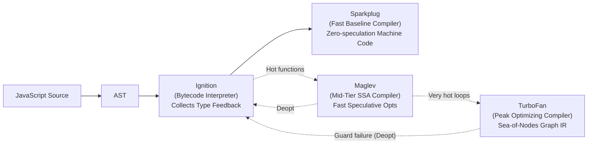
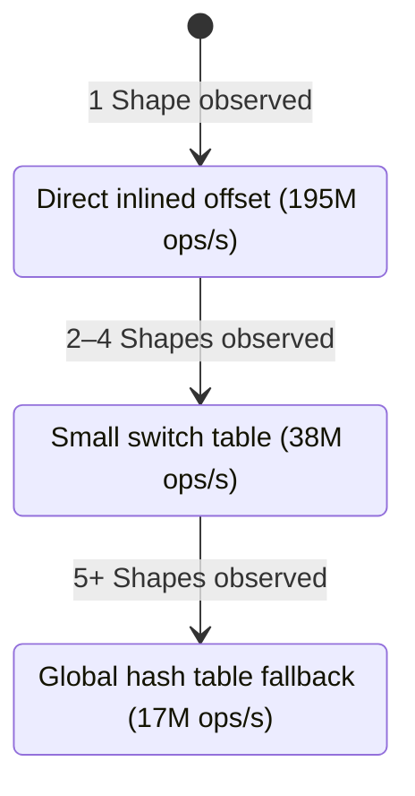

# V8 internals (reference)

Detailed background for the `js-perf` skill. Load only when JIT/deopt/GC internals are needed — the short rules live in `SKILL.md`.

## 🔥 V8 JIT & Deoptimization Deep Dive (Ignition, Sparkplug, Maglev, TurboFan)

V8 executes JavaScript through a 4-tier execution pipeline designed to balance startup latency with peak throughput:



### 1. Deoptimization Types & The Bailout Penalty
When TurboFan or Maglev compiles machine code, it makes speculative assumptions based on type feedback gathered in Ignition (e.g. "parameter `x` is always a 31-bit integer", "object `o` always has Map #42"). When that assumption is violated:

1. **Eager Deopt (`deopt-eager`)**: Triggered directly by an inline guard instruction failing (e.g., `CheckMaps`, `CheckSmi`, bounds check fail, integer overflow).
   - *Cost*: A bailout reconstructs the unoptimized Ignition frame from optimized registers — typically microseconds, not milliseconds. The real damage is repeated bailouts on one function, which can permanently disable optimization (`kOptimizationDisabled`).
2. **Lazy Deopt (`deopt-lazy`)**: Triggered when a global dependency is invalidated by another piece of code (e.g., mutating `Array.prototype` or an object's prototype). All optimized functions relying on that prototype's stability are marked invalid and deoptimize upon return.
3. **Soft Deopt (`deopt-soft`)**: Code reaches a branch that was never executed during profiling. TurboFan bails out to re-profile.
4. **The Deopt Loop Trap (`kOptimizationDisabled`)**:
   If a function deoptimizes repeatedly (typically >10–20 times) for the same bailout reason, V8 permanently disables TurboFan optimization for that function. It will run forever in the interpreter or baseline compiler, permanently losing 10x–50x performance!

---

### 2. Inline Caches (IC) & Hidden Classes (Shapes)
Every object in V8 has an internal hidden class called a **Map** (or **Shape**). V8 uses Maps to compute constant memory offsets for properties instead of performing dynamic dictionary lookups.

#### The Three IC States:


- **Monomorphic (1 Shape)**: TurboFan emits a single type check and inlines direct memory access (`[rax + 16]`). **Fastest: ~195M ops/s**.
- **Polymorphic (2–4 Shapes)**: TurboFan emits a small conditional ladder. **5x slower: ~38M ops/s**.
- **Megamorphic (5+ Shapes)**: TurboFan gives up inlining. Every property read traverses the global stub cache. **11.2x slower: ~17.3M ops/s**.

#### Shape Transition Traps:
```typescript
// ❌ TRAP 1: Property initialization order splits hidden classes!
const objA = { a: 1, b: 2 };
const objB = { b: 2, a: 1 };
// %HaveSameMap(objA, objB) === false! Passing both to fn(o) makes the call polymorphic.

// ❌ TRAP 2: Conditional property assignment
const user = { id: 1 };
if (hasRole) user.role = "admin"; // Creates 2 separate transition trees!

// ✅ FIX: Uniform class constructor with explicit null initialization
class User {
  id: number;
  role: string | null;
  constructor(id: number, role: string | null = null) {
    this.id = id;
    this.role = role; // All instances share the exact same Hidden Class!
  }
}
```

---

### 3. V8 Elements Kinds Lattice (The 1-Way Array Degradation Trap)
V8 internally specializes JavaScript arrays into **Elements Kinds**. Arrays transition down a strictly one-way lattice:

```
PACKED_SMI_ELEMENTS (Dense 31-bit integers: FASTEST)
        │
        ▼ (store float or >2^31)
PACKED_DOUBLE_ELEMENTS (Unboxed IEEE-754 floats)
        │
        ▼ (store string or object)
PACKED_ELEMENTS (Generic JS objects / pointers)
        │
        ▼ (create hole: new Array(N), delete, out-of-bounds index)
HOLEY_ELEMENTS (Sparse elements: SLOWEST)
```

> [!CAUTION]
> **Arrays NEVER transition back up!**
> Once an array becomes `HOLEY` or `PACKED_DOUBLE`, inserting integers will NEVER restore it to `PACKED_SMI`.

#### The Holey Array Disaster:
- Iterating a 100k array of `PACKED_SMI` takes **1,824 ms** (5,481 ops/s).
- Iterating a 100k array with **just 1 hole** takes **13,852 ms** (722 ops/s) — **7.6x SLOWER**!
- *Why*: When V8 reads an index on a holey array and encounters a hole, the ECMAScript specification mandates that V8 must search the entire prototype chain (`Array.prototype`, `Object.prototype`) to check if someone defined a property at that index! This completely destroys CPU branch prediction, cache locality, and vectorization.

```typescript
// ❌ SLOW: Allocates HOLEY_SMI_ELEMENTS with N holes!
const arr = new Array(1000);
for (let i = 0; i < 1000; i++) arr[i] = i * 2;

// ✅ FAST: Pre-fill dense array (PACKED_SMI_ELEMENTS)
const arr = new Array(1000).fill(0);
for (let i = 0; i < 1000; i++) arr[i] = i * 2;

// ✅ FASTEST: Use TypedArray for numeric data (Zero holes possible)
const arr = new Int32Array(1000);
```

---

### 4. Smi vs HeapNumber Representation
- **Smi (Small Integer)**: In 64-bit V8 (with pointer compression), integers between $-2^{31}$ and $2^{31}-1$ are encoded directly inside pointers (low bit set to 0). They require **zero memory allocation** and no pointer dereference.
- **HeapNumber**: Numbers outside the 31-bit range or floating-point numbers cannot fit in a Smi pointer. V8 must allocate a dedicated `HeapNumber` object on the heap:
  ```typescript
  // ❌ DEOPT: Exceeds 31-bit signed int range (0x3fffffff)
  let count = 0x3fffffff;
  count += 1; // Transitions from Smi to HeapNumber / Double!
  // Triggers: [bailout (kind: deopt-eager, reason: not a Smi)]
  ```
- *Fix*: In tight loops, clamp values using 32-bit bitwise operators (`x | 0`), or store floating numbers in `Float64Array`.

---

### 5. Megamorphic Call Sites vs Monomorphic Inlining
When calling a function in a loop (`fn(arg)`):
- **Monomorphic Call (1 Target)**: TurboFan speculatively inlines the function body directly into the caller. Eliminates stack frame creation, parameter passing, and return jumps. **Benchmark: 98M ops/s**.
- **Megamorphic Call (5+ Targets)**: TurboFan cannot determine which function will be invoked. It abandons inlining and falls back to indirect dynamic dispatch. **Benchmark: 894k ops/s (110x SLOWER)**!

```typescript
// ❌ SLOW: Megamorphic call site
function processItems(items: Array<{ process: () => void }>) {
  for (let i = 0; i < items.length; i++) {
    items[i].process(); // If items have 5+ different classes/handlers: 110x penalty!
  }
}

// ✅ FAST: Direct type-dispatched loop or unified method
function processItems(items: Item[]) {
  for (let i = 0; i < items.length; i++) {
    const item = items[i];
    switch (item.type) {
      case ItemType.A: handleA(item); break; // Monomorphic call!
      case ItemType.B: handleB(item); break; // Monomorphic call!
    }
  }
}
```

---

### 6. V8 Deopt Profiling & Diagnostic Commands
Never guess why V8 is slow. Use V8's built-in diagnostic flags:

```bash
# 1. Trace exact eager and lazy deoptimizations with reasons
node --allow-natives-syntax --trace-deopt-verbose script.js

# 2. Trace function optimization tiering (Ignition -> Maglev -> TurboFan)
node --trace-opt script.js

# 3. Trace Inline Cache transitions (MONO -> POLY -> MEGAMORPHIC)
node --trace-ic script.js

# 4. CPU Tick Profiling (TurboFan vs C++ Runtime vs GC)
node --prof script.js
node --prof-process isolate-*.log > v8_profile.txt
```

#### Diagnostic Natives (for internal testing):
```javascript
// Test hidden classes equality
%HaveSameMap(obj1, obj2); // true / false

// Check if object is in fast mode or dictionary mode
%HasFastProperties(obj); // false if 'delete' was used

// Check array element kinds
%HasSmiElements(arr);
%HasDoubleElements(arr);
%HasHoleyElements(arr);

// Check optimization status:
// Bitmask: 1=Function, 16=Optimized, 32=TurboFan, 64=Maglev
const status = %GetOptimizationStatus(fn);
console.log((status & 16) !== 0 ? "Optimized" : "Deoptimized/Interpreted");
```

---

## 🧠 V8 Memory Layout, GC & Allocation Anatomy

JavaScript developers rarely see manual memory management, but V8's Garbage Collector and memory representation dictate whether an application maintains 60 FPS or suffers from 50ms jank spikes.

### 1. Generational GC: Scavenger vs Mark-Sweep-Compact
V8 divides heap memory into distinct spaces:
- **New Space (Nursery + Intermediate)**: Sized between 1MB and 64MB. All new objects are allocated here bump-the-pointer style.
  - **Minor GC (Scavenger)**: Uses Cheney's copying algorithm. Splits space into `From-Space` and `To-Space`. Fast (~0.5–2ms), but stops JavaScript execution.
  - **High Allocation Rate Danger**: If your code allocates 50MB/sec in render ticks (creating temporary vectors, closures, or options objects), Minor GC fires 30–60 times per second, eating 15%–25% of the frame budget.
- **Old Space**: Stores long-lived objects.
  - **Premature Promotion (Tenuring Hazard)**: Objects that survive **two Minor GC cycles** are promoted to Old Space. If temporary objects are retained just slightly too long (e.g. across a 10ms timer or deferred promise), they get promoted to Old Space.
  - **Major GC (Mark-Sweep-Compact)**: Collects Old Space. Executes full heap tracing and memory compaction. Causes **10ms–80ms Stop-The-World (STW)** latency spikes!
- **When NOT to Object Pool**:
  - In modern V8, pooling small short-lived objects (`{x, y}`) often *hurts* performance! Pooled objects live forever, forcing them into Old Space where they fragment memory and increase Major GC traversal costs. Let short-lived objects die in the Nursery unless their allocation rate exhausts the New Space.

---

### 2. TurboFan Escape Analysis & Scalar Replacement of Aggregates (SRA)
TurboFan includes an advanced **Escape Analysis** pass. If an object is allocated locally and does not escape the function boundary, TurboFan performs **Scalar Replacement of Aggregates**:
```typescript
function getDistance(x1: number, y1: number, x2: number, y2: number) {
  // TurboFan eliminates this object allocation entirely!
  // It replaces 'pt' with two raw CPU registers (reg_x, reg_y).
  const pt = { dx: x2 - x1, dy: y2 - y1 };
  return Math.sqrt(pt.dx * pt.dx + pt.dy * pt.dy);
}
```
**Zero heap allocation, zero GC overhead.**

#### 5 Anti-Patterns That Break Escape Analysis:
1. **Passing to Non-Inlined Functions**: Calling `process(pt)` where `process` is too large to inline forces V8 to allocate `pt` on the heap.
2. **Storing in an Array or External Object**: `arr.push(pt)` or `globalCache.last = pt` immediately escapes the object.
3. **Escaping on One Branch of an `if`**:
   ```typescript
   const pt = { x, y };
   if (debug) logToExternalArray(pt); // ⚠️ Escapes for the ENTIRE function!
   ```
4. **Dynamic Computed Keys**: `pt[dynamicKey]` disables scalar replacement.
5. **Reference Equality Checks**: `if (pt === otherPt)` requires the object pointer to exist, breaking SRA.

---

### 3. The Shared Context Leak (Meteor Bug / Lexical Context Sharing)
V8 optimizes closures by sharing a single internal `Context` object across all closures created within the same lexical scope:

```typescript
function setupListeners() {
  const massiveDataBuffer = new Uint8Array(100 * 1024 * 1024); // 100 MB buffer

  // Closure A uses massiveDataBuffer:
  function processData() {
    return massiveDataBuffer[0];
  }

  // Closure B DOES NOT use massiveDataBuffer:
  function onClick() {
    console.log("Clicked");
  }

  window.addEventListener("click", onClick);
  // ⚠️ FATAL LEAK: Closure A and Closure B share the same lexical Context!
  // Because 'onClick' is alive on window, V8 retains the shared Context,
  // which retains 'massiveDataBuffer' forever, even if processData is never called!
}
```

#### The Fix:
```typescript
// Fix 1: Isolate closures into separate block scopes
function setupListeners() {
  {
    const massiveDataBuffer = new Uint8Array(100 * 1024 * 1024);
    // Process data...
  } // massiveDataBuffer is garbage collected here!

  window.addEventListener("click", () => {
    console.log("Clicked");
  });
}

// Fix 2: Explicitly null out large references after usage
massiveDataBuffer = null;
```

---

### 4. V8 String Memory Internals (SlicedString & ConsString)
V8 implements strings using specialized internal representations:

#### `SlicedString` (Memory Pinning Hazard):
When calling `str.substring()` or `str.slice()`, V8 does not copy character bytes. It creates a `SlicedString` consisting of `[parentStringPointer, offset, length]`:
```typescript
// Read 50 MB JSON response from network:
const largeJson = await response.text(); 
const token = largeJson.substring(10, 20); // 10 characters

// If 'token' is stored long-term (e.g. in a cache or user session):
// ⚠️ The entire 50 MB 'largeJson' string CANNOT be garbage collected!
```
- **The Fix**: Force V8 to detach into a flat sequential string:
  ```typescript
  // Flatten / isolate string:
  const token = (" " + largeJson.substring(10, 20)).slice(1);
  ```

#### `ConsString` (Tree Flattening Latency):
String concatenation (`a + b`) does NOT allocate a contiguous string. It creates a binary tree called a `ConsString`.
- If you build a large string with `str += chunk` in a loop, V8 constructs a deep tree of ConsStrings.
- The first time that string is passed to a regular expression (`/pattern/.test(str)`), written to a file, or passed to DOM, V8 must **synchronously flatten the entire tree** into a contiguous `SeqString`. This triggers a massive main-thread freeze.
- **The Fix**: Always accumulate into an array: `chunks.push(chunk)`, then `chunks.join('')`.

---

### 5. ArrayBuffer & TypedArray Zero-Copy Management
- **`.subarray()` vs `.slice()`**:
  - `typedArray.slice(start, end)`: Allocates a new `ArrayBuffer` and copies byte memory.
  - `typedArray.subarray(start, end)`: Allocates a lightweight 24-byte TypedArray view pointing to the **same underlying `ArrayBuffer`**. $O(1)$ zero allocation, zero memory copy.
- **`ArrayBuffer.prototype.transfer()` (ES2024 / Node 22+)**:
  Allows zero-copy resizing or transferring ownership of an ArrayBuffer. It detaches the original buffer and moves the underlying memory pointer without copying:
  ```typescript
  // Grow or shrink buffer without copying:
  const resizedBuffer = oldBuffer.transfer(newByteLength);
  // oldBuffer is now detached (byteLength === 0)
  ```
- **Web Worker Transfer List**:
  Never call `worker.postMessage(arrayBuffer)` without the transfer list!
  ```typescript
  // ❌ SLOW: Deep clone (3-8ms per MB)
  worker.postMessage(buffer);

  // ✅ ZERO-COPY (<0.05ms for ANY size): Detaches from sender, moves pointer to worker
  worker.postMessage(buffer, [buffer]);
  ```

---

### 6. Auto-Vectorization & SIMD in TurboFan
Modern x86 (AVX2/AVX-512) and ARM (NEON) CPUs can process 4 to 8 floating-point operations in a single CPU instruction via SIMD. TurboFan will automatically vectorize numeric loops ONLY if strict requirements are met:
1. **Contiguous TypedArray**: Source and destination must be `Float32Array`, `Float64Array`, or `Int32Array`. Plain JS arrays are never vectorized.
2. **Fixed Power-of-2 Bounds**: Loop count should ideally be a multiple of 4 or 8.
3. **Stride of 1**: Consecutive memory access (`arr[i]`, not `arr[i * 2]`).
4. **No Branching or Function Calls**: Zero `if` statements, zero method calls inside the loop.
5. **No Aliasing**: TurboFan must prove source and destination buffers do not overlap.
```typescript
// ✅ AUTO-VECTORIZABLE LOOP (TurboFan emits AVX/NEON 128-bit instructions)
function addVectors(out: Float32Array, a: Float32Array, b: Float32Array, len: number) {
  for (let i = 0; i < len; i++) {
    out[i] = a[i] + b[i];
  }
}
```

---

