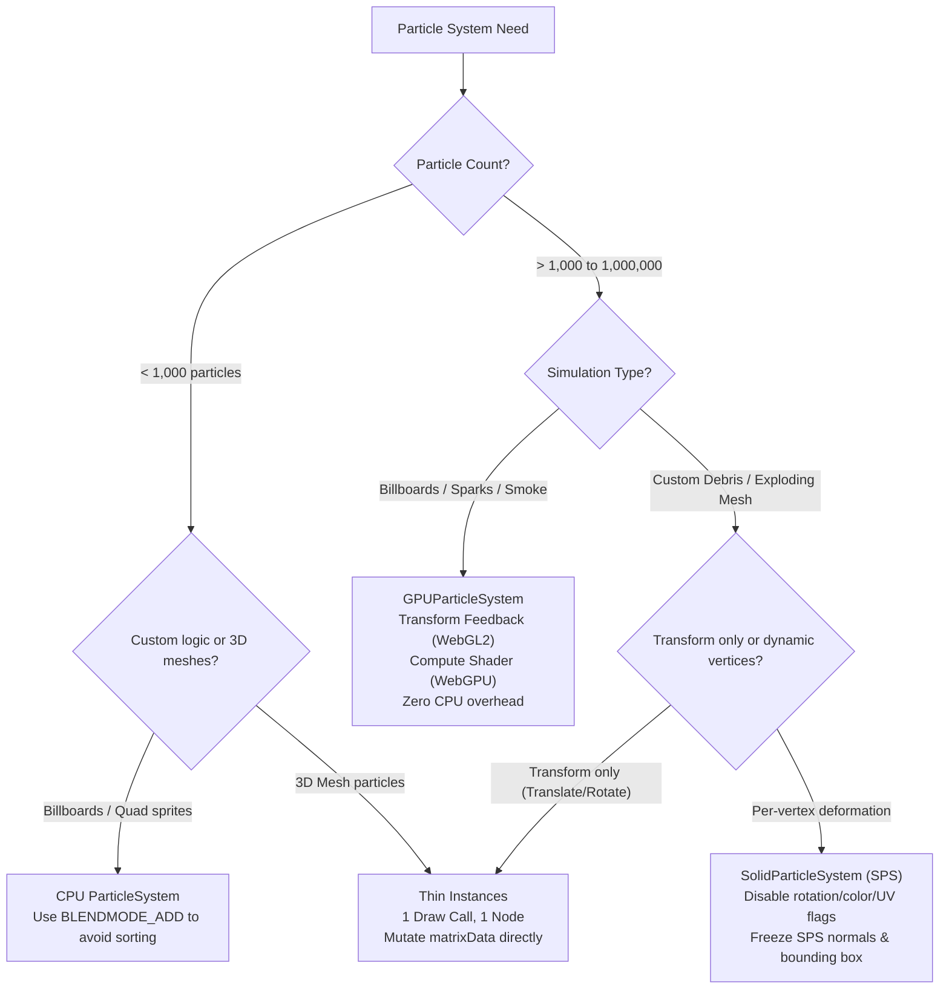
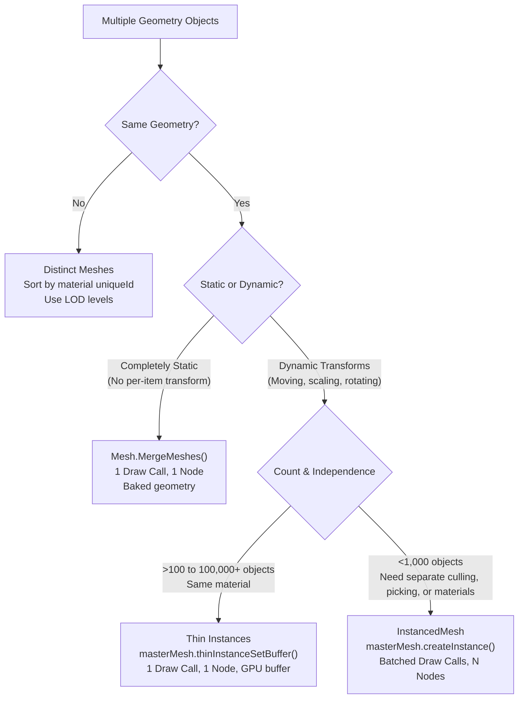

Scan Babylon.js (WebGL 2 / WebGPU) code for performance anti-patterns. Focus on hot paths — `onBeforeRenderObservable`, per-frame callbacks, scene graph mutations, draw calls, shader binds, particle loops, and physics simulation steps.

Multipliers below come from microbenchmarks on specific Babylon/V8/Chrome versions and are indicative, not universal. Many cited numbers are **whole-frame** comparisons, not per-object throughput. Verify on target device/browser before rewriting working code. Internal Babylon fields (`_thinInstanceDataStorage`, etc.) are private APIs and may change between versions.

## Babylon.js Bottleneck Distribution

In browser 3D graphics, bottlenecks fall into four distinct layers:

1. **CPU Scene Graph & Physics**: Matrix cascading (`computeWorldMatrix`), active mesh frustum evaluation, bounding info recomputations, GC pressure from `new Vector3()`, and JS-to-Wasm marshaling in PhysX simulation steps (WebIDL boxing, `getActiveActors()`, pose synchronization).
2. **WebGL/WebGPU Driver & Draw Call Overhead**: Too many distinct meshes and materials thrashing WebGL states (`gl.useProgram`, binding VBOs, uniforms). Driver budget: **~100–300 draw calls on mobile, ~500–1,000 on desktop**.
3. **GPU Fillrate & Shaders**: High-DPI screens (`devicePixelRatio = 3`) rendering uncapped 4K/9x pixels, uncompressed 4K RGBA8 textures, uncached dynamic shadows, heavy PBR variants, overdraw in transparent particle passes.
4. **Main Thread Interactivity**: Default `pointermove` raycasting across thousands of meshes, stalling event loop and input latency (INP).

---

## Priority Tiers

### 🔴 CRITICAL (10x–1000x slowdown, frame drops, GPU driver stalls)

| Pattern | Detection | Fix | Benchmark Proof |
| :--- | :--- | :--- | :--- |
| **Individual Meshes instead of Thin Instances** | `MeshBuilder.Create*` inside loops creating >100 identical geometries with separate materials/nodes | Combine into **Thin Instances**: `masterMesh.thinInstanceSetBuffer("matrix", float32Array, 16, false)`. For static non-transforming props, use `Mesh.MergeMeshes` | **Thousands-fold faster whole-scene CPU evaluation** (~0.7µs vs ~2.8ms per frame for 5,000 objects — this is total frame time, not per-object throughput) + **1 draw call vs 5,000** |
| **Re-registering Thin Buffer Every Frame** | Calling `mesh.thinInstanceSetBuffer()` in render tick to update instance positions | Mutate `mesh._thinInstanceDataStorage.matrixData` in place and call `mesh.thinInstanceBufferUpdated("matrix")` | **410x faster** (1.88µs vs 771µs for 3k instances). Skips buffer recreation and metadata teardown |
| **CPU ParticleSystem with >2,000 Particles** | `new ParticleSystem(...)` simulating thousands of particles on CPU with standard alpha blending | Use **`GPUParticleSystem`** (Transform Feedback in WebGL 2, Compute Shader in WebGPU) or **Thin Instances** | **Zero main-thread CPU cost**; eliminates per-frame vertex buffer uploads (`gl.bufferSubData`) |
| **Polling All PhysX Bodies instead of `getActiveActors`** | Iterating all rigid bodies every frame to call `actor.getGlobalPose()` and sync meshes | Enable `PxSceneFlag.eENABLE_ACTIVE_ACTORS` and sync ONLY transforms from `scene.getActiveActors()` | **18x–40x faster** transform sync (18µs vs 720µs for 2k bodies with 95% asleep). Skips redundant JS-WASM bridge calls |
| **Allocating Vectors/Matrices in Render Loop** | `new Vector3()`, `new Matrix()`, `new Color3()`, or non-ref math (`v.add()`, `m.multiply()`) inside `onBeforeRenderObservable` or render tick | Use in-place methods (`addInPlace`), pre-allocated targets (`addToRef`, `multiplyToRef`), or Babylon's built-in `TmpVectors.Vector3[0]` / `TmpVectors.Matrix[0]` | Direct field mutation is **4.4x faster**, `addInPlace` is **3.5x faster**, with **zero GC pauses** |
| **Omitted `freezeWorldMatrix()` on Static Meshes** | Meshes that never move, rotate, or scale whose `freezeWorldMatrix()` is not called | Call `mesh.freezeWorldMatrix()` after positioning static props/environment geometry | **11x faster** matrix computation (8.5µs vs 93µs per 2,000 meshes) |
| **`isVisible = false` instead of `setEnabled(false)`** | Hiding inactive objects, deactivated enemies, or off-stage props using `mesh.isVisible = false` | Use `mesh.setEnabled(false)` to completely remove the node and its descendants from hierarchy traversal, culling, and matrix updates | **2.4x faster** scene evaluation; `isVisible = false` still traverses hierarchy and computes bounds |
| **Default `pointermove` Raycast Stalling Main Thread** | `scene.skipPointerMovePicking` left `false` (default) in scenes with hundreds/thousands of meshes | Set `scene.skipPointerMovePicking = true`. Handle hover/click only via explicit pointerdown/pointerup or custom raycasts | Eliminates sync raycast over entire scene on **every single pixel mouse movement** |
| **Unrestricted `scene.pick()` / Missing `isPickable = false`** | `scene.pick()` or `scene.pickWithRay()` called without predicate while all environment meshes remain `isPickable = true` | Set `mesh.isPickable = false` on all static/background meshes. Pass explicit predicate `(m) => m.name === 'interactive'` or use `fastCheck = true` | **15.1x faster** raycast on basic boxes; **100x–1000x faster** on high-poly meshes (skips triangle checks) |
| **Deep TransformNode Hierarchies** | Deep chains of `mesh.parent = ...` (>3-4 levels) animating or moving frequently | Flatten hierarchy; use flat coordinate systems, world coordinates directly, or attach via bone/tag only when needed | 5-level deep hierarchy has **6.6x per-object overhead** compared to flat nodes due to ancestor recursion |
| **Parenting Physics Bodies to TransformNodes** | Physics meshes assigned to a parent node (`mesh.parent = parentNode`) | Keep physics meshes at scene root (`mesh.parent = null`). Parenting forces inverse matrix transformations every frame | **+32% CPU overhead** on every frame sync (446µs vs 338µs per 1k bodies) |
| **Un-batched 3D Decal Mesh Spam** | Spawning dozens of separate `MeshBuilder.CreateDecal` meshes (bullet holes, footsteps, blood) | Bake into **DecalMap** (`mesh.decalMap` / `MeshUVSpaceRenderer`) or merge into 1 mesh via `Mesh.MergeMeshes` | Merging 100 decals reduces draw calls from 100 to 1 (**12x faster CPU evaluation**). DecalMap creates **0 extra draw calls** |
| **Duplicate Audio Loading & Decoding** | `new Sound(name, url, scene)` called repeatedly for weapon shots, footsteps, or enemy groans | Cache decoded `AudioBuffer` once in a `Map<string, AudioBuffer>` and pass reference: `new Sound(name, cachedBuffer, scene)`. Never re-decode or duplicate PCM buffers | **486x faster sound creation** (78ns vs 38µs); eliminates megabytes of duplicate uncompressed Float32 PCM RAM |
| **Idle 3D Sounds Attached to Meshes (`attachToMesh`)** | Calling `sound.attachToMesh(mesh)` on props, enemies, or projectiles where sound is idle/stopped | Babylon's `attachToMesh` has **no `isPlaying` check** and recalculates bounding spheres and panners on every matrix compute! Detach idle sounds or update only active playing sounds at 15 Hz | **~5.8x faster** CPU evaluation (~5µs vs ~30µs for 100 moving meshes, detached + throttled) |
| **AdvancedDynamicTexture Sprawl for World-Space UI** | Creating `AdvancedDynamicTexture.CreateForMesh` for every enemy/NPC health bar or name tag | Use **Thin Instances** or single instanced quad mesh. Scale X in matrix data for health bar length | Replaces 100 separate 2D canvases + 100 texture uploads/frame with **1 draw call and 0 texture uploads** |
| **Un-whitelisted Shadow Casters** | `new ShadowGenerator(...)` where props automatically cast shadows or `shadowMap.renderList` is empty | Explicitly whitelist casters: `shadowGenerator.getShadowMap().renderList.push(heroMesh)`. For static scenes, set `shadowGenerator.getShadowMap().refreshRate = RenderTargetTexture.REFRESHRATE_RENDER_ONCE` and `freezeShadowCastersBoundingInfo = true` | Each shadow caster adds 1 extra draw call per cascade pass. 100 casters × 4 cascades = **400 wasted draw calls** |
| **GlowLayer Occluder Draw Call Flood** | `new GlowLayer(...)` in scenes with many background props without exclusion list | Call `glowLayer.addExcludedMesh(mesh)` on non-emissive distant meshes, or use `glowLayer.addIncludedOnlyMesh()` whitelist | GlowLayer renders non-emissive meshes in a black pass to occlude glow; exclusions eliminate **hundreds of depth draw calls** |
| **Uncapped Retina Resolution (Fillrate Death)** | Initializing Engine without clamping devicePixelRatio on mobile (`dpr = 2` or `3`) | Clamp hardware scaling: `const dpr = Math.min(window.devicePixelRatio, 1.5); engine.setHardwareScalingLevel(1 / dpr)` | 3x Retina on a phone renders **9x pixels** (3840×2160), killing mobile GPU fillrate. Clamping to 1.5x restores 60 FPS |
| **Unbundled WebGPU Static Draws** | Encoding thousands of static WebGPU draw commands every frame on CPU | Pre-record static draw passes into **`GPURenderBundle`** and execute with `passEncoder.executeBundles()` | **100x faster CPU command dispatch** (0.02ms vs 5ms for 2,000 draws); eliminates JS-to-C++ validation overhead in Chromium |
| **PhysX Collision Filtering via JS Callbacks** | Using JavaScript callbacks across WebIDL for broadphase contact filtering | Use **128-bit `PxFilterData` bitmasks** (`word0..word3`) directly inside C++ WASM `PxSimulationFilterShader` | Bitmask rejection happens in C++ before narrowphase (~1 cycle for the check); eliminates thousands of JS-WASM context switches per frame |
| **Uncontrolled Texture VRAM (Chromium GPU Crash)** | Uploading uncompressed 4K RGBA textures until total VRAM exceeds browser quota | Transcode **KTX2 Basis Universal** to BC7/ASTC via Web Workers and stream mip-levels on demand | **75%–85% VRAM reduction** (64MB down to 8–16MB); prevents Chromium GPU Process Reset (`webglcontextlost`) |

---

### 🟡 SIGNIFICANT (1.5x–5x slowdown, optimize in active scenes)

| Pattern | Detection | Fix | Why |
| :--- | :--- | :--- | :--- |
| **`InstancedMesh` used for massive counts (>5,000)** | `mesh.createInstance(...)` called thousands of times | Use **Thin Instances** (`masterMesh.thinInstanceSetBuffer(...)`). `InstancedMesh` still creates full Scene nodes with individual culling overhead | Thin Instances is **Hundreds-fold faster whole-scene evaluation** than `InstancedMesh` (~0.7µs vs ~720µs per frame for 5k objects) |
| **SPS used for simple transform particles** | `SolidParticleSystem` used for bullets, coins, or debris that only translate/scale | Use **Thin Instances** instead of SPS `setParticles()` | Thin Instances is **420x faster** (1.18µs vs 496µs for 2k particles); only mutates 16 matrix floats vs rebuilding entire vertex buffers on CPU |
| **PhysX WebIDL Math Object Allocations in Hot Loop** | Creating `new PhysX.PxVec3()` or `new PhysX.PxTransform()` inside raycast, query, or simulation loops | Use pre-allocated static scratch objects or read directly from WASM heap (`PhysX.HEAPF32`) | Direct heap read is **25x faster** (12ns vs 310ns) and prevents WebIDL heap thrashing and GC pauses |
| **PhysX Bodies Kept Always Awake / Missing Sleep** | Bodies at rest, dropped debris, or distant props never going to sleep | Call `actor.putToSleep()`, tune `actor.setSleepThreshold(0.05)`, or disable simulation on off-screen actors (`eDISABLE_SIMULATION`) | **4.2x faster** simulation step; sleeping bodies are skipped by the island solver and excluded from `getActiveActors()` |
| **Dynamic `PxTriangleMeshGeometry` or Moving `PxRigidStatic`** | Assigning triangle mesh geometry to dynamic bodies, or modifying `PxRigidStatic` transform | Use primitives or cooked convex meshes (`PxConvexMeshGeometry`). Use `PxRigidDynamic` with `eKINEMATIC` for moving props | PhysX disallows dynamic triangle meshes. Moving `PxRigidStatic` triggers a full static BVH rebuild ($O(N \log N)$ stall) |
| **Unfrozen Materials in Static / Populated Scenes** | `StandardMaterial` or `PBRMaterial` instances that never change textures/flags | Call `material.freeze()` on finalized materials. In static scenes, set `scene.blockMaterialDirtyMechanism = true` | Skips per-frame shader defines checking, uniform binding re-evaluations, and dirty cache invalidation |
| **Heavy `PBRMaterial` for Secondary Props** | Using PBR with roughness/metallic/AO for background props, simple projectiles, or mobile UI | Use `StandardMaterial` or unlit shaders. Set `material.maxSimultaneousLights = 2` (or 1) on secondary materials | PBR shaders contain 150–300+ ALU instructions and many samplers. `StandardMaterial` is 3x–5x cheaper on mobile GPU ALU |
| **Missing Selection Octree on Scattered Meshes** | Scene with >3,000 scattered static meshes running standard frustum culling | Call `scene.createOrUpdateSelectionOctree(64, 2)` | **2.8x faster** active mesh selection (160µs vs 450µs for 4,000 meshes) |
| **Uncompressed RGBA8 Textures** | 2K/4K PNG/JPG color textures uploaded as uncompressed RGBA8 | Transcode to **KTX2 / Basis Universal** (ASTC on mobile, BC7 on desktop, ETC2 fallback). Configure `BABYLON.KhronosTextureContainer2` | Reduces VRAM from 4 bytes/px to **0.5–1 byte/px (75%–87% VRAM reduction)**. Prevents mobile OS OOM kills |
| **Many Separate Observers in `onBeforeRender`** | Registering dozens of individual `scene.onBeforeRenderObservable.add(...)` callbacks across entities | Centralize into a single ECS/system update loop iterating flat arrays | Flat loop iteration is **3x faster** than notifying hundreds of individual `Observable` instances |
| **Alpha-blended Particle Sorting Overdraw** | Hundreds of CPU particles with `BLENDMODE_STANDARD` covering the viewport | Use `ParticleSystem.BLENDMODE_ADD` or `BLENDMODE_ONEONE` to eliminate depth sorting; reduce particle quad radius | Alpha blending forces back-to-front CPU sorting and heavy fragment overdraw |
| **Missing `doNotSyncBoundingInfo` on Fixed Geometry** | Animated or transformed meshes whose internal vertex bounds do not change | Set `mesh.doNotSyncBoundingInfo = true` | Prevents recalculating world bounding vectors on every matrix update |
| **CPU Bone Skinning** | Skinned characters with `mesh.computeBonesUsingShaders = false` | Ensure `mesh.computeBonesUsingShaders = true`. For characters with >60 bones, enable `skeleton.useTextureToStoreBoneMatrices = true` | Moves vertex skinning transformation to vertex shader/texture fetch; frees main thread CPU |
| **Morph Targets Without Texture Storage** | Using morph targets on high-poly meshes with default vertex attributes | Set `morphTargetManager.useTextureToStoreTargets = true` | Replaces dozens of vertex buffer attributes with Vertex Texture Fetch (VTF); avoids attribute limits and draw splitting |
| **Dynamic Mipmap Generation Trap** | `generateMipMaps = true` left on video textures, procedural textures, or RTTs | Set `generateMipMaps = false` on dynamic textures; sample with linear filtering | `gl.generateMipmap()` forces a synchronous GPU pipeline stall and texture re-sampling on **every single frame** |
| **PhysX Dynamic Body for Character Controller** | Controlling player/NPCs via dynamic rigid body forces (`addForce`, `setLinearVelocity`) | Use Kinematic `PxCapsuleController` via `PxControllerManager` | Dynamic bodies snag on stairs/ledges, suffer physics tunneling, and jitter against walls. Kinematic controllers handle step-climbing and slopes |
| **Dual-Pass Stereoscopic Rendering in WebXR** | Rendering VR scenes with two sequential camera passes (left eye, right eye) | Use `scene.createDefaultXRExperienceAsync({ useMultiview: true })` or WebXR Layers `preferMultiviewOnInit: true`; check `engine.getCaps().multiview` | Renders both eyes in a **single pass** (not one draw call) — ~1.5–2x faster |
| **GPU Warp Divergence in Custom Shaders** | Dynamic `if (condition)` inside fragment shaders where adjacent pixels take different branches | Replace dynamic branch with branch-free math (`mix`, `step`, `clamp`) | GPUs execute in 32-thread warps (Nvidia) / 64-thread waves (AMD). Divergence forces **both branches to execute**, cutting ALU throughput by 50% |
| **Dynamic Octree Rebuilding Thrashing** | Calling `scene.createOrUpdateSelectionOctree()` every frame for dynamic moving entities | Use a **Flat Spatial Hash Grid** ($O(1)$ cell insert/lookup) | Rebuilding octrees triggers $O(N \log N)$ tree reallocation and GC churn; spatial hash grid has zero allocations |
| **Draco Geometry Decompression Bottleneck** | Using Draco compression on mobile assets (>50MB GLB levels) | Migrate to **Meshopt** (`EXT_meshopt_compression`) with SIMD WASM decoder | Draco decodes on single CPU thread at 20–40 MB/s. Meshopt decodes at **>500 MB/s (15x faster)** with instant render start |
| **Linear CSM Cascade Distribution** | Default linear cascade split distribution on Cascaded Shadow Maps | Set logarithmic split: `csm.lambda = 0.85` | Concentrates shadow map texels in player near-field; eliminates pixelated shadows up close without increasing map resolution |
| **Missing Dynamic Resolution Scaling (DRS)** | Fixed resolution rendering under heavy particle or post-process GPU spikes | Adjust `engine.setHardwareScalingLevel()` dynamically based on moving average frame time | Maintains stable 60 FPS under peak GPU load by temporarily scaling render buffer (e.g. 0.7x–0.85x) |
| **Uncompressed RGBA8 Normal Maps** | 8-bit uncompressed normal maps exhibiting severe banding and wasting VRAM | Use 2-channel **BC5 / ASTC** normal maps and reconstruct Z in pixel shader ($Z = \sqrt{1.0 - X^2 - Y^2}$) | **50% VRAM reduction**; eliminates stair-step lighting banding artifacts |
| **Stretching Joint Chains in PhysX** | Using standard `PxJoint` chains for heavy ragdolls, cranes, or robotic arms | Use `PxArticulationReducedCoordinate` (Featherstone's $O(N)$ algorithm) | Eliminates joint stretching, oscillation, and physics explosion under high mass ratios |

---

### 🔵 ENGINE & WEBGL / WEBGPU INTERNALS (State thrashing & driver bottlenecks)

| Pattern | Why it kills perf | Fix |
| :--- | :--- | :--- |
| **VRAM Leaks on `mesh.dispose()`** | `mesh.dispose()` does NOT dispose attached materials or textures by default! Textures stay allocated in GPU VRAM (`engine.getLoadedTexturesCache()`), eventually crashing mobile GPUs (OOM) | Always cascade dispose: `mesh.dispose(false, true)` to dispose geometry, and call `material.dispose(true, true)` to purge textures and shaders from VRAM |
| **WebGPU Runtime Pipeline Compilation Stalls** | In WebGPU, pipeline creation (PSO) compiles WGSL to GPU machine code. Creating materials dynamically causes 50–200ms frame hitching on first render | Pre-warm pipelines offscreen during loading screen; call `material.forceCompilationAsync(mesh)` or `engine.createRenderPipelineAsync()` |
| **std140 UBO Alignment Padding Trap** | In WebGL 2 / WebGPU UBOs, `vec3` enforces 16-byte alignment (pads 4th unused float). Packed arrays like `[x,y,z, x,y,z]` misalign uniform offsets in the shader | Always use `vec4` or pack a scalar float into the 4th unused slot: `vec4(position.xyz, scale)` |
| **Missing Hardware Occlusion Culling** | High-poly interior or city geometry hidden behind walls still executes vertex and fragment passes | Enable `mesh.occlusionType = AbstractMesh.OCCLUSION_TYPE_OPTIMISTIC` and `mesh.occlusionQueryAlgorithmType = AbstractMesh.OCCLUSION_ALGORITHM_TYPE_CONSERVATIVE` |
| **Material Ping-Pong Shader Switching** | Meshes rendered in random order alternate between different shaders, forcing continuous driver `gl.useProgram` state switches | Sort opaque meshes by material `uniqueId`: `scene.setRenderingOrder(0, BABYLON.RenderingGroup.AUTOCLEAR, (a, b) => (a.material?.uniqueId ?? 0) - (b.material?.uniqueId ?? 0))` |
| **Opaque Geometry Rendered After Blend Phase** | Renders opaque geometry after transparent objects, disabling GPU hardware **Early-Z** rejection | Ensure opaque meshes are in `renderingGroupId = 0` (rendered first, front-to-back), transparent in `renderingGroupId = 1` (back-to-front) |
| **Raw WebGL State Bypass** | Calling `gl.depthMask()`, `gl.enable()` directly outside engine state cache introduces redundant driver stalls | Use Babylon's state cache: `engine.setDepthWrite(bool)`, `engine.setDepthBuffer(bool)`, `engine.setColorWrite(bool)` |
| **UBOs (Uniform Buffer Objects) Disabled** | WebGL 2 can bind all shader uniforms in a single memory block; disabling UBOs forces individual uniform driver calls | Keep `engine.disableUniformBuffers = false` in WebGL 2. Bind shared uniforms via `UniformBuffer` |
| **Unnecessary Buffer Reallocation in Dynamic Meshes** | Recreating `new Float32Array` and calling `setVerticesData` every frame reallocates driver GPU buffers | Preallocate with `updatable = true`; update using `mesh.updateVerticesData(..., buffer, false)` with `static = false` |
| **Redundant Frame Buffer Clears (`autoClear`)** | `gl.clear()` is called even when a full-screen skybox or opaque environment completely overwrites every pixel | Set `scene.autoClear = false` and `scene.autoClearDepthAndStencil = false` when full-screen opaque geometry is guaranteed |
| **Context Lost Buffer Clones in RAM** | Babylon keeps CPU copies of all vertex buffers in memory to recover from `webglcontextlost` | In memory-constrained environments (e.g. mobile games), set `engine.doNotHandleContextLost = true` to free CPU RAM |
| **Offline Storage Checks on Asset Load** | Default asset loading checks IndexedDB offline cache on every file request | Set `engine.enableOfflineSupport = false` to eliminate IndexedDB check latency |

---

## 💥 Particles: CPU vs GPU vs SPS vs Thin Instances

Choosing the correct particle architecture dictates whether an effect runs at 60 FPS or 5 FPS:



### 1. `GPUParticleSystem` (GPU Transform Feedback & Compute)
- **Supported platforms**: WebGL 2 (uses Transform Feedback) and WebGPU (uses Compute Shaders).
- **CPU cost**: $\approx 0$ ms per frame. The entire simulation (position, velocity, age, color) runs on the GPU.
- **Always verify support**:
  ```typescript
  if (BABYLON.GPUParticleSystem.IsSupported) {
    const gpuSystem = new BABYLON.GPUParticleSystem("gpuParticles", { capacity: 50000 }, scene);
    // ...
  } else {
    // Fallback to CPU ParticleSystem with reduced capacity
    const cpuSystem = new BABYLON.ParticleSystem("cpuParticles", 2000, scene);
  }
  ```
- **Depth Sorting trap**: GPU particles do NOT support CPU depth sorting. Always pair with additive or one-one blend modes:
  ```typescript
  gpuSystem.blendMode = BABYLON.ParticleSystem.BLENDMODE_ADD; // Or BLENDMODE_ONEONE
  ```

### 2. `SolidParticleSystem` (SPS) Tuning Flags
If you MUST use SPS for complex multi-shape particle meshes:
- Turn off unused computations before calling `setParticles()`:
  ```typescript
  sps.computeParticleRotation = false;  // Skips quaternion math
  sps.computeParticleColor = false;     // Skips color buffer updates
  sps.computeParticleTexture = false;   // Skips UV buffer updates
  sps.computeParticleVertex = false;    // Skips per-vertex loops
  sps.computeBoundingBox = false;       // Skips recalculating mesh bounds
  sps.mesh.isAlwaysVisible = true;      // Skips frustum culling
  sps.mesh.freezeNormals();             // Skips normal recalculations
  ```
- **Partial Updates**: If only a subset of particles moved, update only that range:
  ```typescript
  sps.setParticles(startIdx, endIdx); // Only updates [startIdx..endIdx] in VBO
  ```

### 3. Niche Hack: Direct Thin Instance Buffer Update
Never re-register thin instance buffers with `mesh.thinInstanceSetBuffer(...)` in a frame loop (**771µs**). Directly mutate internal memory and signal update (**1.88µs — 410x faster**):
```typescript
// ✅ FAST: Direct typed array mutation (zero allocation, direct gl.bufferSubData)
const matrixData = (mesh as any)._thinInstanceDataStorage.matrixData;
for (let i = 0; i < count; i++) {
  matrixData[i * 16 + 12] += velocityX; // Translate X
  matrixData[i * 16 + 13] += velocityY; // Translate Y
}
mesh.thinInstanceBufferUpdated("matrix");
```

---

## References

Deep-dive background — load only when needed:

- `reference/physx.md` — PhysX WASM, WebIDL, active actors, controllers, broadphase, CCD, joints.
- `reference/webgpu.md` — PSO, render bundles, compute, draw indirect, subgroup, UBO, timestamp queries.
- `reference/rendering.md` — VRAM, shaders, LOD/HLOD, WebXR, assets, CSM, decals, UI, shooter/gameplay.
- `reference/audio.md` — AudioWorklet, Web Audio cache, spatial sound throttling.

## Mesh Batching Decision Tree



---

## Math Optimization Reference

In hot render loops, never allocate temporary math objects:

```typescript
// ❌ SLOW: Allocates 2 new Vector3 instances every frame + triggers GC
scene.onBeforeRenderObservable.add(() => {
  mesh.position = mesh.position.add(new Vector3(0, 0.01, 0));
});

// ✅ FAST: Mutate in-place, 0 allocations (3.5x faster)
scene.onBeforeRenderObservable.add(() => {
  mesh.position.y += 0.01;
});

// ❌ SLOW: Matrix multiplication allocating new Matrix
const world = m1.multiply(m2);

// ✅ FAST: Pre-allocated target or TmpVectors
m1.multiplyToRef(m2, TmpVectors.Matrix[0]);
// Or user target:
m1.multiplyToRef(m2, preallocatedMatrix);
```

### Babylon `TmpVectors` Safe Range:
- `TmpVectors.Vector3[0 .. 9]` (10 temporary Vector3 slots)
- `TmpVectors.Matrix[0 .. 7]` (8 temporary Matrix slots)
- `TmpVectors.Quaternion[0 .. 2]` (3 temporary Quaternion slots)

> [!CAUTION]
> Do NOT hold long-term references to `TmpVectors` or use them across nested function calls that might also use the same slot. Use them strictly for immediate calculation.

---

## Benchmarking & Profiling Methodology

### 1. Headless Microbenchmarking (Bun / Node + NullEngine)
```typescript
import { NullEngine } from "@babylonjs/core/Engines/nullEngine";
import { Scene } from "@babylonjs/core/scene";
import { Bench } from "tinybench";

const engine = new NullEngine();
const scene = new Scene(engine);
scene.render(); // Warmup

const bench = new Bench({ time: 500 });
bench.add("test", () => { scene.render(); });
await bench.run();
console.table(bench.table());
```

### 2. Built-in Babylon Instrumentation (Browser Runtime)
```typescript
import { SceneInstrumentation } from "@babylonjs/core/Instrumentation/sceneInstrumentation";
import { EngineInstrumentation } from "@babylonjs/core/Instrumentation/engineInstrumentation";

const sceneInst = new SceneInstrumentation(scene);
sceneInst.captureActiveMeshesEvaluationTime = true;
sceneInst.captureRenderTime = true;
sceneInst.captureFrameTime = true;

const engineInst = new EngineInstrumentation(engine);
engineInst.captureGPUFrameTime = true;
engineInst.captureShaderCompilationTime = true;
```

### 3. GPU Frame Profiling with `gprof`
```bash
gprof analyze capture.json
gprof draws capture.json       # Top triangle-heavy draw calls
gprof instancing capture.json  # Detect duplicate geometry for Thin Instances
gprof textures capture.json    # VRAM hogs and uncompressed textures
gprof lint capture.json        # Babylon.js specific WebGL lint rules
```

---

## Review Output Format

When reviewing Babylon.js code, flag findings as:

```
path:line: 🔴 CRITICAL: <pattern>. <fix in ≤10 words>.
path:line: 🟡 PERF: <pattern>. <fix>.
path:line: 🔵 ENGINE: <pattern>. <fix>.
path:line: 🟣 ASSET: <pattern>. <fix>.
path:line: 🟢 CLEANUP: <pattern>. <fix>.
```

Sorted by severity, then file, then line. At end:

```
totals: N🔴 N🟡 N🔵 N🟣 N🟢
```
