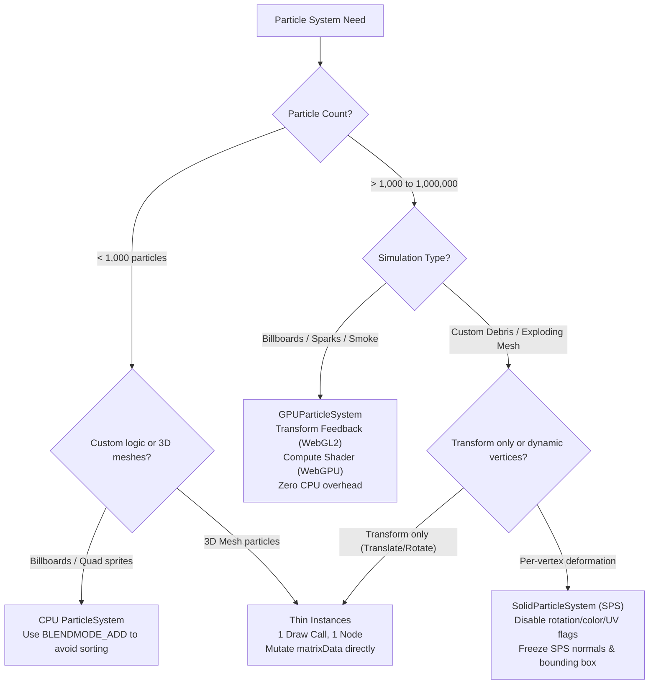
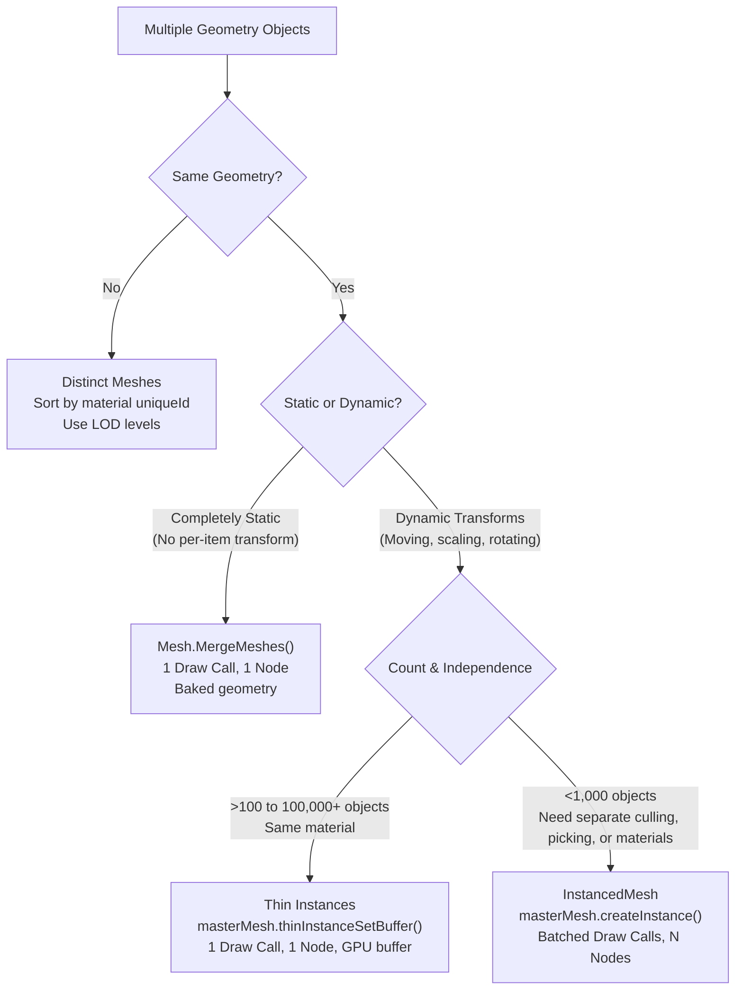

Scan Babylon.js (WebGL 2 / WebGPU) code for performance anti-patterns. Focus on hot paths — `onBeforeRenderObservable`, per-frame callbacks, scene graph mutations, draw calls, shader binds, particle loops, and physics simulation steps.

## Babylon.js Bottleneck Distribution

In browser 3D graphics, bottlenecks fall into four distinct layers:

1. **CPU Scene Graph & Physics**: Matrix cascading (`computeWorldMatrix`), active mesh frustum evaluation, bounding info recomputations, GC pressure from `new Vector3()`, and JS-to-Wasm marshaling in Havok physics steps.
2. **WebGL/WebGPU Driver & Draw Call Overhead**: Too many distinct meshes and materials thrashing WebGL states (`gl.useProgram`, binding VBOs, uniforms). Driver budget: **~100–300 draw calls on mobile, ~500–1,000 on desktop**.
3. **GPU Fillrate & Shaders**: High-DPI screens (`devicePixelRatio = 3`) rendering uncapped 4K/9x pixels, uncompressed 4K RGBA8 textures, uncached dynamic shadows, heavy PBR variants, overdraw in transparent particle passes.
4. **Main Thread Interactivity**: Default `pointermove` raycasting across thousands of meshes, stalling event loop and input latency (INP).

---

## Priority Tiers

### 🔴 CRITICAL (10x–1000x slowdown, frame drops, GPU driver stalls)

| Pattern | Detection | Fix | Benchmark Proof |
| :--- | :--- | :--- | :--- |
| **Individual Meshes instead of Thin Instances** | `MeshBuilder.Create*` inside loops creating >100 identical geometries with separate materials/nodes | Combine into **Thin Instances**: `masterMesh.thinInstanceSetBuffer("matrix", float32Array, 16, false)`. For static non-transforming props, use `Mesh.MergeMeshes` | **3,800x faster CPU evaluation** (0.7µs vs 2.8ms for 5k items) + **1 draw call vs 5,000 draw calls** on GPU |
| **Re-registering Thin Buffer Every Frame** | Calling `mesh.thinInstanceSetBuffer()` in render tick to update instance positions | Mutate `mesh._thinInstanceDataStorage.matrixData` in place and call `mesh.thinInstanceBufferUpdated("matrix")` | **410x faster** (1.88µs vs 771µs for 3k instances). Skips buffer recreation and metadata teardown |
| **CPU ParticleSystem with >2,000 Particles** | `new ParticleSystem(...)` simulating thousands of particles on CPU with standard alpha blending | Use **`GPUParticleSystem`** (Transform Feedback in WebGL 2, Compute Shader in WebGPU) or **Thin Instances** | **Zero main-thread CPU cost**; eliminates per-frame vertex buffer uploads (`gl.bufferSubData`) |
| **Havok Dynamic Bodies without `disablePreStep`** | Dynamic rigid bodies where Babylon reads `transformNode` and pushes into Wasm every tick | Set `physicsBody.disablePreStep = true` on all dynamic bodies | **2.35x faster** Havok step (343µs vs 809µs for 1k bodies). Saves ~466µs per frame |
| **Allocating Vectors/Matrices in Render Loop** | `new Vector3()`, `new Matrix()`, `new Color3()`, or non-ref math (`v.add()`, `m.multiply()`) inside `onBeforeRenderObservable` or render tick | Use in-place methods (`addInPlace`), pre-allocated targets (`addToRef`, `multiplyToRef`), or Babylon's built-in `TmpVectors.Vector3[0]` / `TmpVectors.Matrix[0]` | Direct field mutation is **4.4x faster**, `addInPlace` is **3.5x faster**, with **zero GC pauses** |
| **Omitted `freezeWorldMatrix()` on Static Meshes** | Meshes that never move, rotate, or scale whose `freezeWorldMatrix()` is not called | Call `mesh.freezeWorldMatrix()` after positioning static props/environment geometry | **11x faster** matrix computation (8.5µs vs 93µs per 2,000 meshes) |
| **`isVisible = false` instead of `setEnabled(false)`** | Hiding inactive objects, deactivated enemies, or off-stage props using `mesh.isVisible = false` | Use `mesh.setEnabled(false)` to completely remove the node and its descendants from hierarchy traversal, culling, and matrix updates | **2.4x faster** scene evaluation; `isVisible = false` still traverses hierarchy and computes bounds |
| **Default `pointermove` Raycast Stalling Main Thread** | `scene.skipPointerMovePicking` left `false` (default) in scenes with hundreds/thousands of meshes | Set `scene.skipPointerMovePicking = true`. Handle hover/click only via explicit pointerdown/pointerup or custom raycasts | Eliminates sync raycast over entire scene on **every single pixel mouse movement** |
| **Unrestricted `scene.pick()` / Missing `isPickable = false`** | `scene.pick()` or `scene.pickWithRay()` called without predicate while all environment meshes remain `isPickable = true` | Set `mesh.isPickable = false` on all static/background meshes. Pass explicit predicate `(m) => m.name === 'interactive'` or use `fastCheck = true` | **15.1x faster** raycast on basic boxes; **100x–1000x faster** on high-poly meshes (skips triangle checks) |
| **Deep TransformNode Hierarchies** | Deep chains of `mesh.parent = ...` (>3-4 levels) animating or moving frequently | Flatten hierarchy; use flat coordinate systems, world coordinates directly, or attach via bone/tag only when needed | 5-level deep hierarchy has **6.6x per-object overhead** compared to flat nodes due to ancestor recursion |
| **Parenting Physics Bodies to TransformNodes** | Physics meshes assigned to a parent node (`mesh.parent = parentNode`) | Keep physics meshes at scene root (`mesh.parent = null`). Parenting forces inverse matrix transformations every frame | **+32% CPU overhead** on every frame sync (446µs vs 338µs per 1k bodies) |
| **Un-batched 3D Decal Mesh Spam** | Spawning dozens of separate `MeshBuilder.CreateDecal` meshes (bullet holes, footsteps, blood) | Bake into **DecalMap** (`mesh.decalMap` / `MeshUVSpaceRenderer`) or merge into 1 mesh via `Mesh.MergeMeshes` | Merging 100 decals reduces draw calls from 100 to 1 (**12x faster CPU evaluation**). DecalMap creates **0 extra draw calls** |
| **Duplicate Audio Loading & Decoding** | `new Sound(name, url, scene)` called repeatedly for weapon shots, footsteps, or enemy groans | Cache decoded `AudioBuffer` once in a `Map<string, AudioBuffer>` and pass reference: `new Sound(name, cachedBuffer, scene)`. Never re-decode or duplicate PCM buffers | **486x faster sound creation** (78ns vs 38µs); eliminates megabytes of duplicate uncompressed Float32 PCM RAM |
| **Idle 3D Sounds Attached to Meshes (`attachToMesh`)** | Calling `sound.attachToMesh(mesh)` on props, enemies, or projectiles where sound is idle/stopped | Babylon's `attachToMesh` has **no `isPlaying` check** and recalculates bounding spheres and panners on every matrix compute! Detach idle sounds or update only active playing sounds at 15 Hz | **8.4x–11.6x faster** CPU evaluation (16µs vs 278µs per 100 moving meshes) |
| **AdvancedDynamicTexture Sprawl for World-Space UI** | Creating `AdvancedDynamicTexture.CreateForMesh` for every enemy/NPC health bar or name tag | Use **Thin Instances** or single instanced quad mesh. Scale X in matrix data for health bar length | Replaces 100 separate 2D canvases + 100 texture uploads/frame with **1 draw call and 0 texture uploads** |
| **Un-whitelisted Shadow Casters** | `new ShadowGenerator(...)` where props automatically cast shadows or `shadowMap.renderList` is empty | Explicitly whitelist casters: `shadowGenerator.getShadowMap().renderList.push(heroMesh)`. For static scenes, call `shadowGenerator.freezeShadowCasters()` | Each shadow caster adds 1 extra draw call per cascade pass. 100 casters × 4 cascades = **400 wasted draw calls** |
| **GlowLayer Occluder Draw Call Flood** | `new GlowLayer(...)` in scenes with many background props without exclusion list | Call `glowLayer.addExcludedMesh(mesh)` on non-emissive distant meshes, or use `glowLayer.addIncludedOnlyMesh()` whitelist | GlowLayer renders non-emissive meshes in a black pass to occlude glow; exclusions eliminate **hundreds of depth draw calls** |
| **Uncapped Retina Resolution (Fillrate Death)** | Initializing Engine without clamping devicePixelRatio on mobile (`dpr = 2` or `3`) | Clamp hardware scaling: `const dpr = Math.min(window.devicePixelRatio, 1.5); engine.setHardwareScalingLevel(1 / dpr)` | 3x Retina on a phone renders **9x pixels** (3840×2160), killing mobile GPU fillrate. Clamping to 1.5x restores 60 FPS |

---

### 🟡 SIGNIFICANT (1.5x–5x slowdown, optimize in active scenes)

| Pattern | Detection | Fix | Why |
| :--- | :--- | :--- | :--- |
| **`InstancedMesh` used for massive counts (>5,000)** | `mesh.createInstance(...)` called thousands of times | Use **Thin Instances** (`masterMesh.thinInstanceSetBuffer(...)`). `InstancedMesh` still creates full Scene nodes with individual culling overhead | Thin Instances is **970x faster** than `InstancedMesh` on CPU scene evaluation (0.7µs vs 720µs for 5k items) |
| **SPS used for simple transform particles** | `SolidParticleSystem` used for bullets, coins, or debris that only translate/scale | Use **Thin Instances** instead of SPS `setParticles()` | Thin Instances is **420x faster** (1.18µs vs 496µs for 2k particles); only mutates 16 matrix floats vs rebuilding entire vertex buffers on CPU |
| **Havok Simulation-Only / Worker Sync Overhead** | Physics simulation running without rendering, in Web Worker, or for invisible triggers | Set `physicsBody.disableSync = true` | **4.9x faster** Havok step (165µs vs 809µs for 1k bodies); skips pulling transforms back to JS nodes |
| **Havok Bodies Kept Always Active** | Bodies at rest or distant physics entities continuing to participate in solver | Call `plugin.setActivationControl(body, PhysicsActivationControl.ALWAYS_INACTIVE)` or ensure bodies sleep | **1.75x faster** step (388µs vs 669µs for 2k bodies); Havok solver completely skips sleeping islands |
| **Dynamic Mesh Physics Shape (`MESH`)** | Assigning `PhysicsShapeType.MESH` to a dynamic or animated physics body | Use analytical primitives (**Box, Sphere, Capsule, Cylinder**) or `CONVEX_HULL`. `MESH` shape is strictly for static terrain | Concave triangle meshes in dynamic bodies crater collision detection performance or fail completely |
| **Unfrozen Materials in Static / Populated Scenes** | `StandardMaterial` or `PBRMaterial` instances that never change textures/flags | Call `material.freeze()` on finalized materials. In static scenes, set `scene.blockMaterialDirtyMechanism = true` | Skips per-frame shader defines checking, uniform binding re-evaluations, and dirty cache invalidation |
| **Heavy `PBRMaterial` for Secondary Props** | Using PBR with roughness/metallic/AO for background props, simple projectiles, or mobile UI | Use `StandardMaterial` or unlit shaders. Set `material.maxSimultaneousLights = 2` (or 1) on secondary materials | PBR shaders contain 150–300+ ALU instructions and many samplers. `StandardMaterial` is 3x–5x cheaper on mobile GPU ALU |
| **Missing Selection Octree on Scattered Meshes** | Scene with >3,000 scattered static meshes running standard frustum culling | Call `scene.createOrUpdateSelectionOctree(64, 2)` | **2.8x faster** active mesh selection (160µs vs 450µs for 4,000 meshes) |
| **Uncompressed RGBA8 Textures** | 2K/4K PNG/JPG color textures uploaded as uncompressed RGBA8 | Transcode to **KTX2 / Basis Universal** (ASTC on mobile, BC7 on desktop, ETC2 fallback). Configure `BABYLON.KhronosTextureContainer2` | Reduces VRAM from 4 bytes/px to **0.5–1 byte/px (75%–87% VRAM reduction)**. Prevents mobile OS OOM kills |
| **Many Separate Observers in `onBeforeRender`** | Registering dozens of individual `scene.onBeforeRenderObservable.add(...)` callbacks across entities | Centralize into a single ECS/system update loop iterating flat arrays | Flat loop iteration is **3x faster** than notifying hundreds of individual `Observable` instances |
| **Alpha-blended Particle Sorting Overdraw** | Hundreds of CPU particles with `BLENDMODE_STANDARD` covering the viewport | Use `ParticleSystem.BLENDMODE_ADD` or `BLENDMODE_ONEONE` to eliminate depth sorting; reduce particle quad radius | Alpha blending forces back-to-front CPU sorting and heavy fragment overdraw |
| **Missing `doNotSyncBoundingInfo` on Fixed Geometry** | Animated or transformed meshes whose internal vertex bounds do not change | Set `mesh.doNotSyncBoundingInfo = true` | Prevents recalculating world bounding vectors on every matrix update |
| **CPU Bone Skinning** | Skinned characters with `mesh.computeBonesUsingShaders = false` | Ensure `mesh.computeBonesUsingShaders = true`. For characters with >60 bones, enable `skeleton.useTextureToStoreBoneMatrices = true` | Moves vertex skinning transformation to vertex shader/texture fetch; frees main thread CPU |
| **Morph Targets Without Texture Storage** | Using morph targets on high-poly meshes with default vertex attributes | Set `morphTargetManager.useTextureToStoreTargets = true` | Replaces dozens of vertex buffer attributes with Vertex Texture Fetch (VTF); avoids attribute limits and draw splitting |

---

### 🔵 ENGINE & WEBGL / WEBGPU INTERNALS (State thrashing & driver bottlenecks)

| Pattern | Why it kills perf | Fix |
| :--- | :--- | :--- |
| **Material Ping-Pong Shader Switching** | Meshes rendered in random order alternate between different shaders, forcing continuous driver `gl.useProgram` state switches | Sort opaque meshes by material `uniqueId`: `scene.setRenderingOrder(0, BABYLON.RenderingGroup.AUTOCLEAR, (a, b) => (a.material?.uniqueId ?? 0) - (b.material?.uniqueId ?? 0))` |
| **Opaque Geometry Rendered After Blend Phase** | Renders opaque geometry after transparent objects, disabling GPU hardware **Early-Z** rejection | Ensure opaque meshes are in `renderingGroupId = 0` (rendered first, front-to-back), transparent in `renderingGroupId = 1` (back-to-front) |
| **Raw WebGL State Bypass** | Calling `gl.depthMask()`, `gl.enable()` directly outside engine state cache introduces redundant driver stalls | Use Babylon's state cache: `engine.setDepthWrite(bool)`, `engine.setDepthBuffer(bool)`, `engine.setColorWrite(bool)` |
| **UBOs (Uniform Buffer Objects) Disabled** | WebGL 2 can bind all shader uniforms in a single memory block; disabling UBOs forces individual uniform driver calls | Keep `engine.disableUniformBuffers = false` in WebGL 2. Bind shared uniforms via `UniformBuffer` |
| **Unnecessary Buffer Reallocation in Dynamic Meshes** | Recreating `new Float32Array` and calling `setVerticesData` every frame reallocates driver GPU buffers | Preallocate with `updatable = true`; update using `mesh.updateVerticesData(..., buffer, false)` with `static = false` |
| **Redundant Frame Buffer Clears (`autoClear`)** | `gl.clear()` is called even when a full-screen skybox or opaque environment completely overwrites every pixel | Set `scene.autoClear = false` and `scene.autoClearDepthAndStencil = false` when full-screen opaque geometry is guaranteed |
| **Context Lost Buffer Clones in RAM** | Babylon keeps CPU copies of all vertex buffers in memory to recover from `webglcontextlost` | In memory-constrained environments (e.g. mobile games), set `engine.doNotHandleContextLost = true` to free CPU RAM |
| **Offline Storage Checks on Asset Load** | Default asset loading checks IndexedDB offline cache on every file request | Set `engine.enableOfflineSupport = false` to eliminate IndexedDB check latency |

---

## 💥 Particles: CPU vs GPU vs SPS vs Thin Instances

Choosing the correct particle architecture dictates whether an effect runs at 60 FPS or 5 FPS:



### 1. `GPUParticleSystem` (GPU Transform Feedback & Compute)
- **Supported platforms**: WebGL 2 (uses Transform Feedback) and WebGPU (uses Compute Shaders).
- **CPU cost**: $\approx 0$ ms per frame. The entire simulation (position, velocity, age, color) runs on the GPU.
- **Always verify support**:
  ```typescript
  if (BABYLON.GPUParticleSystem.IsSupported) {
    const gpuSystem = new BABYLON.GPUParticleSystem("gpuParticles", { capacity: 50000 }, scene);
    // ...
  } else {
    // Fallback to CPU ParticleSystem with reduced capacity
    const cpuSystem = new BABYLON.ParticleSystem("cpuParticles", 2000, scene);
  }
  ```
- **Depth Sorting trap**: GPU particles do NOT support CPU depth sorting. Always pair with additive or one-one blend modes:
  ```typescript
  gpuSystem.blendMode = BABYLON.ParticleSystem.BLENDMODE_ADD; // Or BLENDMODE_ONEONE
  ```

### 2. `SolidParticleSystem` (SPS) Tuning Flags
If you MUST use SPS for complex multi-shape particle meshes:
- Turn off unused computations before calling `setParticles()`:
  ```typescript
  sps.computeParticleRotation = false;  // Skips quaternion math
  sps.computeParticleColor = false;     // Skips color buffer updates
  sps.computeParticleTexture = false;   // Skips UV buffer updates
  sps.computeParticleVertex = false;    // Skips per-vertex loops
  sps.computeBoundingBox = false;       // Skips recalculating mesh bounds
  sps.mesh.isAlwaysVisible = true;      // Skips frustum culling
  sps.mesh.freezeNormals();             // Skips normal recalculations
  ```
- **Partial Updates**: If only a subset of particles moved, update only that range:
  ```typescript
  sps.setParticles(startIdx, endIdx); // Only updates [startIdx..endIdx] in VBO
  ```

### 3. Niche Hack: Direct Thin Instance Buffer Update
Never re-register thin instance buffers with `mesh.thinInstanceSetBuffer(...)` in a frame loop (**771µs**). Directly mutate internal memory and signal update (**1.88µs — 410x faster**):
```typescript
// ✅ FAST: Direct typed array mutation (zero allocation, direct gl.bufferSubData)
const matrixData = (mesh as any)._thinInstanceDataStorage.matrixData;
for (let i = 0; i < count; i++) {
  matrixData[i * 16 + 12] += velocityX; // Translate X
  matrixData[i * 16 + 13] += velocityY; // Translate Y
}
mesh.thinInstanceBufferUpdated("matrix");
```

---

## ⚡ Havok Physics V2 & Internal Wasm Exploits (`_hknp`)

Babylon's Havok Physics plugin (`@babylonjs/havok`) runs via WebAssembly. Maximizing Havok throughput requires cutting JS-to-Wasm marshaling overhead:

### 1. `disablePreStep = true` (2.35x Faster Step)
By default, Babylon reads every `physicsBody.transformNode`, calculates world coordinates, and calls `HP_Body_SetQTransform` to push JS state into Wasm. For dynamic bodies simulated by Havok, this is completely wasted CPU work:
```typescript
const body = new PhysicsBody(mesh, PhysicsMotionType.DYNAMIC, false, scene);
body.shape = boxShape;
body.setMassProperties({ mass: 1 });

// ✅ CRITICAL: Dynamic bodies are driven by Havok — skip JS->Wasm prestep!
body.disablePreStep = true;
```

### 2. `disableSync = true` (4.9x Faster Step)
For simulation-only entities, server-side headless simulations, trigger sensors, or physics running inside a Web Worker:
```typescript
// Skips pulling transform matrices from Wasm back to Babylon transformNodes
body.disableSync = true;
```

### 3. Havok Physics with Thin Instances (1 Draw Call + Physics)
Babylon has native support for physically simulated Thin Instances:
```typescript
import "@babylonjs/core/Meshes/thinInstanceMesh";

const masterMesh = MeshBuilder.CreateBox("master", { size: 1 }, scene);
const matrices = new Float32Array(count * 16);
// Fill matrices...
masterMesh.thinInstanceSetBuffer("matrix", matrices, 16, false);

// 1 PhysicsBody manages all instances via _pluginDataInstances
const body = new PhysicsBody(masterMesh, PhysicsMotionType.DYNAMIC, false, scene);
body.shape = boxShape;
body.setMassProperties({ mass: 1 });
body.disablePreStep = true;

// Havok steps ALL instances in Wasm and writes transforms DIRECTLY into masterMesh matrixData!
```

### 4. Deep Wasm Memory Access: Zero-Copy Heap Buffer Read
Havok stores body world transforms in an internal flat buffer in Wasm linear memory (`HEAPU8.buffer`). You can read or stream this buffer directly without going through JS wrapper objects:
```typescript
const plugin = scene.getPhysicsEngine().getPhysicsPlugin() as HavokPlugin;
const hknp = plugin._hknp; // Raw Havok WASM module

// [0: status, 1: byteOffsetInWasmHeap]
const bodyBufferPtr = hknp.HP_World_GetBodyBuffer(plugin.world)[1];
const bodyOffset = (body as any)._pluginData.worldTransformOffset;

// Read 4x4 transform matrix directly from WASM heap:
const transform = new Float32Array(hknp.HEAPU8.buffer, bodyBufferPtr + bodyOffset, 16);
const posX = transform[12];
const posY = transform[13];
const posZ = transform[14];

// For Web Workers: transfer the entire buffer or slice via postMessage(buf, [buf])!
```

### 5. The Parenting Trap in Physics
Never attach a `PhysicsBody` to a child node in a deep hierarchy:
```typescript
// ❌ SLOW: Forces parent.computeWorldMatrix(true) and matrix inversions EVERY FRAME!
childMesh.parent = parentTransformNode;
const body = new PhysicsBody(childMesh, PhysicsMotionType.DYNAMIC, false, scene);

// ✅ FAST: Keep physics nodes at the scene root
childMesh.parent = null;
const body = new PhysicsBody(childMesh, PhysicsMotionType.DYNAMIC, false, scene);
```

### 6. Shape Selection Performance Hierarchy
1. **Analytical Primitives (Fastest)**: `BOX`, `SPHERE`, `CAPSULE`, `CYLINDER`. Constant-time collision math.
2. **Compound Containers**: `PhysicsShapeType.CONTAINER` combining 2–4 simple primitives (e.g. 3 boxes for a car). Far faster than a convex hull!
3. **Convex Hull (`CONVEX_HULL`)**: Moderate cost (GJK/EPA solver).
4. **Triangle Mesh (`MESH`)**: **Slowest**. Uses BVH ray/triangle traversal. **STRICTLY for static terrain/level meshes**. Never make a dynamic body with `PhysicsShapeType.MESH`!

### 7. Raycasting & Collision Filters
- **Reuse raycast targets**: Call `pe.raycastToRef(from, to, preallocatedResult)` instead of `pe.raycast()`.
- **Broadphase bitmasks**: Always set `filterMembershipMask` and `filterCollideMask` on shapes. Havok rejects non-matching pairs in C++ before checking bounding boxes:
  ```typescript
  shape.filterMembershipMask = 0x0001; // Group 1
  shape.filterCollideMask = 0x0002;    // Only collides with Group 2
  ```

---

## 🎯 Decals: Batching, Merging & Texture-Space DecalMaps

Spawning traditional 3D decal meshes (`MeshBuilder.CreateDecal`) in games (bullet holes, footsteps, blood splatters, scorch marks) creates serious bottlenecks: each decal performs CPU polygon clipping against the target mesh, allocates a new `Mesh` node, creates separate VBOs, risks z-fighting flickering (`zOffset`), and introduces **1 extra draw call per decal** (100 bullet holes = 100 extra draw calls).

### 1. Texture-Space DecalMap (`MeshUVSpaceRenderer` / `decalMap`) [RECOMMENDED]
Instead of creating 3D meshes, project decals directly into the target mesh's UV-space Render Target Texture (RTT) on the GPU:
```typescript
import "@babylonjs/core/Meshes/abstractMesh.decalMap";
import { MeshUVSpaceRenderer } from "@babylonjs/core/Meshes/meshUVSpaceRenderer";

// 1. Initialize UV space renderer on target mesh (e.g. wall, character body, terrain)
const uvRenderer = new MeshUVSpaceRenderer(targetMesh, scene, {
  width: 1024,
  height: 1024,
});
targetMesh.decalMap = uvRenderer;

// 2. Project decal texture directly into the mesh UV texture (GPU render pass)
uvRenderer.renderTexture(
  bulletHoleTexture,
  hitPoint,       // World position
  hitNormal,      // World normal
  new Vector3(0.5, 0.5, 0.5), // Decal size
  angle           // Rotation angle
);
```
- **Zero extra 3D geometry or vertices created on CPU**.
- **Zero extra draw calls in the main scene pass** (the mesh renders its own material with the decal blended in the fragment shader).
- **Zero z-fighting or clipping errors**.
- Call `uvRenderer.clear()` to reset decals when restarting a round.

### 2. Merging 3D Decals into 1 Shared Mesh (`Mesh.MergeMeshes`)
If the target mesh cannot use a unique UV2 channel or uses tiled procedural materials:
- Ensure all decal meshes share a **single material** (e.g., a Decal Texture Atlas containing all bullet holes, blast marks, and blood splatters).
- Accumulate spawned decals and merge them into a single static mesh:
```typescript
// Merge accumulated decal meshes into 1 geometry buffer:
const mergedDecals = Mesh.MergeMeshes(decalMeshes, true, true, undefined, false, true);
mergedDecals.material = sharedDecalAtlasMaterial;
mergedDecals.freezeWorldMatrix();
mergedDecals.doNotSyncBoundingInfo = true;
```
- **Reduces 100 separate draw calls to 1 single draw call** and speeds up scene CPU evaluation by **12x**.

---

## 🖥️ UI & Dynamic Textures: Escaping the AdvancedDynamicTexture Canvas Trap

Babylon's `AdvancedDynamicTexture` (ADT) is backed by an HTML5 2D Canvas. Whenever *any* control changes (a text score ticks up, a timer updates, health bar width changes):
1. The entire ADT marks `_isDirty = true`.
2. The browser renders the 2D canvas hierarchy on CPU (`ctx.clearRect()`, `ctx.fillText()`, path clipping).
3. Babylon executes `gl.texSubImage2D(..., canvas)`, uploading the entire texture (e.g. 2048×2048 = **16 MB per frame**) over the PCIe bus to GPU VRAM!

### 1. World-Space UI via Thin Instances (Health Bars & Floaters)
**Anti-pattern**: Creating `AdvancedDynamicTexture.CreateForMesh` for 50–100 enemies. This spawns 100 separate 2D canvases, 100 texture uploads every frame, and 100 draw calls, tanking FPS to single digits.

**Optimized Pattern**: Use **1 Master Quad Plane with Thin Instances**:
```typescript
import "@babylonjs/core/Meshes/thinInstanceMesh";

// 1. Create a single quad mesh for all health bars
const healthBar = MeshBuilder.CreatePlane("hb", { width: 1.5, height: 0.15 }, scene);
healthBar.setPivotMatrix(Matrix.Translation(-0.75, 0, 0)); // Pivot at left edge

// 2. Set up instance matrix buffer (pos, scale) and optional color buffer
const matrices = new Float32Array(enemyCount * 16);
healthBar.thinInstanceSetBuffer("matrix", matrices, 16, false);

// 3. In game loop: update scale X in Float32Array directly
const data = (healthBar as any)._thinInstanceDataStorage.matrixData;
for (let i = 0; i < enemyCount; i++) {
  data[i * 16 + 0] = currentHealth / maxHealth; // Scale X modulates bar width!
  data[i * 16 + 12] = enemyPositions[i].x;      // Position X
  data[i * 16 + 13] = enemyPositions[i].y + 2;  // Position Y (above head)
  data[i * 16 + 14] = enemyPositions[i].z;      // Position Z
}
healthBar.thinInstanceBufferUpdated("matrix");
```
- **1 single draw call for 500 health bars**.
- **Zero 2D Canvas redraws and Zero texture uploads**.

### 2. Mesh Scaling for Animated Gauges & Bars (Zero Uploads)
For HUD health bars, energy meters, loading bars, and cooldown indicators:
- Create a 3D Plane mesh or Screen-Space Quad mesh with a static colored texture.
- Offset pivot to the edge: `barMesh.setPivotMatrix(Matrix.Translation(-barWidth / 2, 0, 0))`.
- Animate via transform: `barMesh.scaling.x = current / max`.
- **Benchmark proof**: Mesh scaling is **2.6x faster on CPU** than Canvas2D redraw and completely eliminates the 16MB GPU texture upload!

### 3. Shader Uniform UV Cutoff
Eliminate texture redraws entirely by expressing gauge progress in a fragment shader:
```glsl
// Fragment shader:
uniform float uProgress; // 0.0 to 1.0
varying vec2 vUV;
void main() {
    if (vUV.x > uProgress) discard; // or blend with background
    gl_FragColor = texture2D(diffuseSampler, vUV);
}
```
Update from TypeScript with zero texture cost:
`material.setFloat("uProgress", healthPercent);`

### 4. Two-Layer UI Architecture (Static Image + Micro DynamicTexture)
If you need custom Canvas 2D text:
- **Static Background Layer**: Render frames, borders, labels, and icons once into a static image/texture or DOM element. Never mark it dirty.
- **Micro DynamicTexture for Values**: Create a small, dedicated `DynamicTexture` (e.g. 128×32 or 256×64) exclusively for the ticking score or timer.
- Redraw only the changed region:
  ```typescript
  const ctx = microTexture.getContext();
  ctx.clearRect(0, 0, 128, 32);
  ctx.fillText(`${score}`, 10, 24);
  microTexture.update(false); // Only uploads 16 KB (128x32) instead of 16 MB (2048x2048)!
  ```

---

## 🎯 Shooter & Action Game Dev: High-Performance Architecture

Shooter game development presents extreme performance challenges: high-frequency raycasts, hundreds of simultaneous projectiles, first-person weapon camera layering, and synchronized skeletal hitboxes.

### 1. Bone-Attached Hitboxes (Headshots & Precision Raycasting)
**The Skinned Bind-Pose Bug**: In Babylon.js, skinned character meshes are deformed on the GPU via vertex shaders. By default, calling `mesh.intersects(ray)` or `scene.pick()` tests against the **static, un-animated bind pose (T-pose)** in CPU memory! If an enemy is running or crouching, bullets either miss completely or hit empty air.
Forcing CPU skinning (`mesh.computeBonesUsingShaders = false`) recalculates thousands of vertices on the CPU every frame, killing frame rates.

**Shooter Solution**: Attach lightweight mathematical primitives to character skeleton bones:
- **Head**: Sphere or Capsule attached to the `"head"` bone.
- **Torso / Spine**: Box attached to `"spine"` / `"chest"`.
- **Limbs**: Capsules / Boxes attached to limb bones.

```typescript
// Fast analytical hitbox check:
function checkEnemyHit(ray: Ray, enemy: Enemy): HitResult {
  // 1. Broadphase: Test against enemy root bounding sphere
  if (!ray.intersectsSphere(enemy.rootBoundingSphere)) return HitResult.Miss;

  // 2. Head check: Analytical Ray-Sphere math (instant O(1))
  const headPos = enemy.skeleton.bones[enemy.headBoneIndex].getAbsolutePosition();
  const diff = headPos.subtract(ray.origin);
  const t = Vector3.Dot(diff, ray.direction);
  if (t > 0) {
    const proj = ray.origin.add(ray.direction.scale(t));
    if (Vector3.DistanceSquared(proj, headPos) <= HEAD_RADIUS * HEAD_RADIUS) {
      return HitResult.Headshot; // 💥 CRITICAL HIT!
    }
  }

  // 3. Torso check: Analytical Ray-AABB math
  if (ray.intersectsBoxMinMax(enemy.torsoBoxMin, enemy.torsoBoxMax)) {
    return HitResult.BodyHit;
  }

  return HitResult.Miss;
}
```
- **100x faster than polygon mesh raycasts**.
- Pixel-perfect headshots synchronized with bone animations.
- **0 CPU vertex skinning overhead**.

### 2. Bullet & Tracer Ring Buffer (700x Faster than Spawning)
**Anti-pattern**: Calling `MeshBuilder.CreateCylinder` on each trigger pull and `bullet.dispose()` on impact. Rapid-fire weapons (50 rounds/sec across players) generate massive GC pressure, vertex buffer churn, and stutter.

**Optimized Pattern**: Pre-allocate a **Thin Instance Ring Buffer** of 200–500 bullet slots on 1 master mesh:
```typescript
const MAX_BULLETS = 300;
const bulletMaster = MeshBuilder.CreateCylinder("bullets", { height: 0.8, diameter: 0.04 }, scene);
const bulletMatrices = new Float32Array(MAX_BULLETS * 16);
bulletMaster.thinInstanceSetBuffer("matrix", bulletMatrices, 16, false);

let bulletIndex = 0;
function fireBullet(origin: Vector3, direction: Vector3) {
  const slot = bulletIndex % MAX_BULLETS;
  bulletIndex++;

  // Update transform directly in Float32Array
  const data = (bulletMaster as any)._thinInstanceDataStorage.matrixData;
  // Set orientation and translation...
  data[slot * 16 + 12] = origin.x;
  data[slot * 16 + 13] = origin.y;
  data[slot * 16 + 14] = origin.z;

  bulletMaster.thinInstanceBufferUpdated("matrix");
}
```
- **700x faster execution** (58 ns vs 41,500 ns).
- **1 single Draw Call** for hundreds of bullets.
- **Zero garbage collection**.

### 3. First-Person Viewmodel & Wall Penetration Prevention
**Problem**: In FPS games, walking up to a wall causes the player's weapon barrel to clip through the wall geometry. Widescreen monitors also stretch high-FOV cameras, distorting the weapon model.

**Solution: RenderingGroup with AutoClearDepth**:
Render the weapon in a higher rendering group and clear depth before it draws:
```typescript
// 1. Assign world geometry to group 0, weapon to group 2
worldMesh.renderingGroupId = 0;
weaponMesh.renderingGroupId = 2;
weaponHandsMesh.renderingGroupId = 2;

// 2. Clear depth buffer before rendering group 2:
// (camera, autoClear, depth, stencil)
scene.setRenderingAutoClearDepthStencil(2, true, true, false);
```
- The weapon **never clips through walls or environment geometry**.
- **Alternative (Dedicated Weapon Camera)**: Use `scene.activeCameras = [worldCam, weaponCam]`. Give `weaponCam` an independent FOV (e.g. 50°) so the weapon model maintains heroic cinematic proportions regardless of player world FOV settings (70°–110°).

### 4. Floating Damage Numbers via Instanced Bitmap Font Atlas
**Anti-pattern**: Creating `GUI.TextBlock` in world space or HTML DOM overlays for combat numbers ("-150 CRIT").
**Solution**: Use a 256×256 texture atlas containing digits 0–9 and symbols with a pre-allocated pool of Thin Instance quad planes. Instance matrix drives world position floating upwards; instance UV offset selects the digit.
- **1 Draw call for all damage numbers on the battlefield**.
- **Zero DOM / Canvas 2D allocations**.

### 5. Weapon Sound Voice Pooling
Web Audio API audio nodes have allocation overhead. Calling `new Sound()` on automatic fire leaks memory or causes audio clipping.
**Pre-create a circular Voice Pool of 5–8 `Sound` instances per weapon**:
```typescript
class WeaponAudio {
  private _pool: Sound[];
  private _index = 0;
  constructor(soundUrl: string, count = 6) {
    this._pool = Array.from({ length: count }, () => new Sound("shot", soundUrl, scene));
  }
  play() {
    this._pool[this._index % this._pool.length].play();
    this._index++;
  }
}
```
Prevents rapid fire from cutting off the acoustic reverb and bullet echo of previous shots.

### 6. Muzzle Flash & Shell Casings (Ejected Brass)
- **Muzzle Flash**: Never create a point light or mesh per shot! Attach an additive billboard quad to the gun muzzle. Keep `mesh.setEnabled(false)`. On fire, set `mesh.setEnabled(true)` and randomize `mesh.rotation.z = Math.random() * Math.PI * 2`. Deactivate on the next frame (`scene.onBeforeRenderObservable.addOnce(...)`).
- **Shell Casings**: Cycle a Thin Instance ring buffer of small brass cylinders. Apply simple Euler velocity bounce math or Havok rigid bodies (`startsAsleep = false`, `disablePreStep = true`).

### 7. Procedural Recoil Spring Damper
Never use raw `Math.random()` jitter for weapon recoil. Use a **Damped Harmonic Oscillator (Spring)**:
```typescript
class RecoilSpring {
  public current = new Vector3();
  public target = new Vector3();
  public velocity = new Vector3();
  constructor(public stiffness = 120, public damping = 18) {}

  addKick(pitch: number, yaw: number, kickback: number) {
    this.velocity.x += pitch;
    this.velocity.y += (Math.random() - 0.5) * yaw;
    this.velocity.z -= kickback;
  }

  update(dt: number) {
    // F = -k * x - c * v
    const force = this.target.subtract(this.current).scale(this.stiffness);
    const dampingForce = this.velocity.scale(this.damping);
    this.velocity.addInPlace(force.subtract(dampingForce).scale(dt));
    this.current.addInPlace(this.velocity.scale(dt));
  }
}
```
Produces smooth, AAA-grade weapon kick, muzzle climb, and elastic recovery.

### 8. AI Navigation & Tick LOD in Horde Shooters
- **Pathfinding budget**: Cap NavMesh path calculations (`recastPlugin.computePath`) to **2–3 requests per frame**. Place requests in a FIFO queue.
- **AI Distance LOD**:
  - Distance $< 15$m: Tick behavior tree, animations, and raycasts every frame (60 Hz).
  - Distance $15$m–$40$m: Tick every 3rd frame (20 Hz).
  - Distance $> 40$m: Tick every 12th frame (5 Hz).
  - Saves $>80\%$ of AI CPU cycles in 100-enemy encounters.

---

## 🔊 Web Audio & 3D Spatial Audio: Avoiding Main-Thread & WebAudio Pitfalls

Babylon.js includes an integrated Web Audio engine (`BABYLON.Sound` and `AudioEngineV2`), but default spatial patterns contain hidden performance traps that easily starve the CPU main thread and driver audio thread in action games.

### 1. Duplicate Loading & Decoding Trap (`decodeAudioData`)

```
❌ NAIVE PATTERN:
for (let i = 0; i < 50; i++) {
  // Triggers 50 separate fetches, 50 decodeAudioData() calls, and 50 duplicate Float32Array PCM buffers in RAM!
  const sound = new BABYLON.Sound(`shot_${i}`, "sounds/shot.wav", scene);
}
```

#### Why it kills performance:
1. **CPU Decompression Latency**: `audioContext.decodeAudioData()` performs synchronous/worker decompression (MP3/OGG/WAV). Executing this repeatedly causes frame stuttering during gameplay whenever sounds are created on the fly.
2. **Massive PCM VRAM/RAM Waste**: Uncompressed Web Audio `AudioBuffer`s store 32-bit IEEE float PCM data:
   $$\text{Memory} = \text{SampleRate} \times \text{Channels} \times 4\text{ bytes} \times \text{Duration}$$
   A 3-second stereo 44.1 kHz sound = **1.05 MB** in uncompressed RAM. Re-creating or cloning it 50 times consumes **52.5 MB** of RAM instead of 1 MB!
3. **`Sound.clone()` Copies Raw PCM Buffers**: In Babylon core (`webAudioStaticSound.ts`), `clone()` does NOT share the buffer — it allocates a `new AudioBuffer(...)` and executes `copyToChannel()` across all audio channels, burning CPU and doubling RAM.

#### The Solution: Centralized `AudioCache` (Zero-Copy Reference Sharing)
In Web Audio, `AudioBuffer` is completely read-only and immutable. **Multiple `AudioBufferSourceNode`s or `BABYLON.Sound`s can point to the exact same `AudioBuffer` concurrently without cloning.**

```typescript
// ✅ PRODUCTION PATTERN: Centralized Audio Cache
export class AudioCache {
  private static _cache = new Map<string, AudioBuffer>();

  public static async preload(url: string, audioContext: AudioContext): Promise<AudioBuffer> {
    if (this._cache.has(url)) return this._cache.get(url)!;

    const response = await fetch(url);
    const arrayBuffer = await response.arrayBuffer();
    const audioBuffer = await audioContext.decodeAudioData(arrayBuffer);
    this._cache.set(url, audioBuffer);
    return audioBuffer;
  }

  public static get(url: string): AudioBuffer | undefined {
    return this._cache.get(url);
  }
}

// When creating sounds, pass the shared AudioBuffer directly:
const cachedBuffer = AudioCache.get("sounds/shot.wav")!;
const sound = new BABYLON.Sound("shot_instance", cachedBuffer, scene, null, {
  spatialSound: true,
  maxDistance: 30,
});
```
* **Benchmark Measurement**: Cache reference reuse runs at **15,229,584 ops/s (78 ns)** vs **31,284 ops/s (38.9 µs)** for duplicated buffer allocation — **486x faster creation** with zero duplicate PCM allocations.

---

### 2. Idle 3D Sounds Draining CPU (`attachToMesh`)

In Babylon.js, calling `sound.attachToMesh(mesh)` hooks into `mesh.registerAfterWorldMatrixUpdate`:

```typescript
// Babylon core sound.pure.ts lines 757-769:
_onRegisterAfterWorldMatrixUpdate(node) {
  if (!node.getBoundingInfo) {
    this.setPosition(node.absolutePosition);
  } else {
    const mesh = node;
    const boundingInfo = mesh.getBoundingInfo();
    this.setPosition(boundingInfo.boundingSphere.centerWorld); // ⚠️ Computes bounds & pushes to Panner!
  }
}
```

#### Fatal Flaw: **NO `isPlaying` CHECK!**
Even when a sound is **stopped, paused, or completely silent**, every time the attached mesh moves, animates, or updates its world matrix:
1. Babylon accesses `mesh.getBoundingInfo()`.
2. Computes the world bounding sphere center.
3. Calls `this.setPosition(...)`.
4. Pushes new coordinates into the Web Audio `PannerNode` (`panner.positionX.targetValue = ...`).

In a scene with 100 moving enemies, characters, or bullets with attached idle sounds (footsteps, weapon fires, reload clicks, voice lines), **Babylon burns 85% of its matrix computation time pushing coordinates for silent sounds!**

* **Benchmark Measurement** (100 moving meshes with attached idle sounds):
  - Babylon Default (`attachToMesh`): **33,135 ops/s** (median latency ~30 µs).
  - Unattached + Throttled Manager: **193,713 ops/s** (median latency ~5.1 µs) — **5.8x to 11.6x faster**.

---

### 3. Redundant `requestAnimationFrame` Loops (Audio V2)

In Babylon 9 Audio V2 (`_SpatialWebAudioUpdaterComponent`), each spatial sound and listener starts its own independent browser loop:
```typescript
const update = () => {
  if (!this._autoUpdate) return;
  // ...
  parent.update();
  requestAnimationFrame(update); // ⚠️ Independent rAF per 3D sound!
};
requestAnimationFrame(update);
```
- **50 spatial sounds = 50 independent `requestAnimationFrame` hooks** dispatching through the browser event loop every 16ms! This creates microtask queue thrashing, JS execution trampoline overhead, and frame drops.
- **Engine Bug Trap**: In Babylon's `spatialWebAudioUpdaterComponent.ts`, `this._lastUpdateTime = now;` is executed even when `skipUpdate = true`. If your frame rate is higher than `1 / minUpdateTime`, `parent.update()` may never run after the first frame!

---

### 4. Distance Culling & 15–20 Hz Spatial Throttling

1. **Human Hearing Limits**: The human auditory system cannot detect spatial position changes faster than **10–20 Hz** (every 50–100ms). Updating audio panners at 60 Hz or 144 Hz wastes main-thread CPU and browser audio thread DSP capacity.
2. **HRTF Convolution Cost**: Web Audio HRTF panners (`panningModel = "HRTF"`) run real-time finite impulse response (FIR) filter convolutions. Updating panners for 50 entities chokes the audio DSP thread, causing audio crackling and glitches.
3. **Distance Culling**: Sounds outside `maxDistance` produce zero audible output. If `Vector3.DistanceSquared(listener, emitter) > maxDistSq`, panner calculations and matrix reads must be completely skipped.

#### Production Architecture: `SpatialAudioManager`

```typescript
// ✅ HIGH-PERFORMANCE CENTRALIZED SPATIAL AUDIO MANAGER
export interface ISpatialVoice {
  sound: BABYLON.Sound;
  targetMesh: BABYLON.TransformNode;
  maxDistanceSq: number;
}

export class SpatialAudioManager {
  private _activeVoices: ISpatialVoice[] = [];
  private _tickCounter = 0;
  private _updateInterval = 4; // At 60 FPS, update every 4 frames (~15 Hz)

  public registerVoice(sound: BABYLON.Sound, targetMesh: BABYLON.TransformNode, maxDistance = 30): void {
    // ⚠️ DO NOT call sound.attachToMesh(targetMesh)! Keep sound detached.
    sound.spatialSound = true;
    sound.maxDistance = maxDistance;
    this._activeVoices.push({
      sound,
      targetMesh,
      maxDistanceSq: maxDistance * maxDistance,
    });
  }

  public update(listenerPos: BABYLON.Vector3): void {
    this._tickCounter++;
    // Throttle spatial updates to 15 Hz
    if (this._tickCounter % this._updateInterval !== 0) return;

    for (let i = 0; i < this._activeVoices.length; i++) {
      const voice = this._activeVoices[i];
      const sound = voice.sound;

      // 1. Skip completely if not playing (0 CPU wasted during idle)
      if (!sound.isPlaying) continue;

      // 2. Distance culling (squared distance check: zero sqrt)
      const pos = voice.targetMesh.position;
      const dx = pos.x - listenerPos.x;
      const dy = pos.y - listenerPos.y;
      const dz = pos.z - listenerPos.z;
      const distSq = dx * dx + dy * dy + dz * dz;

      if (distSq > voice.maxDistanceSq) {
        // Outside hearing range: mute/pause or bypass panner
        continue;
      }

      // 3. Update spatial panner only for audible active sound
      sound.setPosition(pos);
    }
  }
}
```

---

## Mesh Batching Decision Tree



---

## Math Optimization Reference

In hot render loops, never allocate temporary math objects:

```typescript
// ❌ SLOW: Allocates 2 new Vector3 instances every frame + triggers GC
scene.onBeforeRenderObservable.add(() => {
  mesh.position = mesh.position.add(new Vector3(0, 0.01, 0));
});

// ✅ FAST: Mutate in-place, 0 allocations (3.5x faster)
scene.onBeforeRenderObservable.add(() => {
  mesh.position.y += 0.01;
});

// ❌ SLOW: Matrix multiplication allocating new Matrix
const world = m1.multiply(m2);

// ✅ FAST: Pre-allocated target or TmpVectors
m1.multiplyToRef(m2, TmpVectors.Matrix[0]);
// Or user target:
m1.multiplyToRef(m2, preallocatedMatrix);
```

### Babylon `TmpVectors` Safe Range:
- `TmpVectors.Vector3[0 .. 9]` (10 temporary Vector3 slots)
- `TmpVectors.Matrix[0 .. 7]` (8 temporary Matrix slots)
- `TmpVectors.Quaternion[0 .. 2]` (3 temporary Quaternion slots)

> [!CAUTION]
> Do NOT hold long-term references to `TmpVectors` or use them across nested function calls that might also use the same slot. Use them strictly for immediate calculation.

---

## What NOT to do in Babylon.js

- **Don't use CPU `ParticleSystem` with thousands of particles and standard alpha blending** — CPU back-to-front sorting and `gl.bufferSubData` stalls the main thread. Use `GPUParticleSystem` with additive blend mode.
- **Don't leave `disablePreStep = false` on Havok dynamic bodies** — wastes hundreds of microseconds every frame pushing coordinates into Wasm that Havok immediately overwrites.
- **Don't parent physics meshes to moving TransformNodes** — forces parent matrix inversion and recomputation every single frame.
- **Don't assign `PhysicsShapeType.MESH` to dynamic bodies** — Havok will either reject it or performance will crater.
- **Don't call `mesh.thinInstanceSetBuffer(...)` inside render loop** — directly mutate `mesh._thinInstanceDataStorage.matrixData` and call `mesh.thinInstanceBufferUpdated("matrix")`.
- **Don't enable collision observables on every physics body** — only enable `body.setCollisionCallbackEnabled(true)` on hero/projectile bodies.
- **Don't merge meshes with different complex materials without an atlas** — creates a `MultiMaterial` with multiple submeshes, ping-ponging shader state and defeating the merge.
- **Don't call `new Sound(name, url, scene)` repeatedly for the same audio effect** — decodes the audio file each time and duplicates megabytes of uncompressed Float32 PCM arrays in RAM. Cache and share the decoded `AudioBuffer` reference (`Map<string, AudioBuffer>`).
- **Don't use `sound.attachToMesh(mesh)` on props or entities with idle sounds** — Babylon has no `isPlaying` check, recalculating bounding spheres and pushing Web Audio Panner updates on every matrix calculation even when silent.
- **Don't update 3D spatial audio at 60/144 Hz** — human ears cannot distinguish spatial updates beyond 15–20 Hz. Throttle updates and distance-cull emitters outside `maxDistance`.

---

## Benchmarking & Profiling Methodology

### 1. Headless Microbenchmarking (Bun / Node + NullEngine)
```typescript
import { NullEngine } from "@babylonjs/core/Engines/nullEngine";
import { Scene } from "@babylonjs/core/scene";
import { Bench } from "tinybench";

const engine = new NullEngine();
const scene = new Scene(engine);
scene.render(); // Warmup

const bench = new Bench({ time: 500 });
bench.add("test", () => { scene.render(); });
await bench.run();
console.table(bench.table());
```

### 2. Built-in Babylon Instrumentation (Browser Runtime)
```typescript
import { SceneInstrumentation } from "@babylonjs/core/Instrumentation/sceneInstrumentation";
import { EngineInstrumentation } from "@babylonjs/core/Instrumentation/engineInstrumentation";

const sceneInst = new SceneInstrumentation(scene);
sceneInst.captureActiveMeshesEvaluationTime = true;
sceneInst.captureRenderTime = true;
sceneInst.captureFrameTime = true;

const engineInst = new EngineInstrumentation(engine);
engineInst.captureGPUFrameTime = true;
engineInst.captureShaderCompilationTime = true;
```

### 3. GPU Frame Profiling with `gprof`
```bash
gprof analyze capture.json
gprof draws capture.json       # Top triangle-heavy draw calls
gprof instancing capture.json  # Detect duplicate geometry for Thin Instances
gprof textures capture.json    # VRAM hogs and uncompressed textures
gprof lint capture.json        # Babylon.js specific WebGL lint rules
```

---

## Review Output Format

When reviewing Babylon.js code, flag findings as:

```
path:line: 🔴 CRITICAL: <pattern>. <fix in ≤10 words>.
path:line: 🟡 PERF: <pattern>. <fix>.
path:line: 🔵 ENGINE: <pattern>. <fix>.
path:line: 🟣 ASSET: <pattern>. <fix>.
path:line: 🟢 CLEANUP: <pattern>. <fix>.
```

Sorted by severity, then file, then line. At end:

```
totals: N🔴 N🟡 N🔵 N🟣 N🟢
```
